# Prism AI Underwriter Agent

Prism is an AI-assisted underwriting platform for Australian SME Professional Indemnity insurance. It turns broker submissions and supporting documents into evidence-backed risk assessments, deterministic eligibility and pricing results, underwriter-ready case files, quotes, and policy-binding instructions.

The system automates mechanical underwriting work while keeping consequential decisions explainable, reproducible, and under human authority.

**Live demo: [prismunderwriting.au](https://prismunderwriting.au/)**

> This README summarizes the production architecture. The local Quickstart runs the lightweight demo implementation included in this repository.

## Key Capabilities

- Broker application drafts, secure document upload, submission, RFI response, and quote acceptance.
- Document scanning, OCR, normalization, confidence scoring, and source-addressable evidence.
- Versioned eligibility, appetite, authority, pricing, prompt, model, and knowledge-base releases.
- Evidence-grounded AI risk assessment with structured output and citation validation.
- Deterministic decision routing with human review for complex, ambiguous, or high-risk cases.
- Idempotent quote acceptance and an independently recoverable policy-binding workflow.
- Complete auditability across business inputs, configuration, AI output, pricing, and human decisions.

## Design Principles

1. **AI analyzes; deterministic code and authorized people decide.** AI cannot directly write eligibility, pricing, quote, decline, authority, or binding outcomes.
2. **Auto-quote is allowed; auto-decline is not.** Decline recommendations require underwriter review.
3. **Every material recommendation requires evidence.** Unsupported or cross-tenant citations fail closed.
4. **Business facts are immutable and reproducible.** Every evaluation is pinned to one Submission and one configuration snapshot.
5. **Asynchronous processing is durable and idempotent.** Duplicate events, queue deliveries, callbacks, and external timeouts cannot create duplicate business effects.

## Architecture



```text
Broker Portal / Underwriter Workbench / Admin Console
    -> CloudFront + WAF + Cognito
    -> Regional API Gateway REST/WebSocket
    -> VPC Link + Internal ALB
    -> Core API modular monolith on ECS Fargate
    -> Aurora PostgreSQL + Transactional Outbox
    -> EventBridge + Step Functions Standard
    -> workload-specific SQS queues and DLQs
    -> Document, AI, External Check and Binding workers
    -> Bedrock, Textract, OpenSearch and approved external systems
```

### Key Architecture Decisions

| Decision                                  | Rationale                                                                                        |
| ----------------------------------------- | ------------------------------------------------------------------------------------------------ |
| One Core API modular monolith             | Preserves clear Domain Modules and atomic transactions without premature microservice complexity |
| Independent asynchronous workers          | Isolates document, AI, external-provider and binding resource/failure profiles                   |
| Step Functions Standard                   | Provides durable orchestration, retries, timeouts, parallel work and human callback waits        |
| Dedicated SQS queue and DLQ per workload  | Enables independent schemas, IAM, concurrency, scaling, alarms and redrive policies              |
| Aurora PostgreSQL as source of truth      | Owns business state, versions, idempotency, audit metadata and Transactional Outbox              |
| S3 for documents and large artifacts      | Separates immutable binary/evidence storage from transactional state                             |
| OpenSearch as a derived index             | Supports tenant/product-scoped RAG without becoming authoritative business storage               |
| Transactional Outbox                      | Atomically connects committed business facts to asynchronous workflows and consumers             |
| Worker persists before callback           | Prevents a workflow from reporting success before its result is durable                          |
| Separate Evaluation and Binding workflows | Keeps underwriting analysis and external policy issuance independently recoverable               |

The Core API handles synchronous commands, queries, authorization, concurrency, idempotency, and Domain invariants. It does not execute long AI/document work inside HTTP requests and does not act as an internal HTTP relay for workflows.

Step Functions sends versioned tasks to workload-specific SQS queues. Workers validate the task, execute idempotently, persist results to Aurora/S3, callback with the Task Token, and only then acknowledge the message.

## Underwriting Flow

1. A broker edits an Application and uploads documents directly to S3 quarantine.
2. Submit atomically creates an immutable Submission, Evaluation, Audit Record, and Outbox Event.
3. Document workflows scan, extract, normalize, and generate Evidence Fragments in parallel.
4. The Evaluation workflow builds a validated Risk Snapshot, runs deterministic rules, retrieves approved knowledge, and requests a structured AI assessment.
5. Deterministic code validates citations, calculates pricing and authority, and routes the outcome to auto-quote, RFI, or human review.
6. Quote acceptance starts a separate Binding workflow that reconciles Policy Administration System outcomes safely.

An RFI response creates a new Submission and Evaluation instead of mutating an evaluation already in progress. Notifications, analytics, and audit archival consume events asynchronously and never block underwriting success.

## Applications and Tenancy

The frontend is one Monorepo with three independently built and deployed applications:

- **Broker Portal** — applications, documents, RFI, evaluation progress, quotes, and acceptance.
- **Underwriter Workbench** — queue, case workspace, evidence, AI assessment, decision, assignment, and approval.
- **Admin Console** — versioned products, rules, authority, prompts, knowledge releases, audit, and operational controls.

A Tenant represents a Carrier or MGA and is the product, authority, knowledge, and data-isolation boundary. A Brokerage is an independent distribution organization connected to a Tenant through an Appointment. Authorization combines identity, membership, appointment, resource ownership, authority, and current business state; a token claim alone never grants resource access.

## AI Safety Boundary

The controlled AI Underwriter can retrieve approved evidence and knowledge, call approved model releases, and return schema-validated analysis. It cannot make final business decisions or invoke unrestricted tools.

Each execution records its tenant/product scope, model, prompt, guardrail and knowledge versions, retrieved evidence, structured output, citation result, latency, and cost budget. Prompt injection, invalid citations, malformed output, unapproved fallback, timeout, or budget exhaustion moves the case to a safe operational state or human review.

## Technology

| Area                    | Technology                                                                       |
| ----------------------- | -------------------------------------------------------------------------------- |
| Frontend                | TypeScript, independently deployed SPAs, CloudFront, S3, WebSocket notifications |
| API and workers         | TypeScript, Node.js, ECS Fargate, API Gateway, Internal ALB                      |
| Workflow and events     | Step Functions Standard, SQS/DLQ, EventBridge, Lambda adapters                   |
| Transactional data      | Aurora PostgreSQL, RDS Proxy, row-level tenant controls                          |
| Documents and artifacts | S3, multipart upload, quarantine, KMS, immutable versions                        |
| AI and retrieval        | Bedrock, Textract, OpenSearch Serverless, versioned prompts/knowledge            |
| Infrastructure          | AWS CDK, multi-account environments, Sydney primary, Melbourne warm standby      |
| Delivery                | GitHub Actions OIDC, immutable artifacts, canary/rolling promotion               |

## Quality and Security

Production code is tested through confirmed public interfaces. Tests remain close to their owning Module; external systems are mocked only at true system seams. Live model tests are isolated from deterministic pull-request checks.

```bash
pnpm format:check
pnpm lint
pnpm typecheck
pnpm test:unit
pnpm test:integration
pnpm test:coverage
pnpm test:live # manual; requires protected provider credentials
```

The quality contract requires 100% per-file coverage for repository-owned executable TypeScript/TSX, supplemented by contract, state-model, mutation, tenant-isolation, security, AI evaluation, E2E, load, resilience, and disaster-recovery testing.

Production uses private compute/data subnets, workload-specific IAM, KMS encryption, controlled egress, centralized CloudTrail and security findings, immutable audit logs, and physically separate Development, Staging, and Production accounts. The regional disaster target is RTO no greater than one hour and RPO no greater than five minutes.

## Local Demo

Requirements: Node.js 22 and pnpm 9.

```bash
pnpm install --frozen-lockfile
pnpm demo:mock
```

Open `http://localhost:3000`, submit the sample proposal, and follow the streamed underwriting stages. Mock mode uses typed fixtures and requires no provider credentials.

Run the deterministic quality suite with:

```bash
pnpm check
```

## Architecture Documentation

- [Production architecture](./docs/architecture.md)
- [Core underwriting runtime](./docs/core-underwriting-runtime-architecture.md)
- [Backend internal Modules](./docs/backend-architecture.md)
- [Frontend applications and Features](./docs/frontend-architecture.md)
- [Deployment, release and disaster recovery](./docs/deployment-architecture.md)
- [Architecture diagram collection](./docs/architecture-diagrams.md)
- [Product requirements](./prism-ai-underwriter-prd.md)

---

Built by [Emily Sun](https://linkedin.com/in/emily-sunshine/) · Prism, Sydney
