# Prism AI Underwriter Agent Architecture Diagram Collection

> Document status: confirmed visual views of the target architecture
>
> Recommended presentation order: system context -> business lifecycle -> logical components -> underwriting sequence -> AI Agent -> frontend/backend boundary -> physical deployment -> release -> disaster recovery
>
> Detailed basis: [overall architecture](./architecture.md) · [backend architecture](./backend-architecture.md) · [frontend architecture](./frontend-architecture.md) · [deployment architecture](./deployment-architecture.md)

These diagrams describe the same target system from different viewpoints. Diagrams are for communicating boundaries; the written architecture documents remain the source of truth for constraints, failure semantics, and non-functional requirements.

## AWS Production Deployment Architecture Diagram

[Open or download the AWS architecture SVG](./diagrams/prism-aws-production-architecture.svg) · [download high-resolution PNG](./diagrams/prism-aws-production-architecture.png) · [view generation script](../scripts/generate-aws-architecture.mjs)

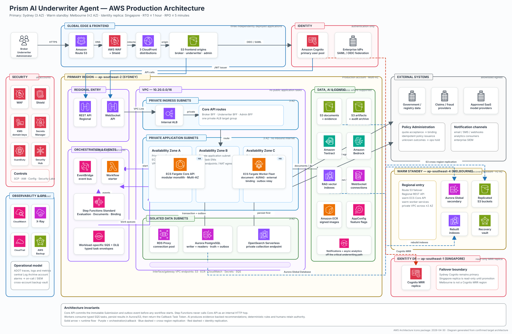

This diagram uses the official AWS Architecture Icons from 2026-04-30 and focuses on the production deployment topology: Global Edge, Sydney three-AZ primary region, private VPC compute and isolated data subnets, managed workflows and queues, AI/RAG services, security and observability, external systems, Melbourne warm standby, and Singapore Cognito MRR. This is the main interview diagram for explaining AWS choices and runtime flow; internal domain components remain in the detailed Mermaid diagrams below.

## Detailed Production Architecture SVG

[Open or download the detailed SVG](./diagrams/prism-production-detailed.svg) · [view editable Mermaid source](./diagrams/prism-production-detailed.mmd)

The detailed diagram expands frontend features, identity, API pipeline, Core API domain modules, document processing, Workflow/Queue/Callback Workers, Underwriting Evaluation, Controlled AI Agent, RAG, Human Review, Quote/Binding, data, security, observability, CI/CD, multi-account structure, and cross-region recovery. It is intended for zoomed inspection and deep architecture discussion; ordinary documentation reading should start with the overview below.

## Production Overview SVG

[Open or download SVG](./diagrams/prism-production-overview.svg)


## 1. System Context

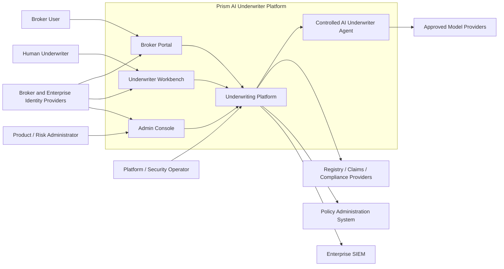

Key point: the AI Agent is an analytical capability constrained by the platform, not an independent actor with final business authority.

## 2. Underwriting Business Lifecycle

```mermaid
flowchart LR
    Draft[Editable Application Draft]
    Submit[Submit Application]
    Submission[Immutable Submission Version]
    Evaluation[Underwriting Evaluation]
    Snapshot[Validated Risk Snapshot]
    Evidence[Evidence + External Checks]
    Analysis[AI Risk Assessment]
    Gates[Deterministic Rules / Pricing / Authority]

    RFI[AWAITING_INFORMATION]
    Supplement[Broker Adds Information]
    Human[Human Review]
    Quote[Immutable Quote Version]
    Accept[Broker Accepts Exact Quote Version]
    Binding[Independent Policy Binding Workflow]
    Policy[Policy Issued]
    Hold[Operational Hold]

    Draft --> Submit --> Submission --> Evaluation
    Evaluation --> Snapshot --> Evidence --> Analysis --> Gates
    Gates -->|Missing or conflicting information| RFI
    RFI --> Supplement -->|New immutable version| Submission
    Gates -->|Authority or uncertainty requires review| Human
    Human -->|Request information| RFI
    Human -->|Approved terms| Quote
    Gates -->|All auto-quote conditions proven| Quote
    Quote --> Accept --> Binding --> Policy
    Evaluation -->|Technical dependency failure| Hold
    Binding -->|Unknown provider outcome| Hold
```

Key point: RFI does not loop inside the original Evaluation; supplementary information creates a new Submission and a new Evaluation. Human Review may wait on the same immutable Submission. Binding is an independent process after quote acceptance.

## 3. Logical Components and Communication Paths

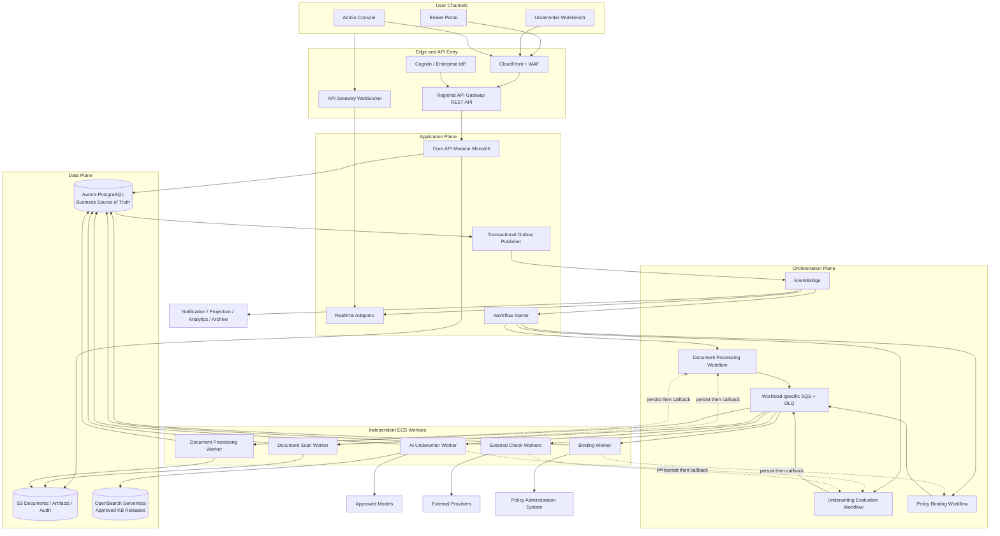

Three communication semantics:

- HTTP Command: an explicit user-initiated business action completed by Core API inside an Aurora transaction.
- Workflow Task: Step Functions requests bounded Worker execution through dedicated SQS queues.
- Domain Event: Aurora Outbox publishes facts that have already happened; consumers own their own retries and idempotency.

## 4. End-to-End Sequence from Submission to Evaluation

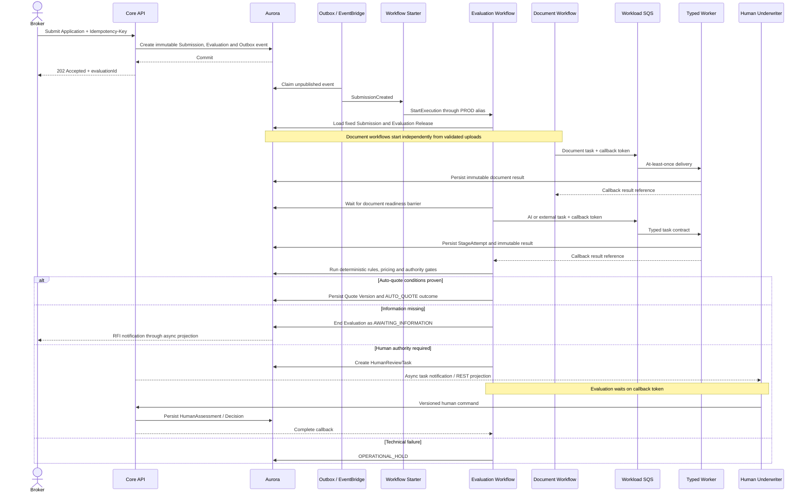

Key point: Core API is not an internal HTTP relay for the workflow. Workers persist results before callback.

## 5. Controlled AI Underwriter Agent

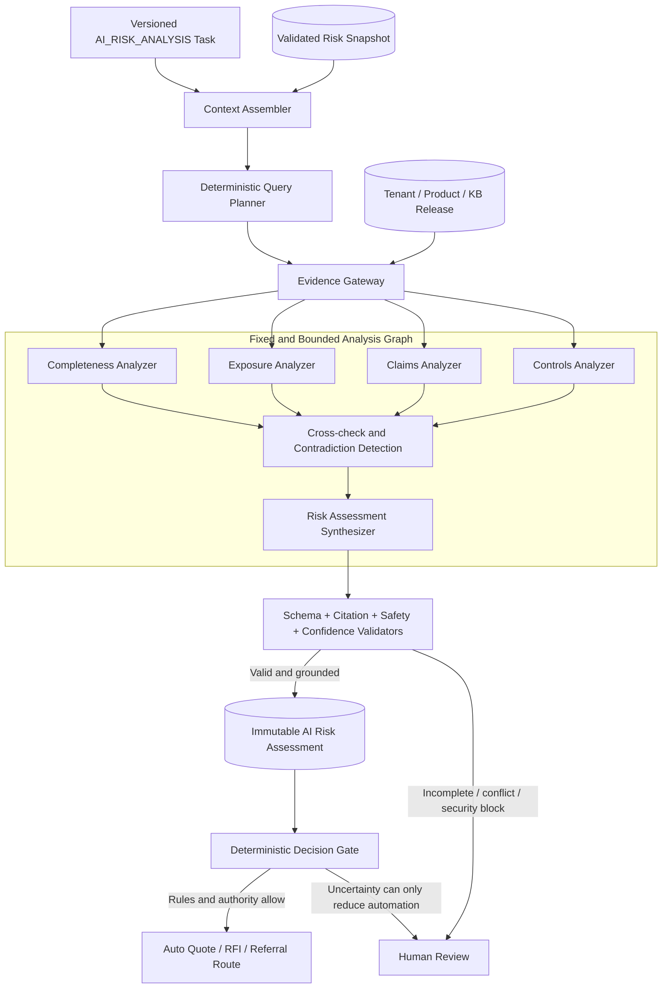

The Agent can only use read-only tools whose scope is injected by the server. Eligibility, Pricing, Authority, final Decision, and Binding are outside the Agent's tool authority.

## 6. Backend Internal Component Boundaries

```mermaid
flowchart TB
    subgraph Inbound[Inbound Adapters]
        BrokerRoute[Broker BFF Routes]
        UWRoute[Underwriter BFF Routes]
        AdminRoute[Admin BFF Routes]
        EventConsumer[Event / Recovery Adapters]
    end

    subgraph Core[Core API Modular Monolith]
        Middleware[Auth / Tenant / Idempotency / Concurrency]
        UseCases[Application Use Cases]

        subgraph Modules[Owned Domain Modules]
            IdentityM[Identity]
            DistributionM[Distribution]
            SubmissionM[Submission]
            DocumentM[Document]
            UnderwritingM[Underwriting]
            PricingM[Pricing]
            BindingM[Binding]
            ConfigurationM[Configuration]
        end

        Ports[Owned Ports]
        Queries[Read Projection Queries]
    end

    subgraph Adapters[Infrastructure Adapters]
        Repositories[PostgreSQL Repositories]
        ObjectStore[S3 Adapter]
        WorkflowPort[Step Functions Adapter]
        EventPort[Outbox / EventBridge Adapter]
        ModelPort[Model Gateway]
        SearchPort[Evidence / OpenSearch Gateway]
        ProviderPort[Provider / PAS Gateways]
    end

    subgraph WorkerServices[Independent Worker Services]
        DocumentWorker[Document Workers]
        AIWorker[AI Worker]
        ExternalWorker[External Workers]
        BindingWorker[Binding Worker]
        OutboxWorker[Outbox Publisher]
    end

    BrokerRoute --> Middleware
    UWRoute --> Middleware
    AdminRoute --> Middleware
    EventConsumer --> UseCases
    Middleware --> UseCases
    Middleware --> Queries
    UseCases --> IdentityM
    UseCases --> DistributionM
    UseCases --> SubmissionM
    UseCases --> DocumentM
    UseCases --> UnderwritingM
    UseCases --> PricingM
    UseCases --> BindingM
    UseCases --> ConfigurationM
    UseCases --> Ports
    Ports -. implemented by .-> Repositories
    Ports -. implemented by .-> ObjectStore
    Ports -. implemented by .-> WorkflowPort
    Ports -. implemented by .-> EventPort
    Ports -. implemented by .-> ModelPort
    Ports -. implemented by .-> SearchPort
    Ports -. implemented by .-> ProviderPort
    DocumentWorker --> Repositories
    AIWorker --> Repositories
    ExternalWorker --> Repositories
    BindingWorker --> Repositories
    OutboxWorker --> Repositories
    DocumentWorker --> ObjectStore
    AIWorker --> ModelPort
    AIWorker --> SearchPort
    ExternalWorker --> ProviderPort
    BindingWorker --> ProviderPort
    OutboxWorker --> EventPort
```

Each business table has a single module write owner. Cross-module calls must go through public Application/Domain interfaces and must not deep-import repositories.

## 7. Frontend Monorepo and Independent Deployments

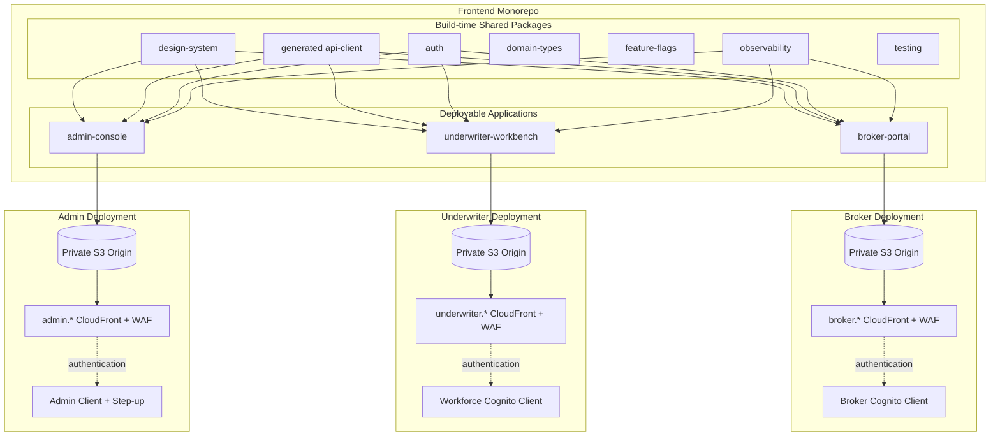

The monorepo unifies dependencies and quality gates. The three applications have independent artifacts, distributions, CSP, identity clients, canaries, and rollback. Runtime micro-frontends are not used.

## 8. Production Multi-Region Deployment

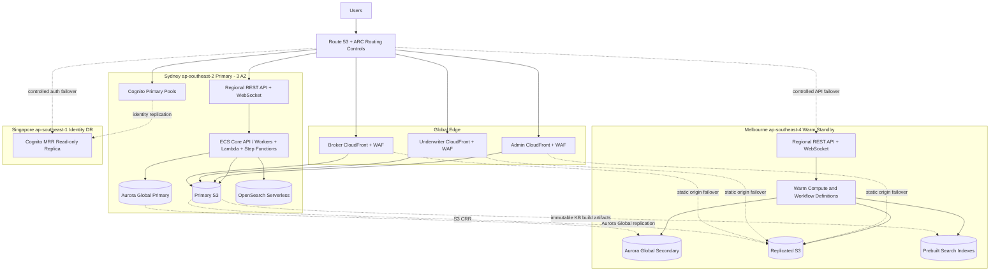

Business data remains in Australia. Only the minimum approved identity data is replicated to Singapore. Targets are RTO <= 1 hour and RPO <= 5 minutes.

## 9. Sydney Regional Runtime Deployment

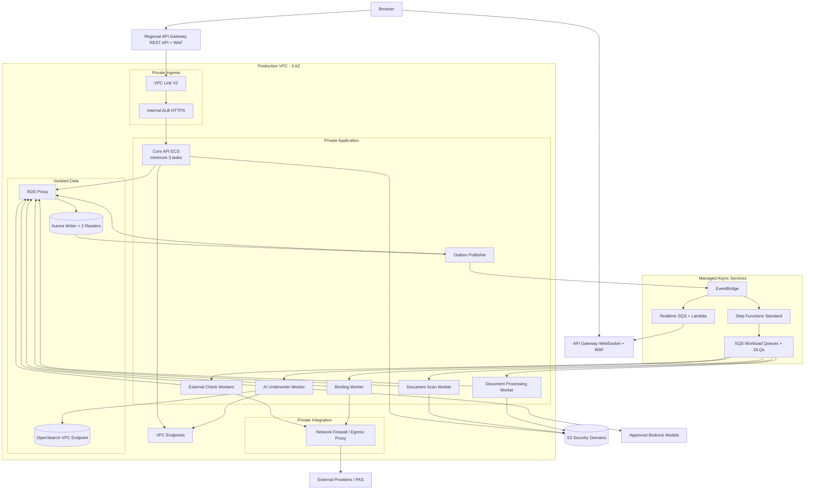

Public subnets only host NAT/network boundaries. ECS has no public IP. Data subnets have no direct internet route.

## 10. Build, Release, and Version Promotion

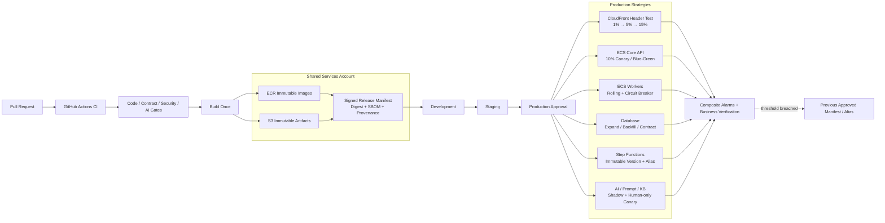

All environments deploy the same digest. Database, Workflow, and AI Releases are versioned separately; "deploy frontend and backend together" is not a substitute for N/N-1 compatibility.

## 11. Regional Disaster Recovery Sequence

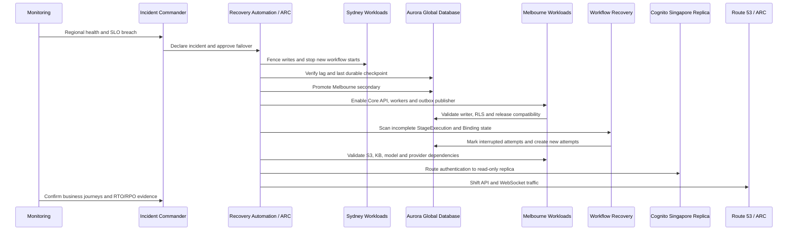

Disaster recovery uses Aurora checkpoints as the source of truth. It does not replicate Step Functions executions or SQS messages. If AI dependencies are not verified, the platform restores manual underwriting while keeping auto-quote disabled.
