# Prism AI Underwriter Agent 架构图集

> 文档状态：已确认目标架构的可视化视图
>
> 建议讲解顺序：系统上下文 → 业务生命周期 → 逻辑组件 → 核保时序 → AI Agent → 前后端边界 → 物理部署 → 发布 → 容灾
>
> 详细依据：[总体架构](./architecture.md) · [后端架构](./backend-architecture.md) · [前端架构](./frontend-architecture.md) · [部署架构](./deployment-architecture.md)

这些图从不同视角描述同一目标系统。图用于沟通边界，文字架构文档仍是约束、异常语义和非功能要求的事实来源。

## AWS 生产部署架构图

[单独打开或下载 AWS 架构 SVG](./diagrams/prism-aws-production-architecture.svg) · [下载高分辨率 PNG](./diagrams/prism-aws-production-architecture.png) · [查看生成脚本](../scripts/generate-aws-architecture.mjs)

该图使用 AWS 官方 2026-04-30 Architecture Icons，聚焦生产部署拓扑：Global Edge、Sydney 三 AZ 主区、VPC 私有计算与隔离数据子网、托管工作流和队列、AI/RAG 服务、安全与可观测性、外部系统、Melbourne warm standby 和 Singapore Cognito MRR。它是面试中讲解 AWS 选型和运行路径的主图；内部领域组件继续使用下方的详细 Mermaid 图。

## 详细生产总架构 SVG

[单独打开或下载详细 SVG](./diagrams/prism-production-detailed.svg) · [查看可编辑 Mermaid 源码](./diagrams/prism-production-detailed.mmd)

详细图展开前端 Feature、身份、API Pipeline、Core API 领域模块、文档处理、Workflow/Queue/Callback Worker、Underwriting Evaluation、Controlled AI Agent、RAG、Human Review、Quote/Binding、数据、安全、可观测性、CI/CD、多账户和跨区域恢复。该图面向缩放浏览和深度架构讨论；普通文档阅读优先使用下面的 Overview。

## 总体生产架构 SVG

[单独打开或下载 SVG](./diagrams/prism-production-overview.svg)

## 1. System Context

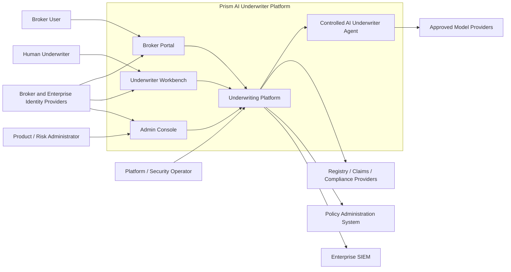

关键表达：AI Agent 是受平台约束的分析能力，不是拥有最终业务权力的独立 Actor。

## 2. Underwriting 业务生命周期

```mermaid
flowchart LR
    Draft[Editable Application Draft]
    Submit[Submit Application]
    Submission[Immutable Submission Version]
    Evaluation[Underwriting Evaluation]
    Snapshot[Validated Risk Snapshot]
    Evidence[Evidence + External Checks]
    Analysis[AI Risk Assessment]
    Gates[Deterministic Rules / Pricing / Authority]

    RFI[AWAITING_INFORMATION]
    Supplement[Broker Adds Information]
    Human[Human Review]
    Quote[Immutable Quote Version]
    Accept[Broker Accepts Exact Quote Version]
    Binding[Independent Policy Binding Workflow]
    Policy[Policy Issued]
    Hold[Operational Hold]

    Draft --> Submit --> Submission --> Evaluation
    Evaluation --> Snapshot --> Evidence --> Analysis --> Gates
    Gates -->|Missing or conflicting information| RFI
    RFI --> Supplement -->|New immutable version| Submission
    Gates -->|Authority or uncertainty requires review| Human
    Human -->|Request information| RFI
    Human -->|Approved terms| Quote
    Gates -->|All auto-quote conditions proven| Quote
    Quote --> Accept --> Binding --> Policy
    Evaluation -->|Technical dependency failure| Hold
    Binding -->|Unknown provider outcome| Hold
```

关键表达：RFI 不在原 Evaluation 内循环；补件产生新 Submission 和新 Evaluation。Human Review 可以等待同一个不可变 Submission。Binding 是报价接受后的独立流程。

## 3. 逻辑组件与通信路径

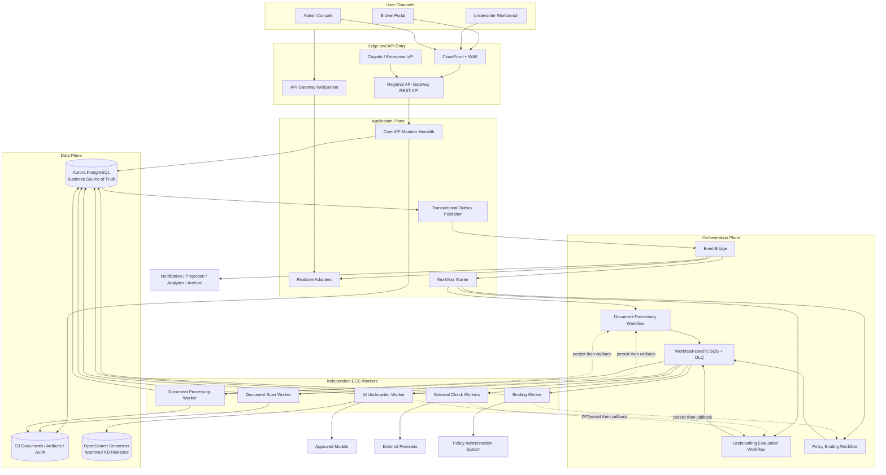

三种通信语义：

- HTTP Command：用户明确发起业务动作，Core API 在 Aurora 事务中完成。
- Workflow Task：Step Functions 通过专用 SQS 请求 Worker 执行受限任务。
- Domain Event：Aurora Outbox 发布已经发生的事实，Consumer 自己处理重试和幂等。

## 4. Submission 到 Evaluation 的端到端时序

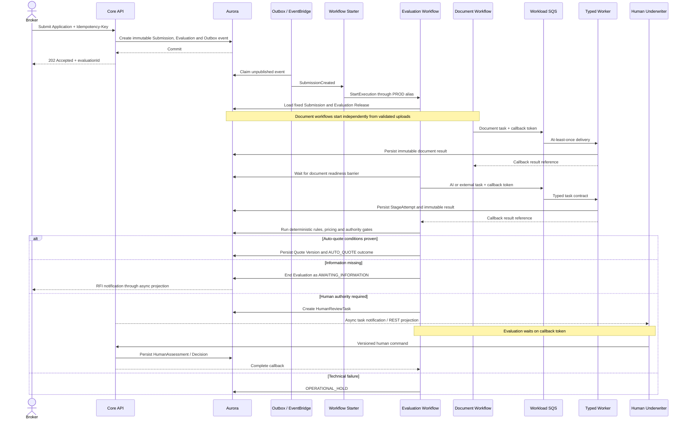

关键表达：Core API 不作为 Workflow 内部 HTTP 跳板；Worker 先保存结果，再 Callback。

## 5. Controlled AI Underwriter Agent

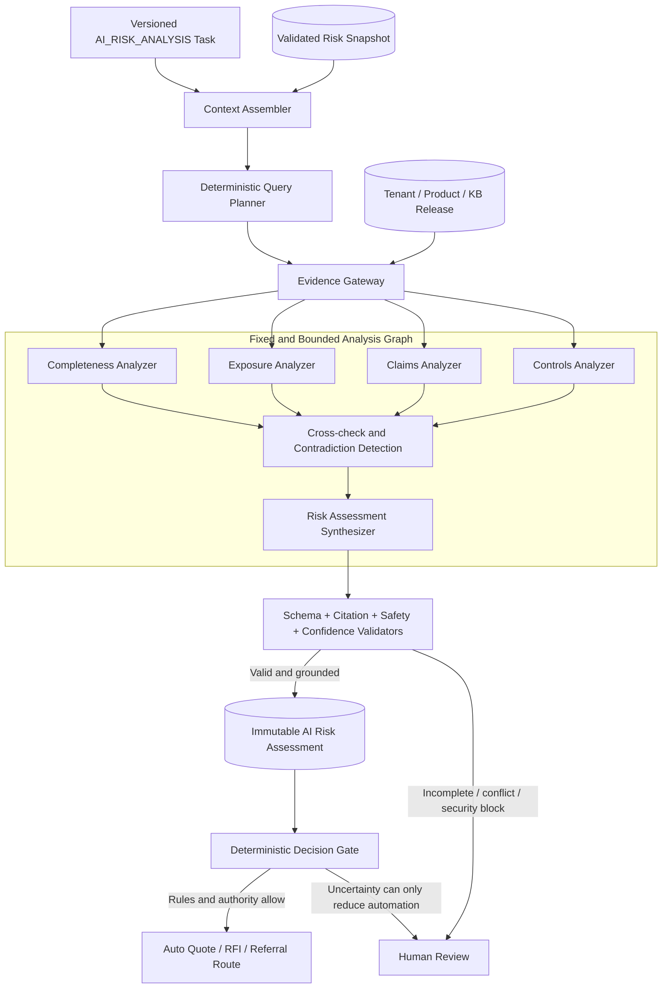

Agent 只能使用服务端注入作用域的只读工具。Eligibility、Pricing、Authority、最终 Decision 和 Binding 不属于 Agent 工具权限。

## 6. 后端内部组件边界

```mermaid
flowchart TB
    subgraph Inbound[Inbound Adapters]
        BrokerRoute[Broker BFF Routes]
        UWRoute[Underwriter BFF Routes]
        AdminRoute[Admin BFF Routes]
        EventConsumer[Event / Recovery Adapters]
    end

    subgraph Core[Core API Modular Monolith]
        Middleware[Auth / Tenant / Idempotency / Concurrency]
        UseCases[Application Use Cases]

        subgraph Modules[Owned Domain Modules]
            IdentityM[Identity]
            DistributionM[Distribution]
            SubmissionM[Submission]
            DocumentM[Document]
            UnderwritingM[Underwriting]
            PricingM[Pricing]
            BindingM[Binding]
            ConfigurationM[Configuration]
        end

        Ports[Owned Ports]
        Queries[Read Projection Queries]
    end

    subgraph Adapters[Infrastructure Adapters]
        Repositories[PostgreSQL Repositories]
        ObjectStore[S3 Adapter]
        WorkflowPort[Step Functions Adapter]
        EventPort[Outbox / EventBridge Adapter]
        ModelPort[Model Gateway]
        SearchPort[Evidence / OpenSearch Gateway]
        ProviderPort[Provider / PAS Gateways]
    end

    subgraph WorkerServices[Independent Worker Services]
        DocumentWorker[Document Workers]
        AIWorker[AI Worker]
        ExternalWorker[External Workers]
        BindingWorker[Binding Worker]
        OutboxWorker[Outbox Publisher]
    end

    BrokerRoute --> Middleware
    UWRoute --> Middleware
    AdminRoute --> Middleware
    EventConsumer --> UseCases
    Middleware --> UseCases
    Middleware --> Queries
    UseCases --> IdentityM
    UseCases --> DistributionM
    UseCases --> SubmissionM
    UseCases --> DocumentM
    UseCases --> UnderwritingM
    UseCases --> PricingM
    UseCases --> BindingM
    UseCases --> ConfigurationM
    UseCases --> Ports
    Ports -. implemented by .-> Repositories
    Ports -. implemented by .-> ObjectStore
    Ports -. implemented by .-> WorkflowPort
    Ports -. implemented by .-> EventPort
    Ports -. implemented by .-> ModelPort
    Ports -. implemented by .-> SearchPort
    Ports -. implemented by .-> ProviderPort
    DocumentWorker --> Repositories
    AIWorker --> Repositories
    ExternalWorker --> Repositories
    BindingWorker --> Repositories
    OutboxWorker --> Repositories
    DocumentWorker --> ObjectStore
    AIWorker --> ModelPort
    AIWorker --> SearchPort
    ExternalWorker --> ProviderPort
    BindingWorker --> ProviderPort
    OutboxWorker --> EventPort
```

每张业务表只有一个模块写入 Owner；跨模块调用只能经过公开 Application/Domain 接口，不能深层导入 Repository。

## 7. 前端 Monorepo 与独立部署

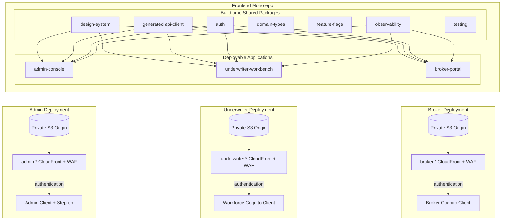

Monorepo 统一依赖和质量门禁；三个应用具有独立 Artifact、Distribution、CSP、身份客户端、灰度和回滚，不采用运行时 Micro-Frontend。

## 8. 生产多区域部署

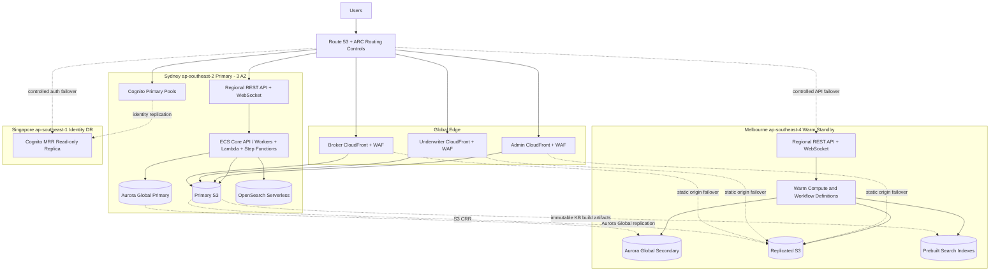

业务数据留在澳大利亚；经批准的最少身份数据复制到新加坡。目标为 RTO ≤1 小时、RPO ≤5 分钟。

## 9. 悉尼区域运行时部署

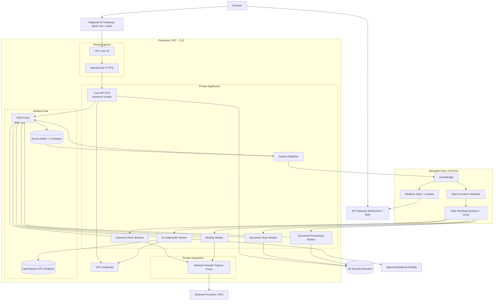

Public Subnet 只承载 NAT/网络边界；ECS 无 Public IP；Data Subnet 不具备直接互联网路由。

## 10. Build、发布与版本晋级

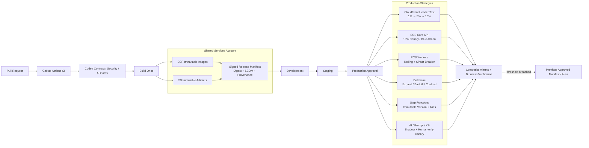

所有环境部署同一 Digest。数据库、Workflow 和 AI Release 分别版本化，不能用“前后端同时上线”代替 N/N−1 兼容。

## 11. 区域灾备时序

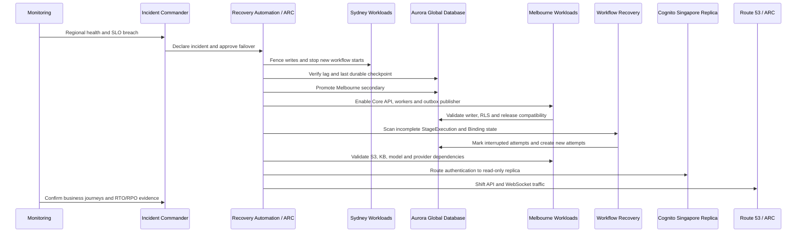

故障恢复以 Aurora Checkpoint 为事实来源，不复制 Step Functions Execution 或 SQS Message。未验证 AI 依赖时恢复人工核保，但保持自动报价关闭。
