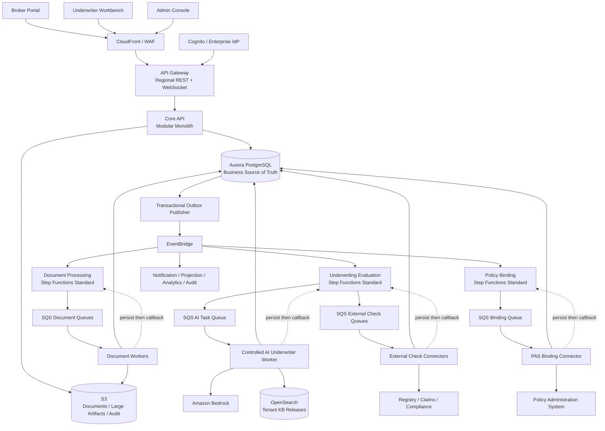
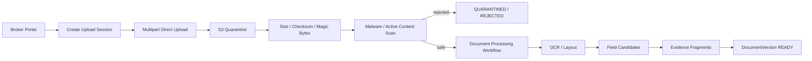
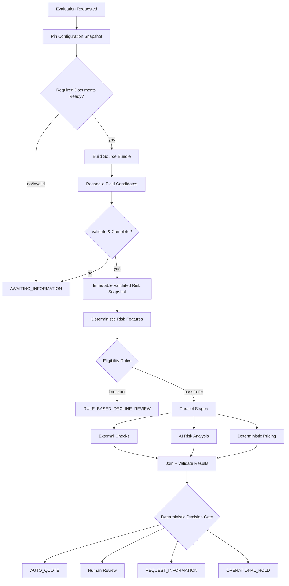
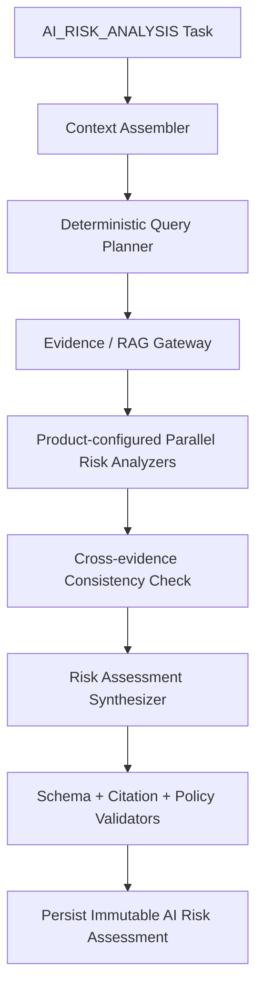

# Prism AI Underwriter Agent 生产架构

> 文档状态：已确认的目标架构（Target Architecture）
>
> 业务范围：澳大利亚 SME Professional Indemnity（PI），AUD 计价
>
> 部署模型：Core API 模块化单体 + 独立异步 Worker + AWS Step Functions Standard
>
> 相关文档：[Mermaid 架构图集](./architecture-diagrams.md) · [生产部署与发布架构](./deployment-architecture.md) · [后端内部组件架构](./backend-architecture.md) · [前端内部组件架构](./frontend-architecture.md)

## 1. 架构结论

Prism 不是让 LLM 直接读取申请并返回 `ACCEPT/DECLINE` 的系统。它是一个由确定性工作流治理、以不可变证据为基础、能够执行受限检索和语义风险分析，并在不确定时主动退出自动化的生产级 AI Underwriter Agent。

核心边界如下：

- Step Functions 控制业务阶段和恢复；AI 不控制工作流。
- AI 负责非结构化理解、风险因素分析、证据冲突和有依据的解释。
- Eligibility、Pricing、Authority 和最终 Decision Gate 由确定性代码执行。
- AI 只能降低自动化等级或要求人工介入，不能把不合格 Case 升级成自动报价。
- 自动报价必须由代码证明满足全部必要条件；AI、外部检查或证据不完整时 Fail Closed。
- AI 不产生最终保单条款，只能引用 Tenant 已批准的 Clause Library。
- 自动拒保不在范围内；硬性排除进入有权限人员的拒保复核。
- 所有 Submission、配置、证据、AI 结果、定价和报价均不可变且可追溯。

## 2. 业务与组织边界

### 2.1 多租户模型

- `Tenant` 是保险 Carrier 或 MGA，是产品、风险偏好、定价、Authority、知识库和数据隔离的边界。
- `Brokerage` 是独立分销渠道，不是 Tenant。
- Tenant 与 Brokerage 通过 `TenantBrokerageAppointment` 建立多对多委任关系。
- `BrokerUser` 通过 `BrokerageMembership` 代表 Brokerage 操作；组织本身不登录、不提交。
- Underwriter 通过 `TenantMembership` 属于 Tenant，并通过独立的 Authority Grant 获得决策权限。
- 一次 Application 固定绑定一个 Tenant、一个 Brokerage、一个有效 Appointment 和实际 Actor。

一次 Broker 操作必须同时满足：

```text
有效 Identity
+ 有效 Brokerage Membership
+ 有效 Tenant-Brokerage Appointment
+ 对目标资源的权限
+ 当前业务状态允许该 Command
```

### 2.2 核心领域术语

| 概念                    | 含义                                                  |
| ----------------------- | ----------------------------------------------------- |
| Application             | Broker 可持续编辑的申请旅程                           |
| Submission Version      | 每次提交/补件产生的不可变申请快照                     |
| Underwriting Case       | 跨多次 Submission/Evaluation 的业务责任和人工处理容器 |
| Underwriting Evaluation | 针对一个固定 Submission 的一次机器核保执行            |
| Validated Risk Snapshot | 下游唯一允许读取的、已归一化和验证的风险事实          |
| Evidence Fragment       | 可定位到原始来源版本、页码/段落/坐标的不可变证据      |
| AI Risk Assessment      | Agent 产生的结构化风险分析，不是业务决定              |
| Pricing Result          | 确定性、不可变的价格计算结果                          |
| Quote Version           | 面向 Broker 的不可变报价版本                          |
| Policy Binding          | Quote 被接受后启动的独立出单流程                      |

Case 与 Evaluation 属于同一个 Underwriting Module，但语义分离：Case 负责“谁处理以及最终发生了什么”，Evaluation 负责“某一固定输入经过了哪次机器分析”。

## 3. 总体组件架构



### 3.1 部署边界

- Core API 是一个部署单元，内部包含 `/broker/api/v1/*`、`/underwriter/api/v1/*` 和 `/admin/api/v1/*` 三个逻辑 BFF Route Module。
- 三个 BFF 不是三个微服务；它们共享进程和事务基础设施，但不能承载核心核保规则。
- Document、AI、External Check 和 Binding Worker 独立部署、独立队列、独立扩缩容和并发配额。
- Step Functions 是编排器，不是业务事实数据库。
- Aurora 是交易与业务状态的 Source of Truth；S3 保存原始/大型产物；OpenSearch 是可重建的检索索引。
- 生产 Core API 和 Worker 运行在跨 3 AZ 的 ECS Fargate；Regional API Gateway REST API 通过 VPC Link V2 和 Internal ALB 访问 Core API。
- 生产使用 Provisioned Aurora PostgreSQL、RDS Proxy、一个 Writer 和两个 Reader；Aurora Global Database 将业务事实复制到墨尔本 Warm Standby。
- RAG 使用按安全域拆分的私有 OpenSearch Serverless Collection；灾备索引从不可变 S3 Release Artifact 重建，不假设自动跨区域复制。
- 物理账户、区域、网络、发布和恢复边界以[生产部署与发布架构](./deployment-architecture.md)为准。

### 3.2 三条通信路径

```text
Business Command
Browser → API Gateway → Core API → Aurora

Workflow Task
Step Functions → 专用 SQS → Worker → 持久化 Result → Callback

Domain Event
Aurora Outbox → EventBridge → Consumer-owned SQS → Consumer
```

Domain Event 是已经发生的事实；Workflow Task 是要执行的类型化命令；HTTP Command 是用户明确发起的业务动作。三者不能互相替代。

Core API 不作为 Workflow 的内部 HTTP 跳板。Worker 直接通过受控 Repository/Port 读取任务引用的数据和写入所属结果。

## 4. 不可变版本与状态模型

### 4.1 Submission 和 Evaluation

- Application Draft 可编辑，并使用乐观并发控制。
- `SubmitApplication` 在一个 Aurora 事务内创建不可变 Submission、`REQUESTED` Evaluation 和 Outbox Event。
- Outbox 发布后由幂等 Workflow Starter 使用 `evaluationId` 作为稳定执行名称启动 Evaluation。
- Pipeline 从开始到结束只绑定一个 Submission Version 和一个 `EvaluationConfigurationSnapshot`。
- 人工更正任何影响核保的事实时，创建新 Risk Snapshot 和新 Evaluation，旧 Evaluation 标记为 `SUPERSEDED`。
- 只有内容寻址且语义未受影响的技术产物（如同一文档版本的 OCR）可以复用。

### 4.2 独立状态机

Application Journey、Submission、Evaluation、Case、Quote、Binding 和 Stage 各自拥有状态机。Application 页面状态是面向用户的 Projection，不能代替这些真实状态。

决策路由固定为：

```text
AUTO_QUOTE
REQUEST_INFORMATION
REFER_UNDERWRITER
REFER_SENIOR_UNDERWRITER
RULE_BASED_DECLINE_REVIEW
OPERATIONAL_HOLD
```

业务 Outcome 与技术状态分离。模型超时、外部依赖故障或回调失败进入 `OPERATIONAL_HOLD`，不能伪装为业务 Referral。

### 4.3 RFI 与 Human Review

- RFI 不在原 Evaluation 中无限循环。
- 原 Evaluation 以 `AWAITING_INFORMATION` 结束；Broker 补件后创建新 Submission 和新 Evaluation。
- Human Review 针对同一个不可变 Submission，可使用 Step Functions Callback Wait。
- 一个 Case 同时只有一个 Active HumanReviewTask 和一个 Primary Underwriter；其他人只读。
- Reassignment/Takeover 是显式、审计化动作；Maker-checker 使用独立 ApprovalTask。

## 5. 文档上传与处理



- Core API 只创建上传会话，不转发文件字节。
- Upload Session 绑定 Tenant、Application、Document、允许类型、大小和过期时间；Object Key 由服务端生成。
- 不信任扩展名和客户端 Content-Type；文档在扫描通过前不能进入 OCR/LLM 或供下载。
- 文档替换创建新 `DocumentVersion`，不得覆盖原对象。
- 保存 SHA-256、上传者、版本、扫描结果、OCR 版本和完整证据坐标。
- 防御压缩炸弹、恶意 PDF、Macro、嵌套附件、隐藏文本和多模态 Prompt Injection。
- 文档工作流在上传后立即启动，多份文档可并行；Evaluation 等待或复用已完成结果。

## 6. Underwriting Evaluation 主流程



下游 Rule、RAG、AI、Pricing 和 Decision Gate 只能读取 `ValidatedRiskSnapshot`，不能各自从原始文档推断一套事实。

自动报价需要同时满足：

- Eligibility 无 Knockout，且所有强制 Rule 已成功运行；
- 必需字段完整、无关键证据冲突；
- 外部检查有效且未过期；
- AI Assessment 合法、引用完整，并满足各维度 Confidence Policy；
- Pricing Result 有效且在系统 Auto-quote Authority 内；
- 仅使用批准的标准 Clause；
- Quote 和 Binding 前要求的时效检查仍有效。

AI 可以通过风险、不确定性或冲突信号把 Case 降级到 RFI/Human Review，但不能覆盖硬规则或把 Case 升级到 Auto Quote。

## 7. Controlled AI Underwriter Agent

### 7.1 执行结构

第一版使用固定分析图，不采用开放式 ReAct Planner 或自由 Multi-Agent：



- 各 Risk Analyzer 是明确的 Task Policy，不是拥有自由目标、长期记忆和互相委派权限的 Agent。
- 风险维度由产品配置定义，可包括 Business、Exposure、Claims、Financial/Limit 和 Document Conflict。
- 整个任务有最大调用数、检索轮次、Token、成本和 Deadline。
- Agent 输出 `COMPLETE`、`INCOMPLETE`、`INVALID` 或 `SECURITY_BLOCKED`；`INCOMPLETE` 是合法业务结果，不是技术错误。

### 7.2 Context 与 Memory

Agent 使用不可变 `AIAnalysisContext`：

```text
EvaluationConfigurationSnapshot
ValidatedRiskSnapshot
SubmissionEvidenceManifest
ExternalCheckResults
RetrievedGuidelineEvidence
ProductRiskTaxonomy
ApprovedClauseReferences
AnalysisBudget
```

- 不使用跨 Case 隐式 Agent Memory。
- 新 Evaluation 不继承旧 Agent 对话；历史业务事实必须通过受控数据查询获得。
- Tenant 长期知识进入版本化 Knowledge Base，而不是会话 Memory。
- 长文档摘要是带来源的派生证据，不能替代原文。
- 不保存或展示私有 Chain-of-Thought；只保存结构化结论、简明理由、证据和工具轨迹。

### 7.3 两层 Tool Gateway

```text
Deterministic System Tools
├── load_risk_snapshot
├── load_configuration_snapshot
├── retrieve_required_guidelines
└── load_external_check_results

Model-callable Read-only Evidence Tools
├── search_application_evidence
├── search_underwriting_guidelines
└── get_evidence_fragment
```

- 第一层由固定图调用，模型不能跳过。
- 第二层只用于有限补充检索，最多固定轮次和结果数。
- Tenant、Evaluation、Submission 和 KB Release 作用域由服务端注入，模型不能提供或改变。
- 禁止 `execute_sql`、任意 HTTP、直接 S3、运行代码、写 Case、定价、报价、发消息或绑定保单。
- 工具返回同样视为不可信数据，并附来源、版本、哈希和大小限制。

## 8. Evidence、Confidence 与输出契约

### 8.1 证据链

```text
Source Artifact Version
    → Evidence Fragment
    → Extracted Fact / Validated Field
    → Risk Assertion
    → AI Risk Assessment
```

`EvidenceFragment` 至少包含 `tenantId`、`sourceType`、来源版本、页码/Section/Bounding Box、原文哈希、归一化内容和提取方法。

`RiskAssertion` 至少包含：

- Risk Category、Statement、Severity；
- Supporting、Contradicting 和 Guideline Evidence IDs；
- Assumptions、Uncertainty Reasons 和 Validation Status。

Applicant 事实证据与 Underwriting Guideline 证据必须区分：前者证明发生了什么，后者证明应如何评估。任何冲突都必须保留，模型不能静默挑选一方。

### 8.2 Confidence

不使用模型自报概率作为自动化依据。确定性 Confidence Policy 综合：

```text
Data Completeness
Extraction Reliability
Evidence Coverage
Evidence Consistency
Retrieval Quality
Citation Validity
Model Output Stability
Offline Calibration
```

业务只展示 `HIGH / MEDIUM / LOW / INSUFFICIENT`，底层指标用于评测和审计。引用无效、关键冲突、必填事实缺失等 Gate 条件直接阻断自动报价，不通过平均分稀释。

### 8.3 Structured Output

正式 `AI Risk Assessment` 是版本化 JSON，不包含 `ACCEPT/DECLINE`、Premium、Eligibility Override 或自由生成 Clause。

验证顺序为：Transport → JSON Schema → Domain → Evidence → Policy → Cross-result。只允许最多一次纯结构修复；语义错误、无效引用和 Policy Violation 不能通过 Repair 掩盖。

## 9. AI Task、Result 与失败契约

SQS/Step Functions 只传引用和哈希，不传完整文档、Prompt 或 Assessment。

Task Envelope 包含：

```text
schemaVersion, taskId, taskType
tenantId, evaluationId, stageExecutionId, attemptNumber
contextManifestId/version/hash
configurationSnapshotId
deadlineAt, traceContext
callbackTaskToken
```

Task Token 是敏感凭证，不得进入日志。Worker 必须从 Aurora 重新验证消息中的 Tenant/Evaluation 绑定。

Worker 执行顺序：

```text
检查 Stage 幂等状态
→ 创建 StageAttempt
→ 执行任务
→ 持久化不可变 Domain Result
→ 标记 Stage 成功
→ Callback Step Functions
```

Callback 失败时只重试 Callback，不能重新调用模型。Workflow 结束后的结果标记 `LATE_RESULT`，保留审计但不改变业务。

统一失败类别：

| 类别              | 示例                             | 行为                   |
| ----------------- | -------------------------------- | ---------------------- |
| Transient         | throttling、暂时网络故障         | 有限指数退避           |
| Permanent Input   | 不支持文档、配置缺失             | 不重试，RFI/人工/运维  |
| Invalid AI Output | Schema、Citation、Policy 失败    | 最多一次受限修复       |
| Security          | Malware、Prompt Injection、越权  | 隔离，不自动重试       |
| Unknown Outcome   | 外部超时、结果已存 Callback 失败 | 先查状态，禁止盲目重做 |

业务级重试由 Step Functions 统一协调，避免 SDK、Worker、SQS 和 Workflow 多层叠加。DLQ 必须先诊断再审计化重放，并复用原幂等键。

## 10. Knowledge Base 与 RAG

### 10.1 权威层级

1. Eligibility、Pricing、Authority 等结构化配置拥有执行权，不由 RAG 覆盖。
2. Approved Product Contract：Policy Wording、Endorsement、Clause Library。
3. Tenant Underwriting Guidelines。
4. Approved Internal Reference。
5. Approved External Reference。

法规或监管资料必须先经过治理并转换为批准的产品配置或知识版本。Agent 不能自行裁决权威冲突。

### 10.2 发布与检索

```text
Draft → Security/Parsing → Metadata/Chunking
→ Conflict Check → Embedding/Index
→ Retrieval Evaluation → Maker-checker Approval
→ Immutable KB Release → Shadow/Canary → Active
```

- 共享 OpenSearch 基础设施，但每个 Tenant 使用独立 Index/Namespace；Release 使用不可变版本和 Active Alias。
- 每个 Chunk 保留 Document Version、标题路径、页码、有效期、审批状态和内容哈希。
- Query Planner 确定性地产生查询；检索使用强制 Tenant/Product/Jurisdiction/Release Filter、Hybrid BM25/Vector 和 Reranking。
- 通用外部知识只有纳入该 Tenant 已批准 Release 后才可检索。
- 发布前冲突阻止 Release；运行时冲突生成 `KNOWLEDGE_CONFLICT` 并转人工。

## 11. Model Gateway 与 AI Release

Model Gateway 根据版本化 `ModelTaskPolicy` 确定模型、Prompt、Schema、Guardrail、区域、超时、Token、成本和批准的 Fallback。模型不能自行选择模型或供应商。

- 小模型用于已评测的分类/归一化；强模型用于复杂风险综合；确定性任务不用模型。
- Fallback 必须独立评测和批准，并使用自己的 Confidence/Automation Policy。
- 未批准 Fallback、持续 Provider 故障或预算耗尽时进入 Human Review/Operational Hold。
- Circuit Breaker 防止故障期间队列和成本失控。
- 每次调用记录实际模型和提供方标识、Release、参数、区域、延迟、Token、成本及 Fallback 原因。

AI Release 是以下组件的原子组合：

```text
Model + Prompt + Output Schema + Risk Taxonomy
+ Retrieval Policy + KB Release + Tool Policy + Confidence Policy
```

发布生命周期：

```text
DRAFT → OFFLINE_EVALUATION → SECURITY_EVALUATION
→ BUSINESS_APPROVAL → SHADOW → CANARY → ACTIVE / ROLLED_BACK
```

评测覆盖 Extraction、Retrieval、Risk Analysis、Grounding、Abstention、安全、延迟和成本，并按产品、风险类别、文档类型和业务分布切片。Critical-risk Miss、跨租户泄漏、越权动作或无证据结论是发布阻断项。Human Feedback 进入受控标注与离线评测，不自动训练或发布。

## 12. External Checks 与 Policy Binding

外部检查由产品的 `ExternalCheckPolicy` 决定，Workflow 通过类型化 Connector Task 发起；Agent 不能自主调用第三方 API。标准化结果区分 `VERIFIED`、`NO_MATCH`、`POSSIBLE_MATCH`、`CONFLICT`、`UNAVAILABLE`、`STALE` 和 `INVALID_RESPONSE`。

- 原始响应加密保存，业务使用带来源、ObservedAt、ValidUntil 和 Evidence IDs 的标准结果。
- Timeout 不能被解释为无风险；Possible Match 进入人工。
- 时效性检查按策略在 Evaluation、Quote Acceptance 或 Binding 前刷新。
- Unknown Outcome 先按 Provider Reference 查询，禁止盲目重复收费调用。
- 外部结果与 Applicant 声明冲突时同时保留并转 RFI/人工。

Quote 接受在 Aurora 同一事务中保存精确 QuoteVersion Acceptance、Binding Request 和 Outbox。Binding 由独立 Workflow 调用 PAS；失败不会回滚已经发生的 Broker Acceptance，而是重试、查询或进入人工对账。

## 13. API、并发与实时状态

三组逻辑 REST/OpenAPI 路由：

```text
/broker/api/v1/*
/underwriter/api/v1/*
/admin/api/v1/*
```

- 状态变化使用明确 Command Endpoint，不允许任意 PATCH 状态。
- 异步 Command 返回 `202 Accepted` 和 Operation/Status URL。
- 有副作用的 Command 使用 `Idempotency-Key`。
- GET 返回 ETag；写操作使用 `If-Match`。
- 版本过期返回 `412 Precondition Failed`；合法版本但业务状态冲突返回 `409 Conflict`。
- 错误使用 RFC Problem Details (`application/problem+json`)。
- 初期不引入 GraphQL；页面聚合由 BFF Read Projection 解决。

WebSocket 只发送轻量变化通知，不传完整 PII 或业务状态。事件包含 Event ID、Sequence、Resource ID 和 Resource Version；前端收到后通过 REST 拉取权威 Projection。断线时尝试从最后 Sequence 恢复，无法补发则 `RESYNC_REQUIRED`，并退化为带抖动的轮询。

## 14. Human-in-the-loop 与 Authority

Underwriter Workspace 按 Evidence → Rules/Pricing → AI Assertion → Human Decision 的顺序组织，降低 Automation Bias。

- 每条 AI Assertion 单独显示 Severity、Confidence Band、不确定原因、支持/反对证据和适用 Guideline。
- Human 可以 `ACCEPT_ASSERTION`、`EDIT_ASSERTION`、`REJECT_ASSERTION`、RFI 或 Escalate。
- Human 修改创建独立 `HumanAssessment`，不覆盖 AI 结果。
- 最终 Human Decision 必须记录独立理由，不能只写 “agree with AI”。
- Override、拒保、非标准 Clause 和高权限发布使用结构化 Reason 与 Maker-checker。
- Authority 在动作提交时重新校验；创建者不能批准自己的高风险动作。
- AI 不预填最终 Accept/Decline 选项，不展示误导性的单一 Overall AI Score。

## 15. 数据架构

### 15.1 Aurora Schema 所有权

```text
identity        Identity、Membership、Tenant
distribution    Brokerage、Appointment
submission      Application、Submission、RFI
document        Document、Version、Extraction、Evidence
underwriting    Case、Evaluation、Risk Snapshot、Review Task
pricing         Pricing Result、Quote、Quote Version
binding         Quote Acceptance、Policy Binding
configuration   Product、Rule、Authority、Prompt、Model/KB Policy
platform        Outbox、Idempotency、Operation、Stage Execution
audit           Append-only Audit Record
```

- 单 Aurora PostgreSQL 集群，按模块划分逻辑 Schema 和单一写入所有权。
- 每张租户业务表显式包含 `tenant_id`；查询和租户内唯一约束以 Tenant 为范围。
- 跨模块只通过公开接口写入；稳定强一致关系可保留外键，但不做跨模块级联删除。
- JSONB 只用于快照、模型输出和低频扩展；核心查询字段结构化。
- 可修改 Aggregate 使用 `version BIGINT` 乐观锁；业务 ID 使用应用层生成的 UUIDv7。
- 时间使用 UTC `TIMESTAMPTZ`，保险有效日期使用独立 `DATE`。
- 列表使用 Keyset Pagination。
- 核心表初期不分区；Audit、Outbox、Stage Attempt、模型调用等高增长追加表达到阈值后按月分区。

### 15.2 持久化结果

每个 Stage 使用：

```text
StageExecution
├── stable business identity and status
├── input/config references and hashes
└── accepted result reference

StageAttempt
├── attempt number, timing, worker/model/provider
├── typed error and metrics
└── callback status

Typed Immutable Domain Result
```

Step Functions History、普通日志和通用 JSON Blob 都不能替代业务结果模型。

### 15.3 Transactional Outbox 与轻量 CQRS

- 业务状态和 Outbox Row 在同一事务提交；Publisher 使用 `FOR UPDATE SKIP LOCKED` 分批领取。
- EventBridge At-least-once 投递；每个 Consumer 使用自己的 SQS Queue 和 `eventId` 幂等处理。
- Aggregate Version 处理乱序；默认不使用 FIFO。
- Aurora Normalized Write Model 是权威；页面使用按需 Read Projection；OpenSearch 负责搜索/RAG。
- 不采用完整 Event Sourcing。

## 16. Configuration Control Plane

统一管理 Product、Form Schema、Validation、Eligibility、Pricing、Authority、Clause、Workflow、Prompt、Model Task Policy、KB Release 和 Retrieval Policy。

生命周期为：

```text
DRAFT → VALIDATING → APPROVED → SCHEDULED → ACTIVE → RETIRED
```

- 发布版本不可原地修改；回滚是重新激活已验证版本并产生新发布记录。
- 发布前运行 Schema、规则冲突、Pricing 回归、AI 离线评测和端到端样例。
- 高风险配置 Maker-checker；Admin UI 不提供任意脚本执行。
- Release Manifest 记录所有组件版本、哈希、审批、有效期和兼容性要求。
- Evaluation 启动时解析一次 `EvaluationConfigurationSnapshot`，运行中不切换。
- Knowledge Base 以 Release 为单位蓝绿发布，不能直接让正在变化的文档集合服务生产。

## 17. 安全与数据治理

### 17.1 身份与授权

- 外部 IdP/Cognito 负责认证；Aurora Membership、Appointment 和 Authority 负责业务授权。
- 客户端提供的 Tenant、Brokerage 和角色不可信。
- Core API 的 Policy Enforcement Layer 统一执行资源级授权；数据库查询始终显式带 Tenant。
- PostgreSQL RLS 可作为纵深防御，但不替代应用授权。
- Worker 使用独立 Workload Identity 和最小 IAM，不冒充用户。
- Support Break-glass 必须限时、审批、记录原因和完整审计。

### 17.2 Prompt Injection 与 Agent 安全

- System Instruction 只来自已发布 Model Task Policy；文档、OCR、RAG 和 Provider 文本永远是不可信数据。
- 正式分析优先读取 Validated Risk Snapshot，仅在核验证据时取最小原文片段。
- Prompt 分隔不是安全边界；真正边界是无写工具、服务端作用域、最小权限和输出验证。
- 禁止根据文档动态加载 URL、代码、工具或新数据源。
- Extraction 与 Risk Analysis 逻辑隔离；抽取阶段只能输出字段候选和证据位置。
- 安全测试包含可见/隐藏指令、图片指令、跨文档注入、RAG Poisoning、越权和数据外传。

### 17.3 数据保护

- S3、Aurora、OpenSearch、Queue 和日志按数据分类使用 KMS；Public Access 全面阻断。
- Secrets 由 Secrets Manager 管理；私有工作负载优先使用 VPC Endpoint。
- 原始 Prompt/Response 若需要留存，进入独立加密存储和更严格保留/访问策略，不进入普通日志。
- Audit、Telemetry 和业务数据分离；Audit 追加写并可归档到 Object Lock。
- 数据保留、匿名化、删除和跨境处理由 Tenant、数据类型和法律依据驱动。

## 18. SLO、可靠性与灾备

初始用户旅程 SLO：

| 旅程                              |                    目标 |
| --------------------------------- | ----------------------: |
| Core API 月度可用性               |                   99.9% |
| 普通查询 p95                      |                ≤ 500 ms |
| Submit API p95                    |                   ≤ 2 s |
| 文档已就绪的 Fast Path Evaluation | p50 ≤ 30 s，p95 ≤ 2 min |
| 需要普通文档处理的 Standard Path  |             p95 ≤ 5 min |
| 大型/依赖受限 Case                |            p95 ≤ 15 min |
| WebSocket 变化通知 p95            |                   ≤ 5 s |
| Critical Outbox Event 发布 p95    |                  ≤ 60 s |

Human Review、RFI 等待和外部人工响应不计入自动处理 SLO，但需要单独业务 SLA。AI/依赖失败不得为了 SLO 跳过必要控制。

- Worker 按 Queue Depth、Oldest Message Age 和任务类型扩缩容；Tenant 与工作负载使用 Bulkhead/配额避免 Noisy Neighbor。
- 所有依赖有 Deadline、Timeout、有限重试、Jitter 和 Circuit Breaker。
- 区域内 Multi-AZ；跨区域采用悉尼 Primary、墨尔本 Warm Standby 的 Active/Passive，而非 Active/Active。
- 区域灾难目标 RTO ≤ 1 小时、RPO ≤ 5 分钟；检测自动化，生产写切换由 Incident Commander 授权。
- Step Functions Execution 和 SQS 不假设跨区域复制；恢复时从 Aurora 的 Evaluation、StageExecution 和 Result Checkpoint 创建新 Recovery Execution。
- 故障切换先建立 Write Fence 和 Region Epoch，再提升墨尔本 Aurora、重建未完成任务并开放写流量，防止 Split Brain。
- Cognito Primary 位于悉尼，身份 MRR 副本位于新加坡；业务数据仍留在悉尼/墨尔本，身份跨境属于显式隐私与法务门禁。
- Unknown Outcome 先查询外部状态；不能盲目重做。
- 定期演练数据库恢复、S3、密钥、Workflow 重建和区域切换；有备份不等于具备 DR。

## 19. 可观测性、审计与运营

统一 Trace 贯穿 `traceId → evaluationId → stageExecutionId → attemptId → modelInvocationId`。

三层观测：

- Operational：API、Queue Age、Stage、Worker、Callback、Provider、DLQ。
- AI Quality/Safety：Unsupported Assertion、Citation Support、Critical-risk Miss、Conflict Detection、Abstention、Injection、Forbidden Output、Confidence Calibration、Human Disposition。
- Business Outcome：Straight-through Rate、RFI/Referral、Turnaround、Quote Acceptance、Handling Time、Override 和 Binding Failure。

指标按 Tenant、Product、Risk Category、AI Release 和模型切片，但高基数业务 ID 只进入受控 Trace/Log。监控输入和输出分布漂移。Safety Violation 触发自动化 Kill Switch；质量回归停止 Canary/回滚；Provider Outage 使用批准 Fallback 或 Operational Hold。每个告警必须关联 Owner 和 Runbook。

## 20. 前端架构摘要

一个 Frontend Monorepo，三个独立部署应用：

```text
apps/
├── broker-portal
├── underwriter-workbench
└── admin-console

packages/
├── api-client
├── auth
├── design-system
├── domain-types
├── observability
└── testing
```

- 不采用运行时 Micro-Frontend。
- API Client 从 OpenAPI 生成；共享包不承载跨应用业务流程。
- Server State 由 Query Client 管理；实时事件只失效缓存，REST Projection 是权威。
- Underwriter Workspace 以 Case 和 Evidence 为中心，不按数据库表拼页面。
- Admin 发布流程体现 Draft、验证、Diff、双人审批、定时发布、Kill Switch 和 Rollback。

## 21. 测试与交付

测试金字塔包含 Domain/Policy Unit、Use Case、Adapter Integration、OpenAPI/Event/Task Contract、Workflow、E2E、规则与定价 Golden Case、AI/RAG Eval 和 Agent Security Red Team。

CI/CD 发布门至少包含：

```text
Typecheck / Lint / Unit / Integration
OpenAPI + Event + Task Contract Compatibility
Database Migration Safety
SAST / Dependency / Secret / Container / IaC Scan
Eligibility and Pricing Regression
AI Offline and Security Evaluation
Staging E2E
Shadow / Canary / Automated Rollback
```

基础设施使用 AWS CDK TypeScript 管理。GitHub Actions 通过 OIDC 和跨账户短期 Role 发布；制品 Build Once，并以签名 Manifest 和不可变 Digest 从 Dev 晋级到 Staging/Production。代码发布、配置发布和 AI Release 分离，但发布前必须验证兼容性。生产数据库迁移采用 Expand/Migrate/Contract，并支持旧新应用短期并存。完整策略见[生产部署与发布架构](./deployment-architecture.md)。

## 22. 实施顺序

当前 repo 是否完整不影响本目标架构。推荐按风险优先实施：

1. Aurora 领域模型、版本、Stage Result 和 Transactional Outbox。
2. Core API 的 Submission、幂等、ETag/If-Match 和资源授权。
3. 安全文档上传、Document Workflow、Evidence 与 Validated Risk Snapshot。
4. Underwriting Evaluation、专用 SQS、Callback Worker 和确定性 Rules/Pricing/Decision Gate。
5. Controlled AI Agent、Model/Tool Gateway、Structured Output 和版本化 RAG。
6. Underwriter Workbench、Human Review、Authority 与 Maker-checker。
7. Quote/Binding Saga、外部 Connector、通知和 Read Projection。
8. AI Evaluation/Release、SLO、可观测性、安全门禁和灾备演练。

## 23. 已确认决策摘要

| 决策         | 选择                                                              |
| ------------ | ----------------------------------------------------------------- |
| 服务形态     | Core API 模块化单体 + 独立 Worker                                 |
| 编排         | Step Functions Standard                                           |
| Worker 调度  | 专用 SQS + Callback Task Token                                    |
| 业务数据库   | Provisioned Aurora PostgreSQL Multi-AZ                            |
| 工作流事实   | Aurora StageExecution/Result，非 Step Functions History           |
| AI 形态      | Fixed Analysis Graph + Bounded Read-only Tools                    |
| 最终决策     | Deterministic Decision Gate                                       |
| AI Memory    | 无跨 Case 隐式 Memory                                             |
| RAG          | Tenant/Release 隔离的 Hybrid Retrieval + Rerank                   |
| 数据版本     | Immutable Submission/Risk/Assessment/Pricing/Quote                |
| RFI          | 新 Submission + 新 Evaluation                                     |
| Human Review | 单一 Primary Assignee + 乐观并发 + Maker-checker                  |
| 事件         | Transactional Outbox + EventBridge + Consumer SQS                 |
| 查询         | Normalized Write Model + Read Projection，不用完整 Event Sourcing |
| API          | REST/OpenAPI + Command Endpoint + Idempotency + ETag              |
| 前端         | Monorepo 内三个独立应用，不用 Micro-Frontend                      |
| 生产区域     | Sydney 3 AZ Primary + Melbourne Warm Standby                      |
| 区域目标     | RTO ≤ 1 小时、RPO ≤ 5 分钟                                        |
| 计算         | ECS Fargate Core API + 独立 Worker；小型事件适配使用 Lambda       |
| 网络入口     | Regional REST API + VPC Link V2 + Internal ALB                    |
| 交付         | GitHub Actions OIDC + CDK + Build Once/Promote Many               |
| 发布         | 前端 CloudFront 灰度；Core API 蓝绿；Worker Rolling               |

上线前仍需由业务、法务和安全批准数据保留期、身份跨境评估、供应商合同和精确 Authority 门槛。容量验证以 20 Tenant、25,000 用户、250,000 年 Submission 和 300 RPS 峰值为初始基线，并在真实负载下校准；这些实施门禁不改变上述核心架构边界。

## 24. 行业与技术参考基线

本文采用以下官方资料作为设计检查基线；它们用于指导风险与控制设计，不代表仅凭本架构文档即可证明监管合规：

- [AWS Well-Architected Financial Services Industry Lens](https://docs.aws.amazon.com/wellarchitected/latest/financial-services-industry-lens/financial-services-industry-lens.html)：金融服务工作负载的安全、韧性、治理和运营设计。
- [AWS Designing agentic workflows](https://docs.aws.amazon.com/prescriptive-guidance/latest/agentic-ai-patterns/designing-agentic-workflows-on-aws.html)：Agentic Workflow、Tool、Memory、编排和观测模式。
- [AWS Rule-based and AI-native orchestration](https://docs.aws.amazon.com/prescriptive-guidance/latest/agentic-ai-serverless/orchestration-models.html)：确定性 Step Functions 与 AI-native Agent 的适用边界。
- [AWS Agentic AI security best practices](https://docs.aws.amazon.com/prescriptive-guidance/latest/agentic-ai-security/best-practices-system-design.html)：能用代码完成的逻辑保持确定性，并限制 Agent Scope。
- [NIST AI RMF Generative AI Profile](https://www.nist.gov/publications/artificial-intelligence-risk-management-framework-generative-artificial-intelligence)：生成式 AI 全生命周期风险、测量、评测和治理。
- [OWASP LLM01 Prompt Injection](https://genai.owasp.org/llmrisk/llm01-prompt-injection/) 与 [OWASP LLM06 Excessive Agency](https://genai.owasp.org/llmrisk/llm062025-excessive-agency/)：不可信内容、Tool Misuse、过多权限和过度自主风险。
- [APRA CPS 230 Operational Risk Management](https://www.apra.gov.au/standards/cps-230)：运营风险、关键运营和服务提供商风险；是否直接适用需由 Tenant 法务/风险团队判断。
- [OAIC Australian Privacy Principles and NDB guidance](https://www.oaic.gov.au/privacy/notifiable-data-breaches/preventing-preparing-for-and-responding-to-data-breaches/data-breach-preparation-and-response/part-1-data-breaches-and-the-australian-privacy-act)：个人信息生命周期与数据泄露响应。
- [RFC 9457 Problem Details for HTTP APIs](https://www.rfc-editor.org/rfc/rfc9457.html) 与 [RFC 9110 HTTP Semantics](https://www.rfc-editor.org/rfc/rfc9110.html)：API 错误与条件请求语义。
