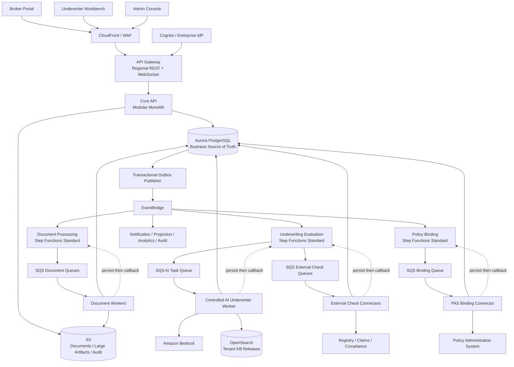
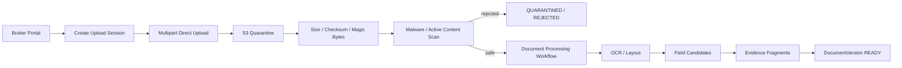

# Prism AI Underwriter Agent Production Architecture

> Document status: confirmed target architecture
>
> Business scope: Australian SME Professional Indemnity (PI), priced in AUD
>
> Deployment model: Core API modular monolith + independent asynchronous Workers + AWS Step Functions Standard
>
> Related documents: [Architecture diagrams](./architecture-diagrams.md) · [Deployment and release architecture](./deployment-architecture.md) · [Backend internal component architecture](./backend-architecture.md) · [Frontend internal component architecture](./frontend-architecture.md) · [Core runtime path](./core-underwriting-runtime-architecture.md)

## 1. Architecture Conclusion

Prism is not a system where an LLM reads an application and directly returns `ACCEPT/DECLINE`. It is a production-grade AI Underwriter Agent governed by deterministic workflows, grounded in immutable evidence, able to perform constrained retrieval and semantic risk analysis, and designed to exit automation when uncertainty appears.

Core boundaries:

- Step Functions controls business stages and recovery; AI does not control workflow.
- AI performs unstructured understanding, risk-factor analysis, evidence conflict detection, and grounded explanation.
- Eligibility, Pricing, Authority, and the final Decision Gate are deterministic code.
- AI can only reduce automation or request human intervention; it cannot promote an ineligible Case into auto-quote.
- Auto-quote requires code to prove that every required condition is satisfied. Incomplete AI, external checks, or evidence fail closed.
- AI does not generate final policy clauses; it may only reference the Tenant-approved Clause Library.
- Auto-decline is out of scope. Hard exclusions route to authorized decline review.
- Submissions, configuration, evidence, AI results, pricing, and quotes are immutable and traceable.

## 2. Business and Organization Boundary

### 2.1 Multi-Tenant Model

- `Tenant` is an insurance Carrier or MGA and is the boundary for products, appetite, pricing, authority, knowledge, and data isolation.
- `Brokerage` is an independent distribution organization, not a Tenant.
- Tenant and Brokerage connect through `TenantBrokerageAppointment`, a many-to-many appointment relationship.
- `BrokerUser` acts for a Brokerage through `BrokerageMembership`; an organization does not log in or submit by itself.
- Underwriters belong to a Tenant through `TenantMembership` and receive decision power through separate Authority Grants.
- Each Application pins one Tenant, one Brokerage, one valid Appointment, and the actual Actor.

A Broker operation requires:

```text
valid Identity
+ valid Brokerage Membership
+ valid Tenant-Brokerage Appointment
+ permission on the target resource
+ current business state allows the Command
```

### 2.2 Core Domain Terms

| Term                    | Meaning                                                                         |
| ----------------------- | ------------------------------------------------------------------------------- |
| Application             | Broker-editable application journey                                             |
| Submission Version      | Immutable application snapshot created by submit or supplement                  |
| Underwriting Case       | Business accountability and human-work container across Submissions/Evaluations |
| Underwriting Evaluation | One machine underwriting execution against one fixed Submission                 |
| Validated Risk Snapshot | Normalized and validated risk facts; the only downstream-readable fact set      |
| Evidence Fragment       | Immutable evidence addressable to source version, page/section/coordinates      |
| AI Risk Assessment      | Structured AI risk analysis, not a business decision                            |
| Pricing Result          | Deterministic immutable pricing calculation                                     |
| Quote Version           | Immutable broker-facing quote version                                           |
| Policy Binding          | Independent issuance flow after quote acceptance                                |

Case and Evaluation belong to the same Underwriting module but have separate meanings: Case owns accountability and final human outcome; Evaluation records how one fixed input was machine-analysed.

## 3. Overall Component Architecture



## 4. Deployment Boundary

- Core API is one deployment unit with `/broker/api/v1/*`, `/underwriter/api/v1/*`, and `/admin/api/v1/*` as logical BFF route modules.
- The three BFFs are not three microservices. They share process and transaction infrastructure, but they cannot contain core underwriting rules.
- Document, AI, External Check, and Binding Workers are deployed separately with independent queues, scaling, concurrency, and failure profiles.
- Step Functions orchestrates; it is not the business fact database.
- Aurora is the transactional business source of truth. S3 stores source documents and large immutable artifacts. OpenSearch is a rebuildable retrieval index.
- Production Core API and Workers run on ECS Fargate across 3 AZs. Regional API Gateway reaches Core API through VPC Link V2 and an internal ALB.
- Production uses provisioned Aurora PostgreSQL, RDS Proxy, one writer, and two readers. Aurora Global Database replicates business truth to Melbourne warm standby.
- RAG uses private OpenSearch Serverless collections split by security domain. DR indexes are rebuilt from immutable S3 release artifacts.

## 5. Communication Semantics

```text
Business Command
Browser -> API Gateway -> Core API -> Aurora

Workflow Task
Step Functions -> dedicated SQS -> Worker -> persist Result -> Callback

Domain Event
Aurora Outbox -> EventBridge -> consumer-owned SQS -> Consumer
```

Domain Events are facts that already happened. Workflow Tasks are typed commands to perform bounded work. HTTP Commands are explicit user business actions. They are not interchangeable.

Core API is not a workflow-internal HTTP relay. Workers read referenced task data and write owned results through controlled repositories/ports.

## 6. Immutable Version and State Model

- Application Draft is editable and uses optimistic concurrency.
- `SubmitApplication` creates immutable Submission, `REQUESTED` Evaluation, Audit, and Outbox Event in one Aurora transaction.
- Outbox publication triggers an idempotent Workflow Starter using `evaluationId` as stable execution identity.
- An Evaluation binds to exactly one Submission Version and one `EvaluationConfigurationSnapshot`.
- Human correction of underwriting facts creates a new Risk Snapshot and new Evaluation; the old Evaluation becomes `SUPERSEDED`.
- Application Journey, Submission, Evaluation, Case, Quote, Binding, and Stage each have separate state machines.

Decision routing is:

```text
AUTO_QUOTE
REQUEST_INFORMATION
REFER_UNDERWRITER
REFER_SENIOR_UNDERWRITER
RULE_BASED_DECLINE_REVIEW
OPERATIONAL_HOLD
```

Business outcomes are separated from technical state. Model timeouts, external dependency failure, or callback failure enter `OPERATIONAL_HOLD`; they are not disguised as business Referral.

## 7. RFI and Human Review

- RFI does not loop forever in the original Evaluation.
- The original Evaluation ends as `AWAITING_INFORMATION`; Broker supplements create a new Submission and Evaluation.
- Human Review targets the same immutable Submission and may use Step Functions Callback Wait.
- A Case has only one active HumanReviewTask and one Primary Underwriter at a time.
- Reassignment/Takeover is explicit and audited. Maker-checker uses a separate ApprovalTask.

## 8. Document and Evidence Pipeline



Core API creates upload sessions but does not proxy file bytes. Upload Session binds Tenant, Application, Document, allowed types, size, and expiry. Object keys are server-generated. File extension and client Content-Type are not trusted. Documents cannot enter OCR/LLM or download paths before scan approval.

Evidence fragments keep source document version, page/section/bounding box, extractor/model, confidence signals, text hash, and normalization metadata. Downstream modules read the Validated Risk Snapshot, not raw arbitrary model output.

## 9. Controlled AI Underwriter

The AI Worker implements versioned tasks such as `AI_RISK_ANALYSIS`. It is not a generic chat agent.

```text
Context Assembler
-> Deterministic Query Planner
-> Evidence Gateway
-> Product-configured Risk Analyzers
-> Consistency Checker
-> Risk Assessment Synthesizer
-> Schema/Citation/Policy Validator
-> AI Assessment Repository
```

The model:

- cannot choose tenant, product, KB, model, prompt, or tools;
- has no SQL, arbitrary HTTP, S3, messaging, pricing, decision, quote, or binding tools;
- can only use read-only evidence tools scoped by the server;
- must return schema-valid output with citations to approved evidence or KB releases;
- fails closed to retry, fallback, operational hold, or human review on invalid schema, invalid citations, security block, timeout, or budget exhaustion.

## 10. Deterministic Decision and Pricing

Deterministic policies own:

- eligibility and knockouts;
- risk feature validation;
- pricing;
- authority;
- automation eligibility;
- quote validity;
- binding preconditions.

AI may influence the risk assessment input only if it passes schema, citation, confidence, and safety validation. It cannot approve, decline, price, or bind.

## 11. Data Ownership

Aurora owns business truth:

- identity and tenancy;
- distribution and appointments;
- application/submission/RFI;
- document metadata and evidence references;
- underwriting case/evaluation/review/decision;
- pricing/quote;
- acceptance/binding;
- configuration release;
- platform operations, idempotency, outbox;
- append-only business audit.

S3 owns documents and large immutable artifacts. OpenSearch owns derived retrieval indexes. EventBridge and SQS own delivery, not truth.

## 12. Observability and Audit

Three audit/telemetry categories must remain separate:

| Category             | Source                                            | Answers                                                   |
| -------------------- | ------------------------------------------------- | --------------------------------------------------------- |
| Runtime Telemetry    | CloudWatch/OpenTelemetry                          | Is the system healthy, slow, or failing?                  |
| Infrastructure Audit | Organization CloudTrail                           | Who changed AWS resources or called control-plane APIs?   |
| Business Audit       | Aurora transaction + Outbox + Object Lock archive | Who did what business action to which Case/Quote and why? |

Normal logs never include tokens, Task Tokens, full prompts, full documents, secrets, or unnecessary PII.

## 13. Security Invariants

- Every request maps JWT to internal Identity/Membership and then performs resource-level authorization.
- Tenant, Brokerage, Role, and Portal selection are never trusted from the client.
- PostgreSQL RLS is defense in depth, not the primary authorization mechanism.
- Workers use workload-specific IAM roles and least privilege.
- Documents, RAG text, and provider responses are untrusted data and are separated from system instructions.
- Business events and replay are audited.
- Prompt/model/KB/guardrail changes are versioned releases, not console edits.

## 14. Production Fit

This architecture optimizes for:

- explainable underwriting decisions;
- recoverable asynchronous work;
- tenant isolation;
- auditability;
- safe AI adoption;
- operational clarity for interviews and real production environments.

The deliberate tradeoff is that the first production platform is a Core API modular monolith, not microservices. This preserves domain consistency and transactional correctness while still isolating slow/failure-prone document, AI, external, and binding work into independent workers.
