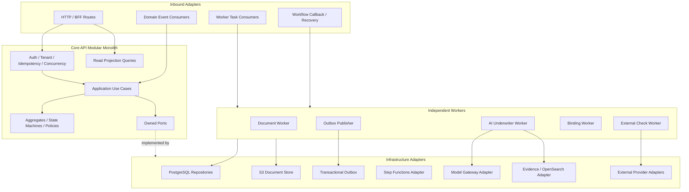

# Prism 后端内部组件架构

> 文档状态：生产目标架构
>
> 上层架构：[Prism AI Underwriter Agent 生产架构](./architecture.md)
>
> 配套文档：[Mermaid 架构图集](./architecture-diagrams.md) · [生产部署与发布架构](./deployment-architecture.md) · [前端内部组件架构](./frontend-architecture.md)

## 1. 后端形态

后端采用：

```text
Core API 模块化单体
+ 独立、按工作负载扩缩容的异步 Worker
+ Step Functions Standard 持久工作流
+ Aurora PostgreSQL 业务事实
```

Core API 内部使用六边形/端口适配器分层。模块化单体提供明确领域边界和同库事务，不为了形式上的微服务拆成大量网络调用。Document、AI、External Integration 和 Binding Worker 因资源、并发和失败模式不同而独立部署。

物理部署上，Core API 是通过 Regional API Gateway REST API、VPC Link V2 和 Internal ALB 暴露的 ECS Fargate Service；Worker 是同一 Cluster 内具有独立 Task Role、Security Group、Queue、DLQ 和伸缩上限的 ECS Service。小型事件路由、Workflow Starter 和 WebSocket Adapter 使用 Lambda。完整边界见[生产部署与发布架构](./deployment-architecture.md)。

原则：

1. Domain 不依赖 HTTP、AWS SDK、数据库 Driver 或模型 SDK。
2. Application Use Case 定义授权、事务意图和跨聚合编排。
3. 每张业务表只有一个模块写入所有者。
4. 长流程由 Workflow 编排；Core API 不作为内部 HTTP 跳板。
5. Worker 先持久化结果，再 Callback Step Functions。
6. AI 只输出结构化风险分析，不能写 Decision、Pricing、Quote 或 Binding。
7. Aurora 是业务事实；Workflow History、Queue 和日志都不是。
8. 所有副作用、重试和恢复必须幂等、可观察、可审计。

## 2. 总体内部结构



入站 Adapter（HTTP、SQS、Event、Recovery）都只能调用 Application API，不能绕过聚合和模块写入边界。

## 3. Core API 的逻辑 BFF

Core API 是一个部署单元，包含三个逻辑 Route Module：

```text
/broker/api/v1/*
/underwriter/api/v1/*
/admin/api/v1/*
```

| Route Module | 主要职责                                                            |
| ------------ | ------------------------------------------------------------------- |
| Broker       | Draft、Upload Session、Submit、RFI、Quote、Acceptance               |
| Underwriter  | Queue、Case Workspace、Evidence、Assessment、Decision、Assignment   |
| Admin        | Configuration Draft、Validation、Approval、Release、Rollback、Audit |

BFF 可以组合页面 Projection、映射 DTO、执行资源授权和协议并发控制，但不能承载 Eligibility、Pricing、Authority 或状态机逻辑。

每个请求依次经过：

1. Correlation/Trace Context；
2. Central Error Handler；
3. Authentication Context；
4. Active Membership/Tenant/Brokerage Context；
5. Resource-level Policy Enforcement；
6. OpenAPI/Schema Validation；
7. Idempotency 或 `If-Match`；
8. Application Use Case；
9. Problem Details/Response Mapping。

## 4. 领域模块与数据库所有权

| 模块          | 主要聚合/实体                                          | Schema          | 写入所有权               |
| ------------- | ------------------------------------------------------ | --------------- | ------------------------ |
| Identity      | Identity、TenantMembership                             | `identity`      | 身份和 Tenant Membership |
| Distribution  | Brokerage、Membership、Appointment                     | `distribution`  | 渠道与委任关系           |
| Submission    | Application、Submission、RFI                           | `submission`    | 草稿、提交版本、补件     |
| Document      | Document、DocumentVersion、Extraction、Evidence        | `document`      | 文档与证据               |
| Underwriting  | Case、Evaluation、RiskSnapshot、ReviewTask、Assessment | `underwriting`  | 核保执行与人工责任       |
| Pricing/Quote | PricingResult、Quote、QuoteVersion                     | `pricing`       | 定价与报价               |
| Binding       | QuoteAcceptance、PolicyBinding                         | `binding`       | 接受和出单 Saga          |
| Configuration | Product、Rules、Authority、Prompt、KB Release          | `configuration` | 不可变配置发布           |
| Platform      | StageExecution、Operation、Outbox、Idempotency         | `platform`      | 平台协调记录             |
| Audit         | AuditRecord                                            | `audit`         | 追加写审计               |

其他模块可以通过公开 Query/Port 读取，但不能直接更新非所属 Schema。跨模块强一致业务动作由一个 Application Use Case 通过公开模块接口和同一个数据库事务完成。

## 5. 核心聚合与不变量

### 5.1 Application 与 Submission

- Application Draft 可编辑，保存 `formVersion` 和乐观锁 `version`。
- Submit 必须针对明确 Draft Version，创建不可变 Submission Version。
- 一个 Submission 固定 Tenant、Brokerage、Appointment、Actor、产品和文档版本集合。
- RFI 补件不修改旧 Submission，而是产生新 Submission。

### 5.2 Underwriting Case 与 Evaluation

- Case 是业务责任容器，可跨多个 Submission/Evaluation。
- Evaluation 只针对一个 Submission 和一个 Configuration Snapshot。
- Evaluation 结果不可变；新事实产生新 Evaluation，旧结果 `SUPERSEDED`。
- Case 同时只能有一个 Active HumanReviewTask 和一个 Primary Assignee。
- Human Assessment 不覆盖 AI Assessment。

### 5.3 Pricing、Quote 与 Binding

- Pricing Result 是确定性、不可变的计算产物，包含费率/规则版本和完整计算明细。
- Quote Version 引用一个 Pricing Result、Coverage、批准 Clause 和 Expiry。
- Broker 接受精确 Quote Version；过期或风险/条款变化产生新 Pricing/Quote。
- Quote Acceptance 是事实；Binding 失败不回滚 Acceptance。

## 6. Application Use Cases

| 业务区域      | 关键 Command                                                                         |
| ------------- | ------------------------------------------------------------------------------------ |
| Submission    | CreateApplication、UpdateDraft、SubmitApplication、SubmitRFIResponse                 |
| Document      | CreateUploadSession、CompleteUpload、RejectDocument、PublishDocumentResult           |
| Underwriting  | StartEvaluation、PublishRiskSnapshot、PublishAIResult、RouteEvaluation               |
| Human Review  | AssignReview、ReassignReview、RecordHumanAssessment、RecordDecision、ApproveDecision |
| Quote         | PublishQuote、ExpireQuote、AcceptQuote                                               |
| Binding       | RequestBinding、RecordBindingStatus、ReconcileUnknownBinding                         |
| Configuration | CreateDraft、ValidateRelease、ApproveRelease、ScheduleRelease、RollbackRelease       |

典型 Command Use Case：

```text
解析 Actor/Command
→ 查询 Idempotency Record
→ 加载 Aggregate + Version
→ 资源授权与 Authority Check
→ 执行 Domain Behavior/Policy
→ 同一事务保存 Aggregate、Version、Audit Metadata、Outbox
→ Commit
→ 返回 Resource Version / 202 Operation
```

数据库事务内不得包含模型或第三方网络调用。需要外部结果时先持久化状态，由 Workflow/Worker 执行，再通过新的受控 Command/Result 恢复。

## 7. 状态机与领域策略

每种 Aggregate 独立维护状态机，不用一个 `application_status` 控制所有流程。

核心纯 Domain Policy：

- Application/Submission Transition Policy；
- Risk Snapshot Validation Policy；
- Eligibility/Knockout Policy；
- Confidence/Automation Policy；
- Pricing Policy；
- Decision Gate Policy；
- Underwriting Authority Policy；
- Quote Validity/Acceptance Policy；
- External Check Freshness Policy。

Policy 接收不可变输入，返回类型化 Outcome 和 Reason Codes，不访问数据库、模型或网络。Policy Version 和执行输入/输出哈希进入审计。

## 8. 工作流边界

三个独立 Standard Workflow：

| Workflow                | 业务身份            | 责任                                        |
| ----------------------- | ------------------- | ------------------------------------------- |
| Document Processing     | `documentVersionId` | 扫描、OCR、归一化、证据和处理状态           |
| Underwriting Evaluation | `evaluationId`      | 风险事实、规则、外部检查、AI、Pricing、路由 |
| Policy Binding          | `bindingId`         | PAS 出单、查询、重试和人工对账              |

Document Workflow 在上传完成后启动，不属于 Submit 事务，也不要求 Evaluation 嵌套启动；Evaluation 建立文档 Barrier 并复用已完成结果。

Submit 在 Aurora 事务中创建 Submission、Evaluation 和 Outbox。事务提交后，Workflow Starter 幂等启动 `evaluationId` Execution，避免数据库成功但 Workflow 丢失的双写窗口。

RFI 结束当前 Evaluation；Human Review 可保持同一 Evaluation 的 Callback Wait。Notification、Analytics 和 Audit Archive 不进入主流程关键路径。

## 9. SQS Callback Worker 协议

长耗时、外部或资源受限 Stage 使用：

```text
Step Functions .waitForTaskToken
→ workload-specific SQS Task
→ Worker
→ persist Domain Result
→ SendTaskSuccess/Failure
```

不是每个 State 都经过 SQS。Choice、Wait、Pass、短确定性 Adapter 和可直接集成的 AWS API 可以留在 Workflow 内。

### 9.1 Task Envelope

```text
schemaVersion / taskId / taskType / workflowVersion
tenantId / evaluationId / stageExecutionId / attemptId
contextManifestId + version + hash
configurationSnapshotId
deadlineAt / traceContext / idempotencyKey
callbackTaskToken
```

消息只携带引用，不携带文档和大对象。Task Token 不进入日志。Worker 从 Aurora 验证 Tenant、Evaluation、Context、Deadline 和当前状态。

### 9.2 Worker 执行模板

```text
Load StageExecution by stable idempotency key
├── SUCCEEDED: retry callback only / acknowledge duplicate
├── RUNNING by valid lease: do not duplicate
└── eligible: create StageAttempt
       → execute bounded task
       → persist immutable typed result
       → atomically mark accepted result
       → callback workflow
```

稳定幂等键推荐 `evaluationId + stageName + stageExecutionVersion`。SQS 的 At-least-once、Visibility Timeout、Worker Crash 和 Callback Failure 都不能产生第二个业务效果。

### 9.3 Result 与状态

Callback 只返回 `stageExecutionId`、`resultId`、`resultHash`、`status` 和时间。完整结果留在 Aurora/S3。

```text
Stage: PENDING → DISPATCHED → RUNNING → SUCCEEDED
                            ↘ FAILED_RETRYABLE → new attempt
                            ↘ FAILED_TERMINAL / TIMED_OUT / CANCELLED

AI Result: COMPLETE / INCOMPLETE / INVALID / SECURITY_BLOCKED / LATE_RESULT
```

执行成功、AI 是否完整以及业务是否允许 Auto Quote 是三个不同语义。

### 9.4 Workflow 与 Contract 版本

- Step Functions 每次发布创建不可变 Version；Workflow Starter 只通过环境 Alias 启动。
- `PROD` Alias 可以为新的 Execution 在当前/候选版本间灰度；已经开始的 Execution 永远继续原版本。
- Evaluation 保存实际 Workflow Version ARN、Task Contract Version 和 Release ID。
- Worker 至少支持当前和上一版兼容 Contract；破坏性变更创建新 `taskType` 或版本化 Queue。
- 旧 Worker 和 Workflow Version 只有在没有活跃执行或等待中的 Human Review 后才能退役。
- Alias 回滚不修改执行中的 Evaluation；受影响案件继续、受控停止或根据持久化 Checkpoint 恢复。

## 10. AI Worker 内部边界

AI Worker 不是通用聊天 Agent。它实现一个版本化的 `AI_RISK_ANALYSIS` Task：

```text
Context Assembler
→ Deterministic Query Planner
→ Evidence Gateway
→ Product-configured Parallel Risk Analyzers
→ Consistency Checker
→ Risk Assessment Synthesizer
→ Schema/Citation/Policy Validator
→ AI Assessment Repository
```

内部 Ports：

| Port                  | 约束                                        |
| --------------------- | ------------------------------------------- |
| ContextManifestReader | 只读固定 Evaluation 输入                    |
| EvidenceGateway       | Tenant/Submission/KB Release 强作用域       |
| ModelGateway          | Task Policy 决定模型/Prompt/Budget/Fallback |
| AssessmentRepository  | 只写 AI 模块拥有的不可变 Result             |
| StageRepository       | Attempt、Metrics、Error、Result Ref         |

模型没有 SQL、任意 HTTP、S3、消息发送、Decision、Pricing、Quote 或 Binding Tool。模型可调用的少量 Evidence Tool 只读、服务端注入作用域、固定最大轮次和返回量。

## 11. Document 与 Evidence Pipeline

文档处理输出不是一个最终表单 JSON，而是：

```text
Source Bundle
→ Extracted Field Candidates
→ Deterministic Reconciliation/Validation
→ Immutable Validated Risk Snapshot
```

每个 Candidate 保留 Document Version、页码/坐标、Extractor/Model、置信信号和原文哈希。Reconciliation 处理相同字段的来源优先级、单位/日期归一化、Applicant 声明与文档冲突。

下游只读 Validated Risk Snapshot。人工修正创建新的 Snapshot/Evaluation，不能就地修改已被使用的风险事实。

## 12. Persistence 与事务

### 12.1 数据规范

- 所有租户业务表显式含 `tenant_id`；租户唯一约束和高频索引以 Tenant 为范围。
- 应用层生成 UUIDv7；可修改 Aggregate 使用 `version BIGINT`。
- UTC `TIMESTAMPTZ` 与保险业务 `DATE` 分离。
- 列表使用 Keyset Pagination。
- JSONB 只存版本快照、模型输出和低频扩展；查询字段结构化。
- 不默认使用软删除；按业务状态、归档、匿名化和保留策略表达生命周期。
- 核心表初期不分区；高增长追加表达到阈值后按月分区。

### 12.2 Stage 持久化

`StageExecution` 保存稳定业务身份、输入/配置引用与哈希、状态和被接受的 Result Ref。`StageAttempt` 保存每次实际执行、Lease、Worker/Model/Provider、时间、Typed Error、成本和 Callback 状态。Domain Result 不可变。

### 12.3 Transactional Outbox

业务数据和 Outbox Row 同事务提交。Publisher 使用 `FOR UPDATE SKIP LOCKED` 批量领取，发布后记录结果。EventBridge At-least-once；每个 Consumer 使用自己的 Queue、`eventId` 去重和 Aggregate Version 处理乱序。

业务 Event 是过去事实，不携带 Task Token，不用来冒充 Workflow Command。

## 13. API 契约与并发

- REST/OpenAPI 作为对外契约，生成前端 Client。
- 异步 Command 返回 `202` 和 Operation URL。
- 有副作用 Command 要求 `Idempotency-Key`，相同 Key+不同 Payload 返回冲突。
- GET 返回 ETag；写操作要求 `If-Match`。
- Stale Version 返回 `412`；当前版本下的非法业务转换返回 `409`。
- 错误使用 `application/problem+json`，稳定 Code 与安全消息分离。
- 状态变化用明确 Command Endpoint，禁止通用 PATCH `status`。

一个 Case 只分配一个 Primary Underwriter 仍然需要 Version Control，因为多标签页、后台更新、管理员 Reassignment、新 Evaluation 和 Approval 都可能竞争。

## 14. Read Model 与实时通知

Aurora Normalized Write Model 是 Source of Truth。Underwriter Queue、Case Workspace、Broker Timeline 和 Admin Search 使用页面特定 Read Projection；OpenSearch 可用于搜索，但不是交易真相。不采用完整 Event Sourcing。

WebSocket Event 只包含 Event ID、Sequence、Resource、Version 和 Event Type。客户端随后通过 REST 获取权威 Projection；乱序事件按 Resource Version 忽略，断线无法补发时要求 Full Resync。

## 15. Configuration Control Plane

Product、Form、Validation、Eligibility、Pricing、Authority、Clause、Workflow、Prompt、Model Task Policy、Retrieval 和 KB Release 均为不可变发布物。

```text
DRAFT → VALIDATING → APPROVED → SCHEDULED → ACTIVE → RETIRED
```

高风险配置 Maker-checker；发布前执行 Schema、规则冲突、Pricing Regression、AI Eval 和 E2E Sample。`EvaluationConfigurationSnapshot` 在 Evaluation 启动时解析一次并固定。

## 16. Failure、Retry 与 DLQ

统一错误类别：

```text
TRANSIENT_DEPENDENCY
PERMANENT_INPUT
INVALID_AI_OUTPUT
SECURITY
UNKNOWN_OUTCOME
```

- 业务级 Retry 由 Step Functions 统一协调；SDK 只做极短网络重试。
- 相同输入的语义错误不能无限重抽模型。
- Security Error 隔离且不自动重试。
- Unknown Outcome 先查 Provider/Stage 状态。
- DLQ 不自动无限 Redrive；先修复原因，再使用原幂等键审计化重放。
- 不可恢复技术错误把 Evaluation 置为 `OPERATIONAL_HOLD`，不映射为业务 Referral。

## 17. 身份、安全与审计

- JWT 密码学验证后仍映射内部 Identity/Membership，并进行资源级授权。
- Tenant/Brokerage/Role 不能信任客户端；所有 Repository Query 显式作用域化。
- PostgreSQL RLS 仅作纵深防御。
- Worker 通过独立 IAM Role 和最小权限访问 Queue、KMS、S3、Bedrock 和数据库。
- 不可信文档、RAG 和 Provider 文本与 System Instruction 分离；正式 AI 优先读 Risk Snapshot。
- 所有模型输出经过 Schema、Evidence、Policy 和安全验证。
- Audit 记录 Actor、Membership、Tenant、Authority、Reason、配置/结果版本、Correlation/Causation。
- 普通日志不记录 Token、Task Token、完整 Prompt、文档、PII 或 Secret。

## 18. Observability 与运行控制

Trace 贯穿 HTTP/Outbox/Event/Workflow/SQS/Worker/Tool/Model/Callback。指标覆盖：

- API latency/error、Queue Age、Stage/Attempt、Worker saturation、Callback 和 DLQ；
- Model latency/token/cost/throttle/fallback、Schema/Citation/Policy Failure；
- Unsupported Assertion、Abstention、Human Disposition 和 Release Drift；
- Auto Quote、RFI、Referral、Turnaround、Override 和 Binding Failure。

Safety 事故触发 Automation Kill Switch；质量回归停止 Canary/回滚；依赖事故按 Runbook 执行 Fallback、Hold 或恢复。Telemetry 与长期业务 Audit 分离。

## 19. 测试策略

| 层级                   | 重点                                                     |
| ---------------------- | -------------------------------------------------------- |
| Domain Unit            | 状态机、Eligibility、Pricing、Authority、Decision Gate   |
| Use Case               | 权限、事务、Idempotency、Outbox、Version Conflict        |
| Repository Integration | PostgreSQL Schema、索引、锁、Migration                   |
| Adapter Contract       | S3、Bedrock、OpenSearch、Provider/PAS                    |
| API Contract           | OpenAPI、Problem Details、ETag、Idempotency              |
| Event/Task Contract    | Schema 兼容、重复、乱序、Token Redaction                 |
| Workflow               | Retry、Timeout、Callback、RFI、Human Wait、Recovery      |
| AI Eval                | Extraction、Retrieval、Grounding、Risk、Abstention、安全 |
| E2E                    | Submit、Auto Quote、RFI、新 Evaluation、Human、Binding   |

普通 CI 测试不依赖实时模型；Live Model/Provider 测试在受控环境运行并设置成本和质量门槛。

## 20. 建议代码结构

```text
apps/core-api/src/
  http/
    broker/
    underwriter/
    admin/
    middleware/
  modules/
    identity/
    distribution/
    submission/
    document/
    underwriting/
    pricing/
    binding/
    configuration/
    platform/
  shared/
    application/
    domain/
    observability/

apps/workers/
  document-worker/
  ai-underwriter-worker/
  external-check-worker/
  binding-worker/
  outbox-publisher/

packages/contracts/
  openapi/
  events/
  workflow-tasks/
  ai-results/

infra/
  organization/
  network/
  security/
  data/
  compute/
  workflows/
  identity/
  edge/
  observability/
  recovery/

database/
  migrations/
```

模块内部可以使用 `domain/application/ports/adapters`，但不强制为每个简单能力创建空目录。跨模块依赖只能通过公开入口；CI 应检查禁止深层导入和循环依赖。
