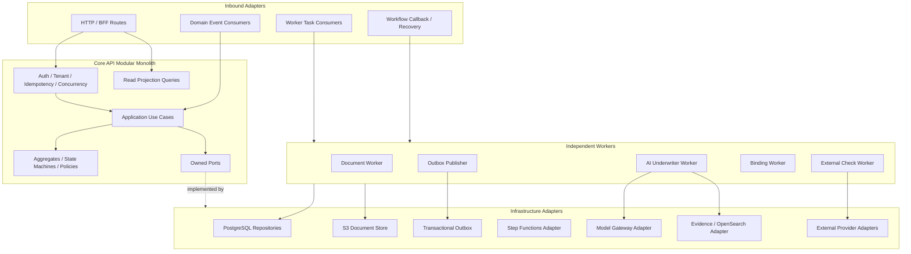

# Prism Backend Internal Component Architecture

> Document status: production target architecture
>
> Parent document: [Prism AI Underwriter Agent Production Architecture](./architecture.md)
>
> Companion documents: [Mermaid architecture diagrams](./architecture-diagrams.md) · [Production deployment and release architecture](./deployment-architecture.md) · [Frontend internal component architecture](./frontend-architecture.md)

## 1. Backend Shape

The backend uses:

```text
Core API modular monolith
+ independent asynchronous Workers scaled by workload
+ Step Functions Standard durable workflows
+ Aurora PostgreSQL as business truth
```

Core API uses a hexagonal / ports-and-adapters layering model internally. The modular monolith gives clear domain boundaries and same-database transactions without splitting into many network calls for the sake of microservices. Document, AI, External Integration, and Binding Workers are deployed separately because their resource needs, concurrency, and failure modes differ.

Physically, Core API is an ECS Fargate service exposed through Regional API Gateway REST API, VPC Link V2, and an internal ALB. Workers are ECS services in the same cluster, each with its own task role, security group, queue, DLQ, and scaling ceiling. Small event-routing, workflow-starter, and WebSocket adapter workloads use Lambda. See [Production deployment and release architecture](./deployment-architecture.md) for the full boundary.

Principles:

1. Domain code does not depend on HTTP, AWS SDKs, database drivers, or model SDKs.
2. Application Use Cases define authorization, transaction intent, and cross-aggregate orchestration.
3. Every business table has exactly one module that owns writes.
4. Long-running flows are orchestrated by workflows; Core API is not an internal HTTP relay.
5. Workers persist results before calling back Step Functions.
6. AI only emits structured risk analysis; it cannot write Decision, Pricing, Quote, or Binding facts.
7. Aurora is business truth; workflow history, queues, and logs are not.
8. All side effects, retries, and recovery paths must be idempotent, observable, and auditable.

## 2. Internal Structure



Inbound adapters such as HTTP, SQS, events, and recovery code may only call the Application API. They must not bypass aggregates or module write boundaries.

## 3. Logical BFFs Inside Core API

Core API is one deployment unit with three logical route modules:

```text
/broker/api/v1/*
/underwriter/api/v1/*
/admin/api/v1/*
```

| Route module | Primary responsibilities                                            |
| ------------ | ------------------------------------------------------------------- |
| Broker       | Draft, Upload Session, Submit, RFI, Quote, Acceptance               |
| Underwriter  | Queue, Case Workspace, Evidence, Assessment, Decision, Assignment   |
| Admin        | Configuration Draft, Validation, Approval, Release, Rollback, Audit |

BFF routes may compose page projections, map DTOs, perform resource authorization, and enforce protocol-level concurrency. They must not contain eligibility, pricing, authority, or state-machine logic.

Each request passes through:

1. correlation and trace context;
2. central error handler;
3. authentication context;
4. active membership, tenant, and brokerage context;
5. resource-level policy enforcement;
6. OpenAPI/schema validation;
7. idempotency or `If-Match`;
8. Application Use Case;
9. Problem Details and response mapping.

## 4. Domain Modules and Database Ownership

| Module        | Main aggregates/entities                               | Schema          | Write owner                                     |
| ------------- | ------------------------------------------------------ | --------------- | ----------------------------------------------- |
| Identity      | Identity, TenantMembership                             | `identity`      | Identity and tenant membership                  |
| Distribution  | Brokerage, Membership, Appointment                     | `distribution`  | Distribution and appointments                   |
| Submission    | Application, Submission, RFI                           | `submission`    | Drafts, submitted versions, RFI                 |
| Document      | Document, DocumentVersion, Extraction, Evidence        | `document`      | Documents and evidence                          |
| Underwriting  | Case, Evaluation, RiskSnapshot, ReviewTask, Assessment | `underwriting`  | Underwriting execution and human accountability |
| Pricing/Quote | PricingResult, Quote, QuoteVersion                     | `pricing`       | Pricing and quotes                              |
| Binding       | QuoteAcceptance, PolicyBinding                         | `binding`       | Acceptance and issuance saga                    |
| Configuration | Product, Rules, Authority, Prompt, KB Release          | `configuration` | Immutable configuration releases                |
| Platform      | StageExecution, Operation, Outbox, Idempotency         | `platform`      | Platform coordination records                   |
| Audit         | AuditRecord                                            | `audit`         | Append-only audit                               |

Other modules may read through public queries or ports, but they cannot directly update schemas they do not own. Strongly consistent cross-module business actions are performed by one Application Use Case through public module interfaces inside one database transaction.

## 5. Core Aggregates and Invariants

### 5.1 Application and Submission

- Application Draft is editable and stores `formVersion` plus optimistic-lock `version`.
- Submit must target an explicit Draft Version and creates an immutable Submission Version.
- A Submission pins Tenant, Brokerage, Appointment, Actor, Product, and document versions.
- RFI supplements do not mutate old Submissions; they create new Submissions.

### 5.2 Underwriting Case and Evaluation

- Case is the business-accountability container and may span multiple Submissions/Evaluations.
- Evaluation targets exactly one Submission and one Configuration Snapshot.
- Evaluation results are immutable; new facts create a new Evaluation and mark old results `SUPERSEDED`.
- A Case can have only one active HumanReviewTask and one Primary Assignee at a time.
- Human Assessment does not overwrite AI Assessment.

### 5.3 Pricing, Quote, and Binding

- Pricing Result is deterministic and immutable. It includes rate/rule versions and full calculation details.
- Quote Version references one Pricing Result, Coverage, approved Clauses, and Expiry.
- Broker accepts an exact Quote Version. Expired quotes or changed risk/terms create new Pricing/Quote versions.
- Quote Acceptance is a fact; Binding failure does not roll back Acceptance.

## 6. Application Use Cases

| Business area | Key commands                                                                         |
| ------------- | ------------------------------------------------------------------------------------ |
| Submission    | CreateApplication, UpdateDraft, SubmitApplication, SubmitRFIResponse                 |
| Document      | CreateUploadSession, CompleteUpload, RejectDocument, PublishDocumentResult           |
| Underwriting  | StartEvaluation, PublishRiskSnapshot, PublishAIResult, RouteEvaluation               |
| Human Review  | AssignReview, ReassignReview, RecordHumanAssessment, RecordDecision, ApproveDecision |
| Quote         | PublishQuote, ExpireQuote, AcceptQuote                                               |
| Binding       | RequestBinding, RecordBindingStatus, ReconcileUnknownBinding                         |
| Configuration | CreateDraft, ValidateRelease, ApproveRelease, ScheduleRelease, RollbackRelease       |

Typical command use-case flow:

```text
Parse Actor/Command
-> read Idempotency Record
-> load Aggregate + Version
-> enforce resource authorization and Authority Check
-> execute Domain Behavior/Policy
-> persist Aggregate, Version, Audit Metadata, and Outbox in one transaction
-> Commit
-> return Resource Version / 202 Operation
```

Database transactions must not contain model calls or third-party network calls. When an external result is required, persist state first, let Workflow/Worker execute the external work, and resume through a new controlled Command/Result.

## 7. State Machines and Domain Policies

Each aggregate owns its own state machine. Do not use one `application_status` to control every process.

Core pure-domain policies:

- Application/Submission Transition Policy;
- Risk Snapshot Validation Policy;
- Eligibility/Knockout Policy;
- Confidence/Automation Policy;
- Pricing Policy;
- Decision Gate Policy;
- Underwriting Authority Policy;
- Quote Validity/Acceptance Policy;
- External Check Freshness Policy.

Policies take immutable inputs and return typed outcomes and reason codes. They do not access databases, models, or networks. Policy Version and execution input/output hashes are written to audit.

## 8. Workflow Boundaries

Three independent Standard workflows:

| Workflow                | Business identity   | Responsibility                                           |
| ----------------------- | ------------------- | -------------------------------------------------------- |
| Document Processing     | `documentVersionId` | Scan, OCR, normalization, evidence, and processing state |
| Underwriting Evaluation | `evaluationId`      | Risk facts, rules, external checks, AI, pricing, routing |
| Policy Binding          | `bindingId`         | PAS issuance, polling, retry, and manual reconciliation  |

Document Workflow starts after upload completion. It is not part of the Submit transaction and does not require Evaluation to start it. Evaluation establishes a document-readiness barrier and reuses completed document results.

Submit creates Submission, Evaluation, and Outbox in an Aurora transaction. After commit, Workflow Starter idempotently starts the `evaluationId` execution, avoiding the dual-write window where the database succeeds but workflow start is lost.

RFI ends the current Evaluation. Human Review may keep the same Evaluation in a Callback Wait. Notification, Analytics, and Audit Archive are not on the critical path.

## 9. SQS Callback Worker Protocol

Long-running, external, or resource-constrained stages use:

```text
Step Functions .waitForTaskToken
-> workload-specific SQS Task
-> Worker
-> persist Domain Result
-> SendTaskSuccess/Failure
```

Not every state goes through SQS. Choice, Wait, Pass, short deterministic adapters, and directly integrated AWS APIs can stay inside the workflow.

### 9.1 Task Envelope

```text
schemaVersion / taskId / taskType / workflowVersion
tenantId / evaluationId / stageExecutionId / attemptId
contextManifestId + version + hash
configurationSnapshotId
deadlineAt / traceContext / idempotencyKey
callbackTaskToken
```

Messages carry references only, not documents or large objects. Task Tokens are not logged. Workers validate Tenant, Evaluation, Context, Deadline, and current state from Aurora.

### 9.2 Worker Execution Template

```text
Load StageExecution by stable idempotency key
├── SUCCEEDED: retry callback only / acknowledge duplicate
├── RUNNING by valid lease: do not duplicate
└── eligible: create StageAttempt
       -> execute bounded task
       -> persist immutable typed result
       -> atomically mark accepted result
       -> callback workflow
```

Recommended stable idempotency key: `evaluationId + stageName + stageExecutionVersion`. SQS at-least-once delivery, visibility timeouts, Worker crashes, and callback failures must not produce a second business effect.

### 9.3 Results and State

Callback returns only `stageExecutionId`, `resultId`, `resultHash`, `status`, and timestamps. Full results remain in Aurora/S3.

```text
Stage: PENDING -> DISPATCHED -> RUNNING -> SUCCEEDED
                            ↘ FAILED_RETRYABLE -> new attempt
                            ↘ FAILED_TERMINAL / TIMED_OUT / CANCELLED

AI Result: COMPLETE / INCOMPLETE / INVALID / SECURITY_BLOCKED / LATE_RESULT
```

Execution success, AI completeness, and whether the business may auto-quote are three different meanings.

### 9.4 Workflow and Contract Versions

- Each Step Functions release creates an immutable Version; Workflow Starter starts only through an environment Alias.
- The `PROD` Alias may canary new executions between current and candidate versions; already-started executions always continue on their original version.
- Evaluation stores the actual Workflow Version ARN, Task Contract Version, and Release ID.
- Workers support at least the current and previous compatible contract; breaking changes create a new `taskType` or versioned queue.
- Old Worker and Workflow versions can retire only after there are no active executions or waiting Human Reviews.
- Alias rollback does not rewrite in-flight Evaluations; affected cases continue, are controlled-stopped, or recover from persisted checkpoints.

## 10. AI Worker Internal Boundary

AI Worker is not a generic chat agent. It implements one versioned `AI_RISK_ANALYSIS` task:

```text
Context Assembler
-> Deterministic Query Planner
-> Evidence Gateway
-> Product-configured Parallel Risk Analyzers
-> Consistency Checker
-> Risk Assessment Synthesizer
-> Schema/Citation/Policy Validator
-> AI Assessment Repository
```

Internal ports:

| Port                  | Constraint                                           |
| --------------------- | ---------------------------------------------------- |
| ContextManifestReader | Read-only fixed Evaluation input                     |
| EvidenceGateway       | Strongly scoped to Tenant/Submission/KB Release      |
| ModelGateway          | Task Policy decides model, prompt, budget, fallback  |
| AssessmentRepository  | Writes only immutable Results owned by the AI module |
| StageRepository       | Attempts, metrics, errors, and result references     |

The model has no SQL, arbitrary HTTP, S3, messaging, Decision, Pricing, Quote, or Binding tools. The few Evidence tools it may use are read-only, server-scoped, bounded in turn count, and bounded in returned volume.

## 11. Document and Evidence Pipeline

Document processing does not output one final form JSON. It outputs:

```text
Source Bundle
-> Extracted Field Candidates
-> Deterministic Reconciliation/Validation
-> Immutable Validated Risk Snapshot
```

Each candidate keeps Document Version, page/coordinates, extractor/model, confidence signals, and source text hash. Reconciliation handles source priority, unit/date normalization, and conflicts between applicant declarations and documents.

Downstream modules only read the Validated Risk Snapshot. Human correction creates a new Snapshot/Evaluation; it cannot modify risk facts already used in place.

## 12. Persistence and Transactions

### 12.1 Data Standards

- Every tenant business table explicitly includes `tenant_id`; tenant-unique constraints and hot indexes are tenant-scoped.
- Application code generates UUIDv7; mutable aggregates use `version BIGINT`.
- UTC `TIMESTAMPTZ` is separated from insurance business `DATE`.
- Lists use keyset pagination.
- JSONB stores version snapshots, model outputs, and low-frequency extensions; queryable fields are structured.
- Soft delete is not the default; lifecycle is expressed through business state, archival, anonymization, and retention policy.
- Core tables are not partitioned initially; high-growth append-only tables are month-partitioned after thresholds are reached.

### 12.2 Stage Persistence

`StageExecution` stores stable business identity, input/configuration references and hashes, state, and the accepted Result Ref. `StageAttempt` stores each actual execution, lease, worker/model/provider, timestamps, typed error, cost, and callback state. Domain Results are immutable.

### 12.3 Transactional Outbox

Business data and Outbox rows commit in the same transaction. Publisher uses `FOR UPDATE SKIP LOCKED` to claim batches and records publish results after success. EventBridge is at-least-once; every Consumer uses its own queue, `eventId` dedupe, and Aggregate Version to handle out-of-order delivery.

Business Events are past-tense facts. They do not carry Task Tokens and must not impersonate Workflow Commands.

## 13. API Contracts and Concurrency

- REST/OpenAPI is the external contract and generates the frontend client.
- Asynchronous Commands return `202` and an Operation URL.
- Side-effecting Commands require `Idempotency-Key`; same key with different payload returns a conflict.
- GET returns ETag; writes require `If-Match`.
- Stale Version returns `412`; illegal business transition on the current version returns `409`.
- Errors use `application/problem+json`, with stable codes and safe messages separated.
- State changes use explicit Command endpoints; generic PATCH `status` is forbidden.

Assigning a Case to a single Primary Underwriter still requires version control because multiple tabs, background updates, admin reassignment, new Evaluations, and approval tasks can compete.

## 14. Read Models and Realtime Notifications

Aurora normalized write model is the source of truth. Underwriter Queue, Case Workspace, Broker Timeline, and Admin Search use page-specific read projections. OpenSearch may support search but is not transactional truth. The platform does not use full Event Sourcing.

WebSocket events contain only Event ID, Sequence, Resource, Version, and Event Type. Clients then fetch the authoritative projection through REST. Out-of-order events are ignored by Resource Version; when disconnects cannot be replayed, the client performs a full resync.

## 15. Configuration Control Plane

Product, Form, Validation, Eligibility, Pricing, Authority, Clause, Workflow, Prompt, Model Task Policy, Retrieval, and KB Release are immutable release artifacts.

```text
DRAFT -> VALIDATING -> APPROVED -> SCHEDULED -> ACTIVE -> RETIRED
```

High-risk configuration uses maker-checker. Before release, run schema checks, rule-conflict detection, pricing regression, AI eval, and E2E samples. `EvaluationConfigurationSnapshot` is resolved once when Evaluation starts and then pinned.

## 16. Failure, Retry, and DLQ

Unified error categories:

```text
TRANSIENT_DEPENDENCY
PERMANENT_INPUT
INVALID_AI_OUTPUT
SECURITY
UNKNOWN_OUTCOME
```

- Business-level retry is coordinated by Step Functions; SDKs only perform very short network retries.
- Semantic errors for the same input must not trigger infinite model retries.
- Security errors are isolated and not auto-retried.
- Unknown outcomes first query provider/stage status.
- DLQ messages are not redriven indefinitely; fix the cause first, then replay with the original idempotency key and audit.
- Non-recoverable technical errors place the Evaluation in `OPERATIONAL_HOLD`; they are not mapped to business Referral.

## 17. Identity, Security, and Audit

- After cryptographic JWT validation, the request still maps to internal Identity/Membership and performs resource-level authorization.
- Tenant, Brokerage, and Role are never trusted from the client; every repository query is explicitly scoped.
- PostgreSQL RLS is defense in depth only.
- Workers use independent IAM roles and least privilege for Queue, KMS, S3, Bedrock, and database access.
- Untrusted documents, RAG text, and provider text are separated from system instructions; production AI reads the Risk Snapshot first.
- All model output passes schema, evidence, policy, and safety validation.
- Audit records Actor, Membership, Tenant, Authority, Reason, configuration/result versions, Correlation, and Causation.
- Normal logs do not record tokens, Task Tokens, full prompts, documents, PII, or secrets.

## 18. Observability and Operational Control

Trace spans HTTP, Outbox, Event, Workflow, SQS, Worker, Tool, Model, and Callback. Metrics cover:

- API latency/error, Queue Age, Stage/Attempt, Worker saturation, Callback, and DLQ;
- model latency/token/cost/throttle/fallback, Schema/Citation/Policy Failure;
- Unsupported Assertion, Abstention, Human Disposition, and Release Drift;
- Auto Quote, RFI, Referral, Turnaround, Override, and Binding Failure.

Safety incidents trigger the Automation Kill Switch. Quality regression stops canary or rolls back. Dependency incidents follow runbooks for fallback, hold, or recovery. Telemetry is separated from long-term business audit.

## 19. Testing Strategy

| Layer                  | Focus                                                                  |
| ---------------------- | ---------------------------------------------------------------------- |
| Domain Unit            | State machines, Eligibility, Pricing, Authority, Decision Gate         |
| Use Case               | Permissions, transactions, idempotency, Outbox, version conflicts      |
| Repository Integration | PostgreSQL schema, indexes, locks, migrations                          |
| Adapter Contract       | S3, Bedrock, OpenSearch, Provider/PAS                                  |
| API Contract           | OpenAPI, Problem Details, ETag, Idempotency                            |
| Event/Task Contract    | Schema compatibility, duplicates, out-of-order events, token redaction |
| Workflow               | Retry, timeout, callback, RFI, human wait, recovery                    |
| AI Eval                | Extraction, retrieval, grounding, risk, abstention, safety             |
| E2E                    | Submit, Auto Quote, RFI, new Evaluation, Human, Binding                |

Normal CI tests do not depend on live models. Live Model/Provider tests run in controlled environments with cost and quality gates.

## 20. Recommended Code Structure

```text
apps/core-api/src/
  http/
    broker/
    underwriter/
    admin/
    middleware/
  modules/
    identity/
    distribution/
    submission/
    document/
    underwriting/
    pricing/
    binding/
    configuration/
    platform/
  shared/
    application/
    domain/
    observability/

apps/workers/
  document-worker/
  ai-underwriter-worker/
  external-check-worker/
  binding-worker/
  outbox-publisher/

packages/contracts/
  openapi/
  events/
  workflow-tasks/
  ai-results/

infra/
  organization/
  network/
  security/
  data/
  compute/
  workflows/
  identity/
  edge/
  observability/
  recovery/

database/
  migrations/
```

Inside each module, use `domain/application/ports/adapters` where it helps, but do not create empty folders for every simple capability. Cross-module dependencies must go through public entry points; CI should reject deep imports and cyclic dependencies.
