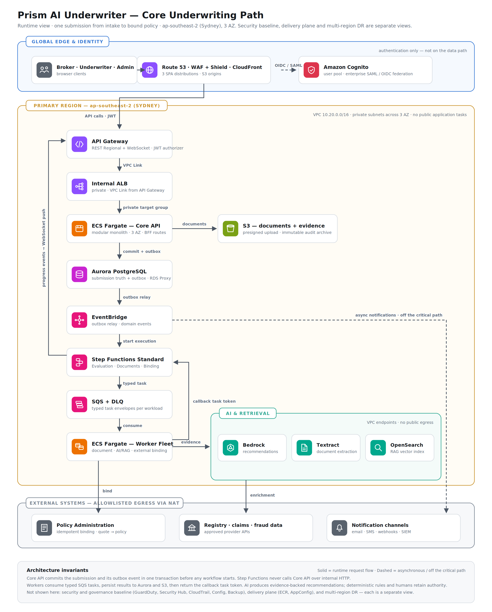

# Prism AI Underwriter 核心核保运行架构

> 文档状态：根据 `docs/diagrams/174.PNG` 整理
>
> 视图范围：一个 Submission 从前端接入到 Policy Binding 的核心运行路径
>
> 部署区域：AWS `ap-southeast-2`（Sydney），跨 3 个 Availability Zone

## 1. 这张图表达什么

这是一张 **Runtime View**，重点回答以下问题：

- Broker、Underwriter 和 Administrator 如何进入系统；
- Core API 如何可靠地接受并持久化一次 Submission；
- 长时间运行的文档处理、外部查询和 AI 分析如何异步执行；
- Step Functions、SQS 和 Worker 如何通过 Callback Task Token 协作；
- 文档、业务状态和 AI Evidence 分别存放在哪里；
- Worker 如何访问 Bedrock、Textract、OpenSearch 和外部数据提供商；
- 报价接受后如何调用 Policy Administration System 完成 Binding；
- 哪些处理位于核心核保路径上，哪些处理被放到异步旁路。

它不是完整的 AWS Landing Zone 或部署总图。以下内容被刻意放在其他视图中：

- GuardDuty、Security Hub、CloudTrail、AWS Config 等安全治理基线；
- ECR、GitHub Actions、AppConfig 和部署晋级等 Delivery Plane；
- Melbourne Warm Standby、数据复制和区域切换等 Multi-Region DR；
- 详细的领域模块、数据库表和前端 Feature 结构。

这种拆分避免在核心业务图中堆叠与一次核保请求无直接关系的服务。

## 2. 图中的架构边界

### 2.1 Global Edge & Identity

该区域负责用户接入、静态前端交付和身份认证。

| 组件                         | 图中职责                                                                       |
| ---------------------------- | ------------------------------------------------------------------------------ |
| Broker · Underwriter · Admin | 三类浏览器用户；分别使用 Broker Portal、Underwriter Workbench 和 Admin Console |
| Route 53                     | 前端域名解析和区域入口解析                                                     |
| AWS WAF                      | 在边缘过滤常见 Web 攻击和不符合规则的请求                                      |
| AWS Shield                   | 为互联网入口提供 DDoS 防护基线                                                 |
| CloudFront                   | 分发三个独立部署的 SPA，并连接各自的 S3 Origin                                 |
| Amazon Cognito               | 承载 User Pool，并与企业 SAML/OIDC Identity Provider 联邦                      |

图中标注 `authentication only — not on the data path`，表示 Cognito 负责登录、Token 签发和身份联邦，但核保业务数据不会经过 Cognito。浏览器获得 Token 后，携带 JWT 直接调用 API Gateway。

`Route 53 · WAF · Shield · CloudFront` 是为了简化展示而合并的边缘入口节点，不表示它们是同一个 AWS 服务。三个前端应用仍然拥有独立的 CloudFront Distribution 和 S3 Origin。

### 2.2 Primary Region — Sydney

核心业务运行在 `ap-southeast-2`，目标部署跨 3 个 AZ。

图中给出的网络约束是：

- VPC CIDR 为 `10.20.0.0/16`；
- Core API 和 Worker 运行在 Private Application Subnet；
- Aurora 位于 Isolated Data Subnet；
- 不为 ECS Application Task 分配公网入口；
- AWS 托管服务优先通过 VPC Endpoint 私有访问；
- 只有调用外部 Provider 和 PAS 时才经过受控 NAT Egress。

图为了突出运行路径，没有展开每个 AZ、Subnet、Route Table、Security Group、NAT Gateway 和 VPC Endpoint。

### 2.3 External Systems

外部系统不属于 Prism 的信任边界，通过 Allowlist、TLS、Secret Rotation、Timeout、Retry、Circuit Breaker 和 Egress Control 访问。

| 外部系统                       | 用途                                                     |
| ------------------------------ | -------------------------------------------------------- |
| Policy Administration System   | 接收幂等 Binding 请求，将被接受的 Quote 转换为 Policy    |
| Registry · Claims · Fraud Data | 为核保提供企业注册、历史理赔、欺诈和合规增强数据         |
| Notification Channels          | 发送 Email、SMS、Webhook，并向 SIEM 或分析消费者提供事件 |

## 3. 核心组件职责

### 3.1 API Gateway

图中一个节点概括了两个逻辑入口：

- **Regional REST API**：Submission、Case、Quote、Review、Binding 等命令和查询；
- **WebSocket API**：向浏览器推送 Evaluation、Document Processing 和 Binding 进度。

API Gateway 校验 Cognito 签发的 JWT，并通过 VPC Link 将 REST 请求转发给私有 ALB。WebSocket 推送是状态通知通道，不是业务事实来源；客户端断线后应通过 REST API 重新读取当前状态。

### 3.2 Internal ALB

Internal Application Load Balancer 位于私有网络中，只接受 API Gateway VPC Link 的流量，并将请求发送给 Core API 的私有 Target Group。

它负责：

- ECS Task 健康检查；
- 跨 AZ 流量分发；
- Target Group 管理；
- Core API 的私有入口。

ALB 不承载身份授权和领域规则。

### 3.3 ECS Fargate — Core API

Core API 是一个部署单元内的模块化单体，跨 3 个 AZ 运行多个 ECS Fargate Task。它包含 Broker、Underwriter 和 Admin 三组 BFF Route，但不会为每组 Route 部署独立后端服务。

Core API 负责：

- Tenant、Membership、Role 和 Authority 授权；
- 请求验证和领域不变量；
- Application Draft 与不可变 Submission Version；
- Case、Human Review、Quote 和 Acceptance 状态；
- 幂等命令处理和乐观并发控制；
- 在数据库事务中同时写入业务状态和 Outbox Event；
- 创建 Evaluation ID，但不在 HTTP 请求中执行长时间 AI 分析。

Core API 不作为 Step Functions 内部步骤之间的 HTTP 跳板。

### 3.4 Aurora PostgreSQL

Aurora PostgreSQL 是业务事实来源，图中 `submission truth + outbox` 表示它至少承载：

- Application、Submission 和 Evaluation；
- Case Assignment、Human Review 和 Decision；
- Quote Version、Acceptance 和 Binding 状态；
- Worker Result Metadata 和幂等执行记录；
- Business Audit Event；
- Transactional Outbox。

Core API 通过 RDS Proxy 管理数据库连接。一次 Submission 提交必须在同一数据库事务中完成：

1. 写入不可变 Submission；
2. 创建 Evaluation；
3. 写入 Outbox Event；
4. 提交事务。

如果事务失败，三项修改全部回滚，因此不会出现“Submission 已保存但 Workflow 永远没有启动”或“Workflow 已启动但 Submission 不存在”的中间状态。

### 3.5 S3 — Documents & Evidence

S3 节点是文档存储能力的逻辑汇总，包括：

- Presigned Upload；
- Quarantine Document；
- Original Document；
- OCR 和 Normalized Artifact；
- Evidence Package；
- 大型 AI 输入输出 Artifact；
- 不可变 Audit Archive。

生产实现中可以使用多个 Bucket 或受控 Prefix 分离不同生命周期和权限。Aurora 保存业务元数据、版本和对象引用，S3 保存文档和大对象；S3 不能代替 Aurora 成为业务状态机。

### 3.6 Outbox Relay 与 EventBridge

Outbox Relay 从 Aurora 读取尚未发布的 Outbox Record，将其发布到 EventBridge，并在成功后记录发布状态。

EventBridge 负责：

- 根据类型化 Domain Event 路由消费者；
- 启动对应的 Step Functions State Machine；
- 将 Notification、Analytics 和 Audit Archive 等非关键处理发送到旁路消费者。

EventBridge 本身不保存核保业务真相；事件消费者必须能够处理重复投递。

图中 Aurora 到 EventBridge 的箭头标记为 `outbox relay`。这是一项逻辑职责，实际可由独立 Outbox Relay Worker 执行。

### 3.7 Step Functions Standard

图中的 Step Functions 节点代表三条独立的 Standard Workflow，而不是一个包含所有业务的巨大 State Machine：

| Workflow                | 责任                                                                 |
| ----------------------- | -------------------------------------------------------------------- |
| Underwriting Evaluation | 编排一个 Submission 的证据收集、分析、规则判断和最终 Evaluation 状态 |
| Document Processing     | 对单份文档执行扫描、OCR、归一化、分类和 Evidence 生成                |
| Policy Binding          | Quote 被接受后，独立调用 PAS，并处理成功、失败和未知结果             |

Step Functions 负责业务阶段顺序、Timeout、Retry、Catch、并行分支和 Callback Wait，不负责保存最终领域事实。

`Submit Application` 不属于 Step Functions：Core API 必须先完成数据库提交，再由 Outbox/EventBridge 启动 Workflow。

### 3.8 SQS + DLQ

Step Functions 不通过 Core API 间接调用 Worker，而是向工作负载专用 SQS Queue 投递类型化 Task Envelope。

典型 Queue 包括：

- Document Processing Queue；
- AI/RAG Analysis Queue；
- External Check Queue；
- Binding Queue。

每类 Queue 都有对应 DLQ，并拥有独立的：

- Visibility Timeout；
- Retry 和 Redrive Policy；
- Concurrency Limit；
- Scaling Policy；
- IAM Permission；
- Payload Schema 与版本。

Task Envelope 只传递 ID、版本、租户上下文、Correlation ID、Trace Context 和 Task Token 等控制信息。大型文档或模型结果通过 S3 Reference 传递，不能直接放入消息。

### 3.9 ECS Fargate — Worker Fleet

Worker Fleet 是与 Core API 分开部署和扩缩容的异步计算平面。图中将多个 Worker Workload 汇总在一个节点：

- Document Worker；
- AI/RAG Worker；
- External Integration Worker；
- Policy Binding Worker；
- Outbox Relay Worker。

一次 Callback Task 的正确执行顺序是：

1. 从专用 SQS Queue 取得类型化 Task；
2. 使用业务幂等键检查任务是否已经完成；
3. 调用 AWS 托管服务或外部 Provider；
4. 将业务结果持久化到 Aurora，并将大型 Artifact 写入 S3；
5. 完成数据库事务；
6. 使用 Callback Task Token 通知 Step Functions 成功或失败；
7. 删除 SQS Message。

关键约束是 **persist first, callback second**。如果 Worker 在持久化后、Callback 前崩溃，重试必须读取已有结果并安全地重新 Callback，不能重复产生业务副作用。

### 3.10 AI & Retrieval

该区域包含三个受控能力：

| 服务              | 责任                                                                                     |
| ----------------- | ---------------------------------------------------------------------------------------- |
| Amazon Textract   | 从批准的文档中提取文字、表格和结构化字段                                                 |
| Amazon OpenSearch | 保存经过批准、按版本发布的 Knowledge Base Vector Index，支持受 Tenant/Product 约束的检索 |
| Amazon Bedrock    | 根据 Risk Snapshot、Evidence、规则上下文和引用材料生成结构化核保建议                     |

这个方框表示通过 VPC Endpoint 私有访问的一组托管服务，不应理解为 Bedrock 和 Textract实际运行在客户 VPC Subnet 中。

AI 的输出是 Evidence-backed Recommendation，不是最终业务决定。它必须包含：

- 固定 JSON Schema；
- Evidence Citation；
- Model、Prompt、Knowledge Base 和 Policy Version；
- Confidence、Uncertainty 和 Missing Information；
- Safety 和 Schema Validation 结果。

AI 无权自行修改 Submission、决定最终价格、批准风险、拒保或绑定保单。确定性 Eligibility、Pricing、Authority Rule 和 Human Underwriter 保留最终业务权力。

## 4. 一次 Submission 的端到端运行时序

### 4.1 登录和前端加载

1. 用户通过 Route 53 访问对应 Portal 域名；
2. WAF 和 Shield 保护 CloudFront Distribution；
3. CloudFront 从应用专属 S3 Origin 返回 SPA；
4. 用户通过 Cognito 或企业 SAML/OIDC IdP 登录；
5. 浏览器获得 Access Token，并在 API 请求中携带 JWT。

### 4.2 提交业务事务

1. 浏览器调用 Regional REST API；
2. API Gateway 验证 JWT；
3. API Gateway 通过 VPC Link 和 Internal ALB 调用 Core API；
4. Core API 执行 Tenant Authorization、Schema Validation、Domain Validation 和 Idempotency Check；
5. Core API 在 Aurora 的同一事务中写入 Submission、Evaluation 和 Outbox Event；
6. Core API 返回 `202 Accepted`、Submission ID、Evaluation ID 和可查询状态地址。

### 4.3 启动 Workflow

1. Outbox Relay 读取已提交的 Outbox Event；
2. Outbox Relay 将 Domain Event 发布到 EventBridge；
3. EventBridge 根据事件类型启动对应的 Step Functions Standard Workflow；
4. Notification 等非关键消费者异步接收同一事件，但不阻塞 Workflow。

### 4.4 执行异步分析

1. Step Functions 将类型化 Task 和 Callback Task Token 投递到专用 SQS Queue；
2. 对应 Worker 消费任务；
3. Document Worker 调用 Textract 并写入 Document Artifact 和 Evidence；
4. External Worker 查询 Registry、Claims、Fraud 和 Compliance Provider；
5. AI/RAG Worker 从 OpenSearch 检索批准的 Knowledge，并调用 Bedrock；
6. Worker 将结果持久化到 Aurora/S3；
7. Worker 使用 Task Token Callback Step Functions；
8. Step Functions 聚合各分支状态，并进入下一个核保阶段。

### 4.5 决策、进度和 Binding

1. 确定性 Rule、Pricing 和 Authority Gate 使用已持久化 Evidence 执行；
2. 满足自动报价的 Case 生成不可变 Quote Version；
3. 存在不确定性、权限越界或规则要求时进入 Human Review；
4. 缺失信息时进入 RFI；Broker 补件后创建新的 Submission 和 Evaluation，而不是在旧 Evaluation 中无限循环；
5. Workflow 进度通过 WebSocket API 推送给前端；
6. Broker 接受明确的 Quote Version 后启动独立 Binding Workflow；
7. Binding Worker 使用幂等请求调用 PAS；
8. PAS 成功后记录 Policy；结果未知时进入 Operational Hold 并执行 Reconciliation。

图中没有展开 Rule Engine、Pricing、Authority Gate、Human Review 和 Quote Version 节点，它们被 Core API 与 Underwriting Evaluation 的业务阶段抽象覆盖。

## 5. 实线与虚线的语义

| 线型          | 含义                                       | 示例                                                            |
| ------------- | ------------------------------------------ | --------------------------------------------------------------- |
| 实线          | 核心运行请求、命令或必需的数据流           | Browser → API Gateway → Core API；Step Functions → SQS → Worker |
| 虚线          | 异步、支持性或不在关键路径上的流量         | EventBridge → Notification Channels                             |
| Callback 回线 | Worker 完成持久化后恢复正在等待的 Workflow | Worker → Step Functions Task Token Callback                     |

WebSocket 只用于进度通知。即使 WebSocket 推送失败，业务 Workflow 仍然继续，最终状态仍可从 Core API 查询。

## 6. 必须保持的架构不变量

### 6.1 持久化先于编排

Core API 必须先提交不可变 Submission 和 Outbox Event，然后才能启动 Workflow。Workflow 不能依赖尚未提交的数据。

### 6.2 业务状态和事件原子提交

业务记录和 Outbox Event 必须处于同一 Aurora Transaction，避免数据库和消息系统之间的 Dual Write 问题。

### 6.3 Worker 先保存结果再 Callback

Worker 必须先将结果持久化到 Aurora/S3，再使用 Task Token 恢复 Step Functions，防止 Workflow 显示成功但业务结果不存在。

### 6.4 所有异步消费者都必须幂等

SQS、EventBridge、Callback 重试和外部 API Timeout 都可能导致重复执行。幂等性记录必须位于持久化存储中，不能仅存在于 Worker 内存。

### 6.5 Core API 不作为内部 HTTP 跳板

Step Functions 通过 Queue 与 Worker 交互。Core API 保持用户命令、查询和领域事务边界，不代理 Workflow 的内部步骤。

### 6.6 AI 只提供受约束建议

AI 输出必须有 Evidence 和版本信息。最终 Eligibility、Pricing、Authority、Decline Review 和 Binding 权限由确定性规则及授权人员控制。

### 6.7 通知不阻塞核保

Email、SMS、Webhook、Analytics 和 SIEM Export 使用 EventBridge 异步处理，不进入 Underwriting Evaluation 的关键成功路径。

## 7. 这张图有意省略的内容

为保持 Core Underwriting Path 可读，下列内容需要在其他架构图或文档中描述：

### Security & Governance View

- AWS Organizations、Account Boundary 和 SCP；
- IAM、KMS、Secrets Manager 和 Certificate Management；
- GuardDuty、Security Hub、AWS Config 和 CloudTrail；
- Application Audit 与 Infrastructure Audit 的边界；
- Data Classification、Retention 和 Legal Hold。

### Delivery View

- GitHub Actions OIDC；
- CDK Pipeline；
- ECR Image Signing 和 Vulnerability Scanning；
- Core API Blue/Green、Worker Rolling 和 Frontend Canary；
- Step Functions Version/Alias；
- Database Expand/Backfill/Contract；
- AppConfig Feature Flag 和 AI Shadow Release。

### Multi-Region DR View

- Sydney Primary 与 Melbourne Warm Standby；
- Aurora Global Database；
- S3 Cross-Region Replication；
- OpenSearch Index Rebuild；
- Cognito Singapore MRR；
- Route 53 Failover；
- RPO、RTO、Failover Runbook 和恢复演练。

## 8. 面试讲解主线

可以按照以下顺序讲解这张图：

1. **先说明范围**：这是一张 Sydney 三 AZ 的单次核保 Runtime View，不是所有 AWS 服务总图；
2. **说明同步路径**：浏览器经过 Edge、Cognito、API Gateway、VPC Link 和 ALB 到 Core API；
3. **说明事务边界**：Core API 在 Aurora 中原子写入 Submission 和 Outbox；
4. **说明异步解耦**：Outbox Relay → EventBridge → Step Functions → 专用 SQS → Worker；
5. **说明可靠回调**：Worker 先持久化，再通过 Task Token Callback；
6. **说明 AI 边界**：Textract、OpenSearch、Bedrock提供 Evidence 和 Recommendation，不能直接做最终决定；
7. **说明外部副作用**：Policy Binding 独立、幂等，并处理未知结果；
8. **最后说明省略项**：Security、Delivery 和 DR 有独立视图，避免污染核心业务路径。

一句话总结：

> Prism 将强一致的核保业务不变量保留在 Core API 和 Aurora 中，将耗时、易失败且需要独立扩缩容的文档、AI 和外部集成工作隔离到 Step Functions、SQS 和 Worker，并通过持久化优先、Outbox、幂等和 Callback Token 保证生产可靠性。
