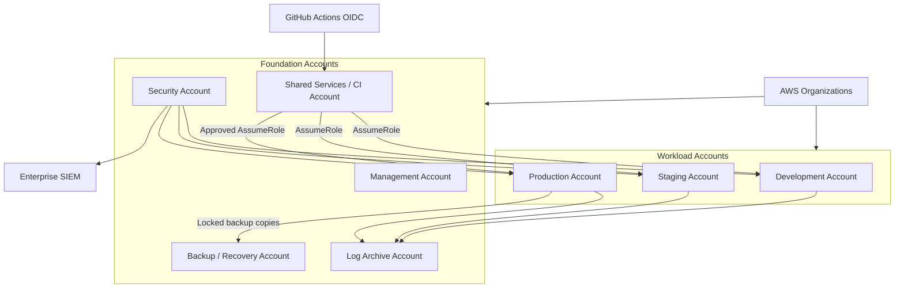
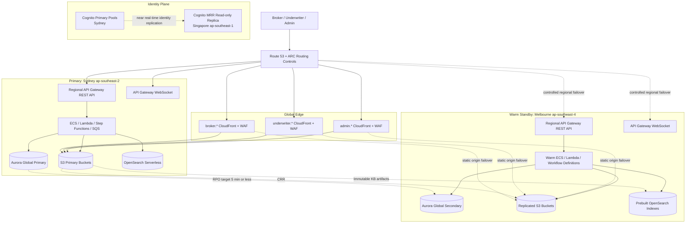
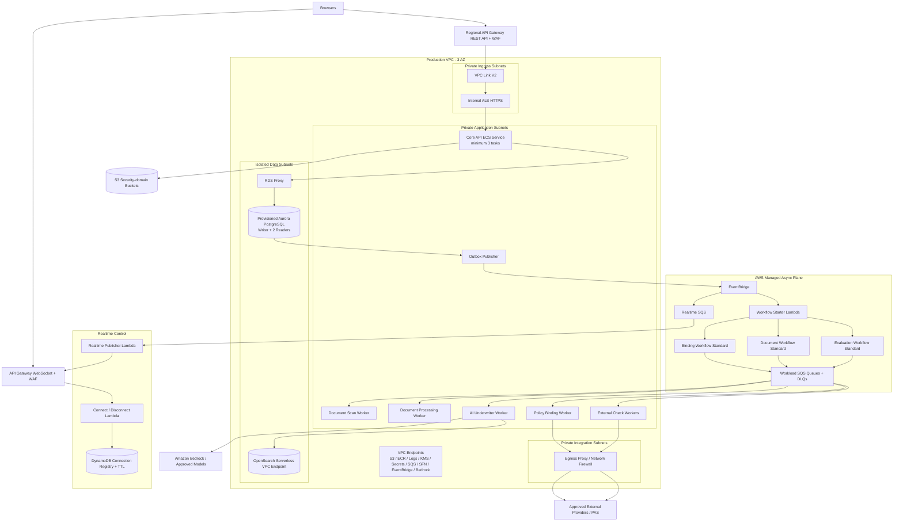

# Prism Production Deployment and Release Architecture

> Document status: confirmed target architecture
>
> Baseline date: 2026-08-05. Region capabilities and service quotas must be revalidated before implementation.
>
> Business scope: Australian SME Professional Indemnity (PI) AI Underwriter Agent
>
> Related documents: [Architecture diagrams](./architecture-diagrams.md) · [Overall production architecture](./architecture.md) · [Backend internal component architecture](./backend-architecture.md) · [Frontend internal component architecture](./frontend-architecture.md)

This document describes the target production environment. It does not mean the current repository already implements every AWS resource. The current code can continue as a demo and incremental implementation base; production deployment must follow the security, isolation, release, and recovery boundaries in this document.

## 1. Deployment Conclusions

Production uses these baselines:

- AWS Organizations multi-account governance with physically separate Development, Staging, and Production.
- Primary business region is Sydney `ap-southeast-2`, deployed across 3 Availability Zones.
- DR region is Melbourne `ap-southeast-4` with at least 2 AZ warm standby.
- Regional disaster target is RTO <= 1 hour and RPO <= 5 minutes.
- Core API is one ECS Fargate modular monolith service. Document, AI, External Check, Binding, and Outbox Workers are independently deployed.
- Long-running workflows use Step Functions Standard and deliver typed tasks to workload-specific Standard SQS queues.
- Aurora PostgreSQL is business truth. S3 stores documents and large artifacts. OpenSearch Serverless is a rebuildable retrieval index.
- The three frontend apps live in one monorepo but have independent S3 buckets, CloudFront distributions, WAF, releases, and rollback.
- GitHub Actions uses OIDC and cross-account short-lived roles. Artifacts are built once and promoted through immutable digests.
- Production regional write failover is authorized by the Incident Commander and executed through automation. Unconditional automatic database failover is not used.
- Code, database, workflow, AI release, and knowledge base versions are versioned separately and released through compatibility gates.

## 2. AWS Accounts and Environment Boundary



| Account            | Responsibility                                                            | Forbidden use                        |
| ------------------ | ------------------------------------------------------------------------- | ------------------------------------ |
| Management         | Organizations, SCPs, account lifecycle, billing                           | application workloads or daily ops   |
| Security           | delegated Security Hub, GuardDuty, Config, Access Analyzer, investigation | product workloads                    |
| Log Archive        | Organization CloudTrail, security logs, long-term immutable logs          | direct application archive mutation  |
| Shared Services/CI | build, scan, sign, ECR/S3 release registry                                | long-lived production credentials    |
| Development        | dev integration and non-sensitive test data                               | production data connection           |
| Staging            | production-like validation, migration rehearsal, AI eval, recovery drills | temporary developer sandbox          |
| Production         | Sydney primary, Melbourne warm standby, Singapore identity replica        | ad hoc console changes               |
| Backup/Recovery    | cross-account locked backups and restore validation                       | business writes from production apps |

Controls:

- Use Control Tower or equivalent Landing Zone for account baselines, SCPs, centralized logs, and config compliance.
- Humans use IAM Identity Center short sessions. Application users never become AWS operators.
- CI/CD does not use IAM User access keys. Break-glass role requires hardware MFA, dual approval, and post-incident audit.
- SCPs prevent disabling CloudTrail, GuardDuty, Config, Public Access Block, and production backup protection.
- Tenant does not map to AWS Account by default. Isolation is enforced in the application layer, database RLS, indexes, object prefixes, and authorization. Dedicated data plane is an exception only for proven contractual or scale requirements.

## 3. Global and Cross-Region Deployment



| Region                     | Mode             | Normal state                                                                     |
| -------------------------- | ---------------- | -------------------------------------------------------------------------------- |
| Sydney `ap-southeast-2`    | Primary          | all production reads/writes, workflows, async tasks                              |
| Melbourne `ap-southeast-4` | Warm Standby     | continuous data replication; core resources deployed; compute minimal or stopped |
| Singapore `ap-southeast-1` | Identity Replica | Cognito MRR replica only, no insurance data plane                                |

Business PII, documents, evaluations, quotes, and policy data remain in Australian regions. Only minimum approved authentication data may replicate to Singapore, subject to privacy, legal, security, vendor, and incident-response controls.

## 4. Sydney Runtime Topology



Public subnets only carry NAT/network boundaries. ECS tasks have no public IP. Aurora sits in isolated data subnets. AWS service access uses VPC Endpoints where available; external providers and PAS use controlled egress.

## 5. Frontend Edge and Identity

The frontend monorepo builds three independent applications:

```text
broker-portal
underwriter-workbench
admin-console
```

Public entry:

```text
prism.example              -> single sign-in / home-realm discovery
broker.prism.example       -> broker-portal
underwriter.prism.example  -> underwriter-workbench
admin.prism.example        -> admin-console
```

Rules:

- The public entry shows one `Sign in`, not unauthenticated portal choices.
- Phase 1 routes directly to Workforce Cognito because only Underwriter is implemented.
- Phase 2 adds Email/Home-realm Discovery to choose Broker or Workforce issuer/app client without leaking account-existence differences.
- After login, Core API `/me` returns allowed portals from trusted membership/role. One portal auto-routes; multiple workforce portals show an authenticated Workspace Selector.
- Route, token claim, or user selection does not grant authorization. Core API authorizes every resource-level action.
- Each app has its own private S3 origin, CloudFront distribution, WAF, CSP, runtime config, release artifact, canary, and rollback path.

## 6. Data, Keys, and Storage

- Aurora, documents, AI artifacts, audit archives, release artifacts, and identity data use separate customer-managed KMS keys.
- Secrets live in Secrets Manager. Dynamic kill switches live in AppConfig. Non-sensitive parameters live in Parameter Store.
- Secrets do not enter Git, images, task definitions, logs, or frontend bundles.
- Aurora uses Multi-AZ, RDS Proxy, PITR, and Global Database.
- Backups copy cross-account to locked vaults and are periodically restore-tested.
- S3 uses versioning, lifecycle, access logging, and cross-region replication where required. Audit archive uses Object Lock.
- PostgreSQL tenant scope is enforced in the application; RLS is defense in depth.

## 7. CI/CD and Release Promotion

```mermaid
flowchart LR
    PR[Pull Request]
    CI[GitHub Actions CI]
    Gates[Quality / Security / Contract / AI Gates]
    Build[Build Once]
    Registry[Immutable Artifact Registry\nECR + S3]
    Manifest[Signed Release Manifest\nDigest + SBOM + Provenance]
    Dev[Development]
    Staging[Staging]
    Prod[Protected Production Promotion]
    Verify[Composite Alarms + Business Journey Verification]
    Rollback[Previous Approved Manifest]

    PR --> CI --> Gates --> Build --> Registry --> Manifest
    Manifest --> Dev --> Staging --> Prod --> Verify
    Verify -. breach .-> Rollback
```



Release principles:

- Build once; promote the same digest through environments.
- GitHub Actions uses OIDC and short-lived AWS roles.
- Production promotion is protected by branch/environment rules and approval.
- Actions are pinned and run with minimum permissions.
- Frontend, Core API, Workers, Database, Workflow, AI release, and KB release are versioned separately.
- Database migration follows expand/backfill/contract.
- Step Functions publishes immutable Versions and routes new executions through Aliases.
- AI releases use shadow mode and human-only canary before broader automation.

## 8. Deployment Strategies

| Component | Strategy                                                                                                   |
| --------- | ---------------------------------------------------------------------------------------------------------- |
| Frontend  | CloudFront staging distribution, header-based internal validation, then canary where traffic is sufficient |
| Core API  | ECS blue/green or canary with health checks, alarms, and rollback                                          |
| Workers   | rolling deployment with circuit breaker, drain, queue-age alarms, and concurrency caps                     |
| Database  | expand/backfill/contract with N/N-1 application compatibility                                              |
| Workflow  | immutable Step Functions Version + Alias; in-flight executions continue original version                   |
| AI/KB     | versioned release manifest, offline eval, shadow, human-only canary, kill switch                           |

Do not rely on simultaneous frontend/backend release to avoid compatibility work.

## 9. Guardrails

Infrastructure guardrails block or require exception for:

- public S3 buckets or public databases;
- ECS tasks with public IPs;
- unencrypted S3, Aurora, SQS, ECR, or Log Groups;
- wildcard IAM `Action: *` or `Resource: *` without exception;
- missing DLQ, alarms, retention, or removal policy;
- production Aurora without deletion protection or PITR;
- queues with visibility timeout lower than worker deadline;
- API Gateway/CloudFront without WAF, TLS, and access logs;
- missing owner, environment, data classification, and cost tags.

Policy exceptions require reason, risk owner, expiry, and compensating control.

## 10. Security Monitoring and Audit

- Organization CloudTrail writes to Log Archive.
- AWS Config Aggregator and conformance packs monitor configuration.
- Security Hub aggregates control findings.
- GuardDuty is enabled in approved regions and delegated to Security account.
- Inspector scans ECR and runtime workloads.
- IAM Access Analyzer detects external access.
- Macie scans sensitive S3 data where justified.
- EventBridge routes high-severity findings to on-call/SIEM.
- Drift detection runs regularly.

CloudTrail is infrastructure security audit. It does not replace CloudWatch runtime observability or application business audit.

## 11. Observability and SLOs

Use ADOT/OpenTelemetry to collect traces into CloudWatch/X-Ray for:

- HTTP, Outbox, EventBridge, Workflow, SQS, Worker, Tool, Model, and Callback;
- stage/attempt duration and error class;
- queue age, DLQ, callback failure, worker saturation;
- model latency, token, cost, throttle, schema/citation/policy failure;
- business journey and SLO burn rate.

High-cardinality IDs are not unbounded metric labels.

Separate:

| Audit/telemetry type | Source                                | Purpose                                      |
| -------------------- | ------------------------------------- | -------------------------------------------- |
| Runtime Telemetry    | CloudWatch/OpenTelemetry              | system health and performance                |
| Infrastructure Audit | Organization CloudTrail               | AWS resource/control-plane changes           |
| Business Audit       | Aurora + Outbox + Object Lock archive | business action, actor, reason, and evidence |

## 12. Disaster Recovery

Failover sequence:

1. Monitoring detects regional health/SLO breach.
2. Incident Commander declares incident and approves failover.
3. Recovery automation fences Sydney writes and stops new workflow starts.
4. Verify Aurora lag and last durable checkpoint.
5. Promote Melbourne Aurora secondary.
6. Enable Melbourne Core API, Workers, and Outbox Publisher.
7. Validate writer, RLS, release compatibility, S3, KB, model, and provider dependencies.
8. Scan incomplete StageExecution and Binding state; mark interrupted attempts and create new attempts.
9. Route authentication to Singapore replica if needed.
10. Shift API/WebSocket traffic through Route 53/ARC.
11. Confirm business journeys and collect RTO/RPO evidence.

Recovery uses Aurora checkpoints as truth. It does not copy Step Functions executions or SQS messages. If AI dependencies are not verified, restore manual underwriting and keep auto-quote disabled.

## 13. Production Readiness Rule

Production deployment is not allowed until:

- Dev and Staging deployments are repeatable from the same digest;
- rollback and restore are tested;
- critical Broker, Underwriter, and Admin journeys are passing;
- security guardrails and alarms are active;
- runbooks have owners;
- data residency, retention, and audit requirements are documented;
- RPO <= 5 minutes and RTO <= 1 hour are evidenced through a drill.
