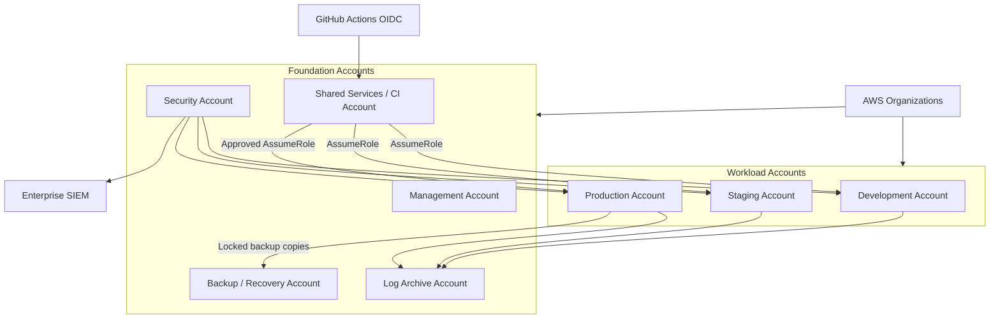
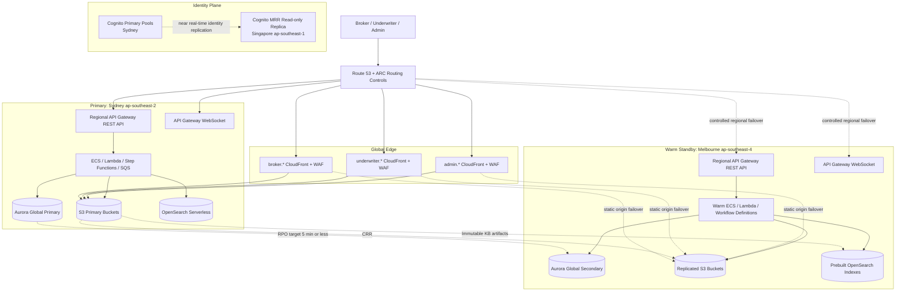
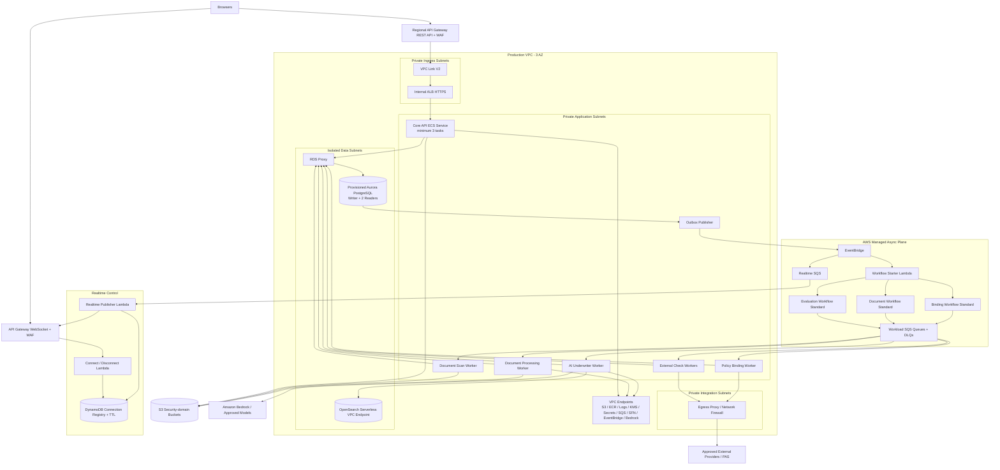

# Prism 生产部署与发布架构

> 文档状态：已确认的目标架构（Target Architecture）
>
> 基准日期：2026-08-05；区域能力和服务配额在实施前必须重新核验
>
> 业务范围：澳大利亚 SME Professional Indemnity（PI）AI Underwriter Agent
>
> 相关文档：[Mermaid 架构图集](./architecture-diagrams.md) · [总体生产架构](./architecture.md) · [后端内部组件架构](./backend-architecture.md) · [前端内部组件架构](./frontend-architecture.md)

本文描述目标生产环境，不代表当前 repo 已经实现所有 AWS 资源。当前代码可以继续作为演示和增量实现基础；生产部署必须以本文的安全、隔离、发布和恢复边界为准。

## 1. 部署结论

生产部署采用以下基线：

- AWS Organizations 多账户治理；Development、Staging 和 Production 物理隔离。
- 业务主区域为悉尼 `ap-southeast-2`，跨 3 个 Availability Zone。
- 灾备区域为墨尔本 `ap-southeast-4`，采用至少 2 AZ 的 Warm Standby。
- 区域灾难目标为 RTO ≤ 1 小时、RPO ≤ 5 分钟。
- Core API 是一个 ECS Fargate 模块化单体服务；Document、AI、External Check、Binding 和 Outbox Worker 独立部署。
- 长流程由 Step Functions Standard 编排，通过工作负载专用 Standard SQS Queue 向 Worker 投递类型化任务。
- Aurora PostgreSQL 是业务事实；S3 是文档和大型产物存储；OpenSearch Serverless 是可重建的检索索引。
- 三个前端应用位于同一 Monorepo，但具有独立 S3 Bucket、CloudFront Distribution、WAF、发布和回滚。
- GitHub Actions 使用 OIDC 和跨账户短期角色；制品只构建一次，以不可变 Digest 逐级晋级。
- 生产写流量的区域切换由 Incident Commander 授权，恢复动作自动化；不使用无条件全自动数据库 Failover。
- 代码、数据库、Workflow、AI Release 和 Knowledge Base 各自版本化，并通过兼容性门禁组合发布。

## 2. AWS 账户与环境边界



### 2.1 账户职责

| 账户               | 职责                                                            | 禁止事项               |
| ------------------ | --------------------------------------------------------------- | ---------------------- |
| Management         | Organizations、SCP、账户生命周期和结算                          | 承载应用或日常运维     |
| Security           | Security Hub、GuardDuty、Config、Access Analyzer 委派管理与调查 | 运行产品工作负载       |
| Log Archive        | Organization CloudTrail、安全日志和长期不可变日志               | 应用直接修改归档       |
| Shared Services/CI | 构建、扫描、签名、ECR/S3 Release Registry                       | 持有生产长期凭证       |
| Development        | 开发集成和非敏感测试数据                                        | 连接生产数据           |
| Staging            | 生产等价验证、迁移演练、AI Eval 和恢复演练                      | 作为临时开发环境       |
| Production         | 悉尼主区、墨尔本 Warm Standby 和新加坡身份副本                  | 人工控制台随意变更     |
| Backup/Recovery    | 跨账户锁定备份和恢复验证                                        | 被生产应用写入业务数据 |

### 2.2 账户控制

- 使用 Control Tower 或等价 Landing Zone 建立账户基线、SCP、集中日志和配置合规。
- 人员通过 IAM Identity Center 使用短时 Session；应用用户身份不进入 AWS 操作员身份系统。
- 禁止 IAM User Access Key 用于 CI/CD；Break-glass Role 使用硬件 MFA、双人授权和事后审计。
- SCP 阻止关闭 CloudTrail、GuardDuty、Config、Public Access Block 和生产备份保护。
- Tenant 默认不映射为 AWS Account；数据和权限在应用层、数据库 RLS、索引及对象前缀中隔离。只有合同或规模证明需要时才提供 Dedicated Data Plane。

## 3. 全球与跨区域部署



### 3.1 区域职责

| 区域                       | 模式             | 正常状态                                             |
| -------------------------- | ---------------- | ---------------------------------------------------- |
| Sydney `ap-southeast-2`    | Primary          | 承载全部生产读写、Workflow 和异步任务                |
| Melbourne `ap-southeast-4` | Warm Standby     | 数据持续复制；核心资源已部署，计算保持最小或停止状态 |
| Singapore `ap-southeast-1` | Identity Replica | 仅作为 Cognito MRR 副本，不承载保险业务数据面        |

业务 PII、文档、评估、报价和保单数据保持在澳大利亚区域。允许复制到新加坡的是经过隐私、法务和安全批准的最少身份认证数据。该跨境处理必须纳入数据处理记录、供应商评估和事件响应范围。

## 4. 悉尼生产区域运行时拓扑



### 4.1 网络分层

- 每个环境、每个区域使用独立 VPC；初期不引入共享 VPC、Transit Gateway 或 Service Mesh。
- Public Subnet 只承载 NAT Gateway 和必要的网络边界资源，不承载应用任务。
- Private Ingress Subnet 承载 VPC Link ENI 和 Internal ALB。
- Private Application Subnet 承载 Core API、Worker 和 Outbox Publisher。
- Private Integration Subnet 隔离需要访问互联网或合作方的 Connector。
- Isolated Data Subnet 不配置直接互联网路由，只允许指定 Security Group 访问 Aurora 和 OpenSearch Endpoint。
- Production 每 AZ 一个 NAT Gateway；非生产可以在接受 AZ Egress 单点风险的情况下共享一个 NAT。
- AWS 服务优先通过 VPC Endpoint 访问；外部访问经过 Network Firewall/Egress Proxy、域名/IP Allowlist 和审计日志。
- Security Group 使用 SG-to-SG 引用，不以整个 VPC CIDR 开放数据库端口。
- 不部署 Bastion Host；生产诊断使用受审计的 ECS Exec/SSM，并默认关闭或按事件临时启用。

## 5. Edge、前端与实时连接

### 5.1 独立前端应用

| 应用                  | 域名示例                    | Origin  | 身份客户端                 | 发布边界      |
| --------------------- | --------------------------- | ------- | -------------------------- | ------------- |
| Broker Portal         | `broker.prism.example`      | 私有 S3 | Broker Cognito App Client  | 独立          |
| Underwriter Workbench | `underwriter.prism.example` | 私有 S3 | Workforce App Client       | 独立          |
| Admin Console         | `admin.prism.example`       | 私有 S3 | Workforce Admin App Client | 独立、Step-up |

- 每个应用使用独立 S3 Bucket、CloudFront Primary/Staging Distribution、WAF、CSP、Cache Policy 和发布流水线。
- S3 只允许 CloudFront Origin Access Control 读取；全面开启 Public Access Block 并禁用 ACL。
- Hash JS/CSS 使用长期 `immutable` Cache；`index.html` 与 `runtime-config.json` 使用短缓存或 `no-cache`。
- Source Map 不公开；如需错误符号化，上传到受限的错误分析存储。
- Monorepo 只是源码和共享包治理方式，不意味着三个应用统一部署。

### 5.2 API 与 WebSocket

- `api.prism.example` 指向 Regional API Gateway REST API；区域 WAF 位于 API Gateway 前。
- API Gateway 通过 VPC Link V2 和 Internal ALB 访问 Core API，ECS Task 没有 Public IP。
- `ws.prism.example` 指向独立 API Gateway WebSocket API。
- REST 生成一次性、短时 Realtime Ticket；浏览器不用在 WebSocket URL 中暴露长期 Access Token。
- `$connect`/`$disconnect` Lambda 管理 DynamoDB TTL Connection Registry。
- WebSocket 只发送状态变化提示和 Sequence，不承载业务 Command 或完整业务事实。
- 客户端收到通知后失效缓存并通过 REST 重新获取权威 Projection；断线时使用带抖动的轮询恢复。

## 6. Compute 与异步任务边界

### 6.1 ECS 服务

每个环境/区域使用一个 ECS Fargate Cluster，但服务、Task Role、Security Group、Queue 和伸缩策略独立：

```text
core-api
document-scan-worker
document-processing-worker
ai-underwriter-worker
external-check-worker-<provider>
policy-binding-worker
outbox-publisher
```

- Core API 在生产正常状态下至少运行 3 个 Task，并通过 AZ Spread 分布。
- Core API 根据 ALB Request Count、CPU、内存和延迟扩缩容。
- Worker 根据 Queue Backlog per Task、Oldest Message Age、p95 Task Duration 和下游配额扩缩容。
- Autoscaling 的最大值受 Aurora Connection Budget、Bedrock/Provider Quota 和租户公平性约束。
- 容器镜像使用 Digest Pinning、非 Root 用户、Read-only Root Filesystem、最小 Linux Capability 和显式 Health Check。
- Task 使用独立 IAM Role；不得共享一个“万能 Worker Role”。
- 所有任务无 Public IP，通过 VPC Endpoint 或受控 Egress 访问依赖。

### 6.2 Queue 与 Callback

- 每种工作负载使用独立 Standard SQS Queue 和 DLQ；不默认使用 FIFO。
- FIFO 只在确有同一业务键严格顺序要求且吞吐权衡被接受时引入。
- Task Envelope 包含 `taskType`、`schemaVersion`、业务引用、Attempt、Deadline、Idempotency Key 和 Task Token。
- 消息不携带完整文档、Prompt 或 AI 结果。
- Worker 从 Aurora 重新验证 Tenant、Submission、Evaluation、状态和 Deadline。
- Worker 先幂等持久化不可变 Result，再 Callback Step Functions，并记录 Callback 投递状态。
- DLQ 不自动无限 Redrive；修复原因后使用原 Idempotency Key 执行审计化重放。
- Step Functions 承担业务级 Retry；SDK 只执行短暂网络重试，避免重试层叠。

## 7. 数据部署

### 7.1 Aurora PostgreSQL

悉尼使用 Provisioned Aurora PostgreSQL：

- AZ-A Writer、AZ-B 首选 Failover Reader、AZ-C 第二 Reader。
- RDS Proxy 提供 Writer 和 Read-only Endpoint；Core API 和 Worker 使用小型、受限连接池。
- 初始 `MaxConnectionsPercent` 以约 70% 为上限，保留约 30% 给迁移、故障恢复和运维；最终数值由负载测试校准。
- Command、Read-your-write 和强一致读取访问 Writer；可容忍延迟的 Projection/Report 访问 Reader。
- Tenant RLS Context 使用事务级 `SET LOCAL`，避免在池化连接中残留 Session 状态。
- 启用 TLS、Customer-managed KMS Key、Deletion Protection、35 天 PITR 和自动备份。
- Aurora Global Database 将数据复制到墨尔本 Secondary，并监控 Replication Lag。
- 关键备份复制到独立 Backup/Recovery Account，并定期执行 Restore Test。

### 7.2 S3 安全域

使用独立 Bucket 或等价强隔离 Access Point/Policy 管理以下安全域：

```text
frontend-broker
frontend-underwriter
frontend-admin
document-quarantine
document-originals
document-derived-artifacts
knowledge-release-artifacts
ai-evaluation-artifacts
business-audit-archive
access-and-security-logs
```

- Quarantine 只允许上传和扫描组件访问，不允许 OCR/AI 读取，不复制到灾备区域，并设置短生命周期。
- Originals 使用不可变版本 Key，不在文件名中包含 PII；启用 Versioning、KMS 和严格 Access Point。
- Derived Artifacts 保存 OCR、布局、证据和受控模型产物，使用更细的读取权限。
- Knowledge 与 AI Eval Artifact 与客户文档分离发布。
- Business Audit Archive 跨账户写入启用 Object Lock 的 Bucket。
- 可信任且恢复必需的 Originals、Derived、KB Artifact 和前端 Release 使用 S3 CRR 到墨尔本。
- 不使用 S3 Multi-Region Access Point 自动选择写区域；故障切换后由 API 明确签发墨尔本上传会话。
- `ObjectCreated` 只是技术事件；开始业务处理前必须验证 Upload Session、Key、Tenant、Size、Checksum 和扫描状态。

### 7.3 OpenSearch Serverless

每个区域建立两个私有 Collection：

- `underwriting-kb-vector`：只保存批准的 Tenant/Product/KB Release 检索数据。
- `business-search`：服务 Case、Audit 和运营搜索，不能被 AI 当作权威知识源。

Collection 通过 VPC Endpoint、KMS、Network Policy、IAM/Data Access Policy 保护，浏览器不得直连。每个 Tenant/Product/KB Release 使用不可变索引和 Active Alias。OpenSearch Serverless 不作为交易事实，也不假设自动跨区域复制；Release Pipeline 从不可变 S3 Artifact 在悉尼和墨尔本分别构建、评测并激活索引。

## 8. 身份部署与容灾

### 8.1 身份池边界

- Broker 使用独立 Cognito User Pool，支持原生或经过批准的联合身份。
- Underwriter/Admin 使用 Workforce Cognito User Pool，并与 Tenant/企业 SAML/OIDC IdP 联合。
- Underwriter 与 Admin 使用不同 App Client、Redirect URI、Scope 和 Session Policy；Admin 高风险操作要求 Step-up Authentication。
- SPA 使用 Authorization Code + PKCE，属于 Public Client，不保存 Client Secret。
- API Gateway Route Group 使用对应 Authorizer；最终资源授权由 Core API 根据 Aurora Membership、Appointment 和 Authority 重建。
- AWS 操作员使用 IAM Identity Center，与应用身份完全分离。

### 8.2 跨区域身份

截至本文基准日期，Cognito Multi-Region Replication 的可用区域包含悉尼和新加坡，但不包含墨尔本。因此：

- Broker 和 Workforce Pool 以悉尼为 Primary，以新加坡为 MRR Read-only Replica。
- `auth-broker.prism.example` 和 `auth-workforce.prism.example` 使用独立自定义域名；受控 DNS/健康检查将认证流量切到副本。
- 使用 Essentials/Plus Tier、Multi-Region KMS Key 和 Multi-Region OIDC Issuer。
- 区域 SES/SNS、Lambda Trigger、WAF 和日志配置必须在副本侧独立部署和测试。
- 灾备期间已有用户可继续认证；新用户注册、密码重置和 Profile 修改暂停。
- Workforce MFA 优先由上游 Enterprise IdP 执行；所有 MFA 方法必须纳入实际 Failover 测试。
- API Token Validator 信任批准的 Multi-Region Issuer/JWKS，而不是写死单一区域 Endpoint。
- 身份 Failover 与业务区域 Failover 受同一 Incident Runbook 管理。

如果 AWS 后续支持 Sydney→Melbourne Cognito MRR，应重新执行隐私、功能和故障演练评估，再决定是否把身份副本迁回澳大利亚；不得静默改变身份数据位置。

## 9. KMS、Secrets、证书与运行配置

### 9.1 密钥边界

- Development、Staging、Production 使用完全独立的密钥和 Key Policy。
- Aurora、Document、OpenSearch、Audit、Release Artifact 和 Identity 使用不同 Customer-managed KMS Key。
- 默认使用区域 Key；只有 Cognito MRR 等明确需要跨区域相同密钥材料的能力使用 Multi-Region KMS Key。
- Key Administrator 与 Key User 分离；应用 Role 只有所需的 Encrypt/Decrypt/Data Key 权限。
- Production Key 开启删除等待期、监控和变更审批；禁止应用角色 ScheduleKeyDeletion。
- CloudTrail 记录 KMS 管理和使用事件；异常 Decrypt、跨区域或跨账户调用触发告警。

### 9.2 Secret 与配置

| 数据                    | 存储                         | 发布方式                               |
| ----------------------- | ---------------------------- | -------------------------------------- |
| 数据库、第三方 API 凭证 | Secrets Manager              | 自动或受控轮换；灾备必需项复制到墨尔本 |
| 非敏感环境配置          | SSM Parameter Store/CDK 参数 | 随环境部署                             |
| 动态开关、Kill Switch   | AWS AppConfig                | 验证器、分阶段发布、自动回滚           |
| 前端非敏感配置          | `runtime-config.json`        | 独立签名/校验发布                      |
| Product/Rules/Prompt/KB | Configuration Release Store  | 不可变业务发布流程                     |

- Secret 不进入 Git、容器镜像、普通日志、前端 Bundle 或明文 Terraform/CDK Context。
- ECS 通过 Task Role 在启动或运行时读取 Secret；Secret 值不写入 Task Definition 明文。
- 支持轮换的数据库和供应商凭证自动轮换；不支持自动轮换的凭证进入带 Owner、Expiry 和审批的手动流程。
- CloudFront 的 ACM 证书部署在 `us-east-1`；Regional API/WebSocket 证书分别部署到悉尼和墨尔本。
- Route 53 Zone、Certificate Validation 和域名所有权由 Edge Stack 管理，应用 Stack 不直接修改 DNS 根权限。

## 10. Infrastructure as Code

基础设施使用 AWS CDK TypeScript 和 CloudFormation。CDK 与应用共用 TypeScript 工具链，但保持独立 Package、依赖和部署权限。

```text
infra/
├── organization/       # Organizations、SCP、账户基线
├── bootstrap/          # 账户/区域 CDK Bootstrap
├── network/            # VPC、Subnet、Endpoint、NAT、Firewall
├── security/           # KMS、基础 IAM、Secrets、WAF
├── data/               # Aurora、RDS Proxy、S3、OpenSearch
├── compute/            # ECS、Core API、Workers、Lambda
├── workflows/          # Step Functions、SQS、DLQ、EventBridge
├── identity/           # Cognito、Federation、Identity DR
├── edge/               # Route 53、CloudFront、API Gateway、ACM
├── observability/      # Logs、Metrics、Alarms、Dashboards
└── recovery/           # Melbourne Warm Standby 和恢复资源
```

规则：

- 每个账户/区域独立 Stack，不创建跨区域巨型 Stack。
- Network、Data、Compute、Workflow 和 Edge 按生命周期与 Blast Radius 分离。
- Stack 之间仅传递少量稳定接口；避免隐式循环 CloudFormation Export。
- Production 部署必须先生成、审查和批准 Change Set。
- `cdk-nag` 和组织 Policy-as-Code 阻止公共 S3、未加密存储、过宽 IAM 和开放管理端口。
- Drift Detection 定期执行；生产控制台变更必须被检测、解释并回写 IaC 或撤销。
- CDK Bootstrap Role 按账户、环境和动作最小化，不允许 Development Pipeline Assume Production Role。

## 11. CI/CD 与不可变制品

```mermaid
flowchart LR
    PR[Pull Request]
    CI[GitHub Actions CI]
    Gates[Tests / Contracts / SAST / IaC / AI Evals]
    Build[Build Once]

    subgraph Registry[Shared Services Account]
        ECR[ECR Immutable Images]
        Artifacts[S3 Release Artifacts]
        Manifest[Signed Release Manifest + SBOM]
    end

    Dev[Deploy Development]
    DevTest[Integration / E2E]
    Stage[Promote Same Digests to Staging]
    StageTest[Migration / Load / DR / AI Gates]
    Approval[Production Protected Environment\nTwo-person approval where required]
    Prod[Deploy Production]
    Verify[Canary / Bake / Automated Alarms]
    Rollback[Previous Approved Manifest]

    PR --> CI --> Gates --> Build
    Build --> ECR
    Build --> Artifacts
    ECR --> Manifest
    Artifacts --> Manifest
    Manifest --> Dev --> DevTest --> Stage --> StageTest --> Approval --> Prod --> Verify
    Verify -. alarm .-> Rollback
```



### 11.1 权限模型

- GitHub Actions 使用 OIDC 获取短期凭证，不保存 AWS Access Key。
- PR Workflow 只执行测试、扫描和只读 Plan，不能部署生产。
- 构建 Workflow 只能 Assume Shared Services Build Role。
- Dev、Staging 和 Production 提供独立的 Deployment Role；Production Role 只能由受保护 Environment 和批准 Workflow 使用。
- CDK Plan/Change Set Role 与 Apply Role 分离。
- 必须访问私有数据库的迁移和测试由目标账户中的临时 CodeBuild Job 或 ECS Task 执行，不开放数据库到 GitHub Runner。
- GitHub Action 固定到 Commit SHA；第三方 Action 纳入 Allowlist 和依赖更新流程。
- CloudTrail 事件必须能关联 Git Commit、Release ID、Workflow Run 和审批人。

### 11.2 Build Once, Promote Many

一个 Git Commit 只生成一次制品：

- Core API 和每个 Worker 分别生成 OCI Image，并使用 `sha256` Digest 部署。
- 每个前端应用生成独立不可变 Bundle；环境差异由无 Secret 的 Runtime Config 提供。
- Lambda ZIP、Migration Bundle、State Machine Definition 和 CDK Cloud Assembly 使用同一 Release ID。
- 制品进入 Shared Services 的 ECR/S3 Registry，附带 SBOM、测试证据、漏洞报告、签名和 Provenance。
- Dev→Staging→Production 晋级同一 Digest；禁止按环境重新 Build。
- Production Approval 对明确的 Signed Release Manifest 生效，不对 `main`、`latest` 或可移动 Tag 生效。
- 回滚重新部署上一份已批准 Manifest；Hotfix 必须生成新 Manifest，不能修改已有制品。

## 12. 发布策略

### 12.1 前端

每个前端应用独立使用不可变 S3 Release Prefix：

```text
releases/<release-id>/index.html
releases/<release-id>/runtime-config.json
releases/<release-id>/assets/<content-hash>.js
```

发布顺序：

1. 上传新 Release Prefix，不覆盖现有对象。
2. CloudFront Staging Distribution 指向新 Prefix。
3. 使用 `aws-cf-cd-*` 测试 Header 执行内部 Smoke/E2E。
4. Broker Portal 使用 Session Stickiness 依次切入 1%、5%、15% 流量。
5. 低流量的 Underwriter/Admin 使用指定内部 Cohort 和业务验证，不依赖无统计意义的随机 1%。
6. RUM、JS Error、API Failure、CSP 和关键 Journey 越界时终止灰度。
7. 验证完成后 Promote Staging Distribution；保留前几个 Release 以便回滚。

CloudFront Continuous Deployment 权重上限为 15%；从 Canary 到全量通过 Promote 完成。前端新版本必须兼容当前和上一版 API Contract。

### 12.2 Core API

Core API 使用 ECS 原生 Canary/Blue-Green：

- Internal ALB 配置 Primary/Alternate Target Group 和受限 Test Listener。
- Green Task 使用固定 Image Digest；先完成 Readiness、数据库兼容、鉴权、Contract 和受控写入测试。
- 10% 生产流量切至 Green，经过观测窗口后切换 100%。
- CloudWatch Composite Alarm 监控 5xx、延迟、Command Failure、数据库错误和业务不变量。
- 任何阻断 Alarm 触发自动切回 Blue；Blue 在 Bake Time 内保留。
- 新旧 Task 并存时必须支持同一个 Expanded Schema 和 N/N−1 API/Event Contract。

### 12.3 Worker

Worker 使用 Rolling Deployment：

- `minimumHealthyPercent=100`、`maximumPercent=200`，启用 Deployment Circuit Breaker 和自动回滚。
- 新 Worker 在 Staging 使用生产脱敏回放集和故障注入验证。
- 收到 `SIGTERM` 后停止领取消息，完成或安全释放当前任务，再退出。
- Visibility Timeout、Heartbeat 和 Callback Retry 必须覆盖部署期间的长任务。
- 新旧 Worker 短期并存，因此 Task Schema 和 Result Schema 支持 N/N−1。
- Breaking Contract 使用新 `taskType` 或新 Queue；旧 Worker 保留到没有旧 Workflow/Task。

### 12.4 数据库

数据库采用 `Expand → Deploy → Backfill → Switch → Contract`：

- Migration 由 VPC 内一次性 ECS Task 使用独立 Schema Owner Role 执行。
- PostgreSQL Advisory Lock 保证一次只有一个 Migration Runner。
- 应用启动时禁止自动执行 DDL。
- Expand 只增加兼容表、列、索引或约束；大索引使用在线/并发方式并设置 Lock Timeout。
- Backfill 使用分批、限流、带 Checkpoint 的独立 Job，不在一个超长事务内处理整表。
- Feature Flag 控制新读路径；必要的短期双写有一致性指标和明确删除期限。
- Contract 至少等待一个完整发布与回滚窗口，并单独审批破坏性变更。
- Snapshot/PITR 是最后防线，不是普通 Deployment Rollback 机制；数据变更失败优先 Stop/Forward Fix。

## 13. Workflow 与 AI Release 兼容

### 13.1 Step Functions Version/Alias

- 每次 Workflow 发布创建不可变 State Machine Version。
- Core API/Workflow Starter 只通过 `PROD` Alias 启动，不调用未限定 Revision。
- `CANDIDATE` Alias 执行内部和合成案件；验证后 `PROD` 可在两个版本间为新 Execution 灰度。
- Evaluation 保存实际 Workflow Version ARN 和 Release ID。
- 已启动 Execution 继续原版本；Alias 回滚只影响之后启动的案件。
- Workflow Version 和对应 Worker Contract 保留到没有活跃 Execution，包括等待 Human Review 的长流程。

Task Envelope 至少包含：

```json
{
  "taskType": "ai.evaluate",
  "schemaVersion": 2,
  "workflowVersion": 7,
  "stageExecutionId": "...",
  "attemptId": "...",
  "idempotencyKey": "...",
  "deadline": "...",
  "inputRef": "...",
  "taskToken": "..."
}
```

Task Token 视为敏感凭证：不进入普通日志、Trace Attribute 或业务 Audit；Callback 只返回 Result Reference、Hash 和状态。

### 13.2 AI Release

AI 资产不随容器镜像隐式改变。每次 Evaluation 固定一个不可变 Manifest：

```text
EvaluationReleaseManifest
├── agentGraphVersion
├── promptPackageVersion
├── toolSchemaVersion
├── modelRoutingPolicyVersion
├── underwritingRuleSetVersion
├── knowledgeBaseReleaseId
├── safetyPolicyVersion
└── evaluationThresholdVersion
```

发布路径为：

```text
Draft
→ Static Validation
→ Offline Evaluation
→ Security / Prompt-Injection Tests
→ Shadow
→ Human-Review-Only Canary
→ Underwriting + AI Risk Approval
→ Active
```

- Prompt、Rule、Tool Schema 和 Model Routing Policy 进入 Git/Release Registry，禁止在生产控制台直接修改。
- AI Release 可按 Tenant/Product 激活，不进行无范围的全局切换。
- Shadow 结果不影响真实业务；Canary 输出强制 Human Review。
- Fallback Model 必须提前完成同任务、同地区、同安全策略的批准和评测。
- 回滚只影响新 Evaluation；严重问题通过 Kill Switch 暂停自动评估并转人工，不在执行中静默换模型。
- AI/Engineering Owner 与 Underwriting Risk Owner 双重批准，并保留 Eval Dataset、指标、Diff、批准人和原因。

## 14. Observability、安全监控与审计

### 14.1 可观测性平面

- ADOT/OpenTelemetry 统一采集 ECS、Lambda、API 和 Worker 的 Metric、Log 与 Trace。
- CloudWatch Metrics/Logs/Dashboards/Alarms 与 X-Ray/ServiceLens 提供区域运行观测。
- CloudWatch Synthetics 从外部验证登录、API、提交、案件读取和灾备 Endpoint。
- Trace 贯穿 `requestId → evaluationId → stageExecutionId → attemptId → modelInvocationId`。
- Error 和高风险 Command 100% 保留；普通 Trace 按风险和流量采样。
- Tenant/Product/Release 可作为受控维度；Submission 等高基数标识只进入受限 Trace/Log，不作为无界 Metric Label。

普通日志不得包含 JWT、Task Token、Secret、完整 Prompt、文档正文、模型原始响应或不必要 PII。需要保留的 AI 内容写入独立加密 Artifact Store，并使用更严格访问和保留策略。

### 14.2 安全监控

- Organization CloudTrail、Config、GuardDuty、Security Hub、Inspector、Access Analyzer 和 Macie 汇总到 Security Account。
- Organization Log 和访问日志写入 Log Archive Account 的不可变 S3。
- 安全事件输出到企业 SIEM；告警包含 Owner、Severity、Runbook 和升级路径。
- 业务 Audit 由应用事务/Outbox 产生，跨账户归档到 Object Lock；日志不能替代业务审计事实。
- 生产日志访问使用独立只读调查角色，并审计查询和导出。

必须覆盖的告警：

| 层级     | 关键信号                                                                              |
| -------- | ------------------------------------------------------------------------------------- |
| Edge/API | WAF Block 异常、Auth Failure、5xx、p95/p99、Command Failure                           |
| Async    | Queue Age、Backlog、DLQ、Workflow Failed/TimedOut、Callback Delay、Outbox Lag         |
| Data     | Aurora Connection/Lock/Storage/Replica Lag、OpenSearch Error/Release Drift            |
| AI       | Model Timeout/Throttle/Fallback、Token/Cost、Citation Coverage、Abstention、Injection |
| Business | Auto-quote、RFI、Referral、Human Override、Binding Failure 的异常变化                 |
| Security | 跨租户尝试、异常 Decrypt、Secret Access、公开资源、恶意文档和数据外传信号             |

## 15. 容量、配额与成本保护

以下是架构验证基线，不是永久业务预测：

| 指标                          |            基线 |
| ----------------------------- | --------------: |
| Carrier/MGA Tenant            |              20 |
| Brokerage                     |           2,000 |
| Broker/Underwriter/Admin 用户 |          25,000 |
| 年 Submission                 |         250,000 |
| API 峰值                      |         300 RPS |
| Submission 短时峰值           |            2/秒 |
| 同时运行 Evaluation           |             100 |
| 平均文档                      |    8/Submission |
| 单文档上限                    |          100 MB |
| 单 Submission 文档总量        |          500 MB |
| 正常容量验证                  | 预期峰值的 2 倍 |
| 短时保护验证                  | 预期峰值的 5 倍 |

保护规则：

- API、Upload Session、Workflow Start、Model 和 External Provider 分别执行 Tenant/Workload Quota。
- 初期不为每个 Tenant 建 Queue；共享工作负载 Queue 配合应用 Token Bucket 和公平调度。
- 大型 Tenant 在真实 Noisy-neighbor 数据证明需要时升级为 Dedicated Queue/Worker Pool。
- Worker 最大并发同时受数据库连接、Provider Quota、成本预算和区域容量限制。
- 每个 Evaluation 有最大模型调用数、Token、Deadline 和 Cost Budget。
- Tenant 日/月 AI Budget 超限时告警并进入人工或 Operational Hold，禁止无限重试消费。
- 过载时优先保护 Submission 持久化、案件读取、人工核保和 Binding 对账；Analytics、通知和非关键重建延后。
- 上线前通过 Service Quotas/供应商合同申请足够的 API、Bedrock、SES/SNS 和并发额度。
- 成本按 Tenant、Product、Evaluation、Document Pipeline 和 Model 分摊，并对异常 Unit Cost 告警。
- 每季度使用真实流量、文档大小、模型延迟和人工路径重新校准基线。

## 16. 区域故障切换与回切

### 16.1 原则

- 故障检测和通知自动化；生产写流量切换必须由 Incident Commander 授权。
- 先建立 Write Fence，再提升数据库和开放流量，防止 Split Brain。
- Aurora、S3 和业务 Checkpoint 恢复业务事实；不尝试复制 Step Functions Execution 或 SQS Message。
- API 可恢复不等于 AI 可自动报价；每个模型、KB 和外部依赖必须独立通过 DR Readiness Check。
- 如果 AI Data Plane 不完整，恢复案件查看和 Human Underwriting，但保持 Auto-quote Kill Switch 关闭。

### 16.2 Failover 时序

```mermaid
sequenceDiagram
    participant Mon as Monitoring
    participant IC as Incident Commander
    participant Ctrl as Recovery Automation / ARC
    participant Syd as Sydney Workloads
    participant DB as Aurora Global Database
    participant Mel as Melbourne Workloads
    participant Rec as Workflow Recovery
    participant Id as Cognito Singapore Replica
    participant DNS as Route 53 / ARC

    Mon->>IC: Regional health and SLO breach
    IC->>Ctrl: Declare incident and approve failover
    Ctrl->>Syd: Fence writes and disable workflow starts
    Ctrl->>DB: Verify replication lag and last checkpoint
    Ctrl->>DB: Promote Melbourne secondary to writer
    Ctrl->>Mel: Enable Core API, workers and outbox publisher
    Mel->>DB: Validate writer, RLS and release compatibility
    Ctrl->>Rec: Rebuild unfinished stages from Aurora checkpoints
    Rec->>DB: Create new attempts with original idempotency identity
    Ctrl->>Mel: Validate S3, KB, models, providers and binding
    Ctrl->>Id: Activate identity failover; keep identity writes paused
    Ctrl->>DNS: Shift API and WebSocket traffic to Melbourne
    Mon->>IC: Confirm business journey and RTO/RPO evidence
```

### 16.3 Write Fence 与 Workflow 恢复

- Core API Command 在事务内验证 `activeRegion`/`regionEpoch`；Standby 默认拒绝业务写入。
- Failover Runbook 禁用悉尼 Workflow Starter/Worker，并撤销或隔离旧 Writer 路径。
- 提升后的墨尔本数据库更新 Region Epoch，只有匹配新 Epoch 的服务才能提交 Command。
- Recovery Scanner 读取 Aurora 中未完成的 Evaluation、StageExecution、HumanReviewTask 和 Binding 状态。
- 悉尼 `RUNNING` Attempt 标记为 `REGION_INTERRUPTED`；Recovery 创建新 Attempt，不覆盖历史记录。
- 原 Callback Token 不复用；墨尔本 Workflow 根据持久化 Checkpoint 创建新的等待和 Task。
- Result Acceptance 使用稳定业务 ID、Attempt 和 Hash，确保重复消息或迟到结果不能造成第二次业务效果。
- Outbox Consumer 通过 `eventId` 幂等恢复；未知外部 Binding Outcome 先查询 PAS，再决定继续、补偿或人工对账。

### 16.4 Failback

- 墨尔本恢复后作为临时 Primary 运行到事件关闭和数据完整性确认。
- 悉尼恢复时先作为新的 Global Database Secondary 重新同步，不立即接收写流量。
- 完成数据校验、Workflow Drain、容量验证和变更冻结后，在计划窗口执行受控 Switchover。
- Failback 采用与 Failover 相同的 Write Fence、Region Epoch、验证和审计步骤。
- 每季度执行组件恢复测试，每半年执行完整区域切换演练；演练记录实际 RTO、RPO、数据差异和改进项。

## 17. SLO 与发布/运行门禁

| 范围                   | 目标/门禁                  |
| ---------------------- | -------------------------- |
| Core API 可用性        | 99.9% monthly              |
| 普通查询               | p95 ≤ 500 ms               |
| Submit API             | p95 ≤ 2 s                  |
| Fast Path Evaluation   | p50 ≤ 30 s，p95 ≤ 2 min    |
| Standard Document Path | p95 ≤ 5 min                |
| 大型/依赖受限 Case     | p95 ≤ 15 min               |
| WebSocket 通知         | p95 ≤ 5 s；REST 始终可恢复 |
| Critical Outbox 发布   | p95 ≤ 60 s                 |
| 区域灾难               | RTO ≤ 1 h，RPO ≤ 5 min     |

Human Review、Broker RFI 等待和外部人工响应不计入自动处理 SLO，但必须有独立 Business SLA。SLO 不能成为跳过证据、Authority、人工复核或安全控制的理由。

生产发布至少需要：

```text
Code + Contract + Migration + Security Gates
+ Staging E2E and Capacity Evidence
+ AI/KB Evaluation Evidence when affected
+ Signed Release Manifest
+ Required Human Approval
+ Rollback and Runbook Readiness
```

## 18. 运行责任与上线门禁

| 能力             | 主要 Owner                         | 上线前证据                                      |
| ---------------- | ---------------------------------- | ----------------------------------------------- |
| Edge/API/ECS     | Platform Engineering               | Load、Canary、Rollback、Quota                   |
| Aurora/Migration | Data/Platform                      | Restore、Migration Rehearsal、Connection Budget |
| Workflow/Queue   | Backend Platform                   | Redrive、Callback、Recovery、Idempotency        |
| AI/Prompt/Model  | AI Engineering + Underwriting Risk | Eval、Security、Shadow、Approval                |
| Knowledge Base   | Underwriting Content Owner         | Source、Conflict、Index、Dual-region Readiness  |
| Identity         | Security/IAM                       | Federation、MFA、MRR Failover、Privacy Approval |
| DR               | Incident Management + Platform     | Game Day、RTO/RPO、Failback Runbook             |
| Audit/Retention  | Security/Legal/Compliance          | Access、Object Lock、Retention Schedule         |

仍需在正式上线前由责任人批准、但不改变架构边界的参数包括：

- 各数据类别的最终保留、删除和 Legal Hold 周期；
- Cognito 身份数据复制到新加坡的 APP 8/合同与风险评估；
- 外部模型、Registry、Claims、Compliance 和 PAS 的区域、配额、SLA 与 Exit Plan；
- 各 Tenant/Product 的精确 Authority Threshold、AI Budget 和自动化门槛；
- 使用真实负载重新校准的 Task 数、连接池、Queue Alarm 和容量上限。

## 19. 明确不采用的方案

- 不把三个前端合成一个统一部署物，也不采用运行时 Micro-Frontend。
- 不为 Broker、Underwriter、Admin 分别部署三个重复 Core API。
- 不把 Workflow 内部步骤通过 Core API HTTP 中转。
- 不使用一个共享 SQS Queue 承载所有工作负载，也不默认全部使用 FIFO。
- 不使用 Lambda 承载长时间 OCR、AI 分析或供应商批处理。
- 不使用 Step Functions History、SQS、OpenSearch 或日志作为业务事实数据库。
- 不使用 Active/Active 双区域业务写入；先采用可演练的 Active/Passive Warm Standby。
- 不在区域故障时盲目复制或重放外部 Binding Command。
- 不在每个环境重新构建代码，也不以 `latest` Tag 发布生产。
- 不允许应用启动时自动执行数据库 DDL。
- 不把 Prompt/Model/KB 更新隐藏在普通容器发布中。
- 不让 Cognito Token Claim 代替 Aurora 中的资源级业务授权。

## 20. 官方能力参考

以下资料用于核验本文采用的 AWS 能力；服务区域、限制和配额可能变化，实施时应再次检查：

- [Amazon Cognito multi-Region replication](https://docs.aws.amazon.com/cognito/latest/developerguide/user-pool-multi-region.html)
- [AWS announcement: Cognito multi-Region replication regions](https://aws.amazon.com/about-aws/whats-new/2026/06/amazon-cognito-multi-region/)
- [Amazon ECS deployment strategies](https://docs.aws.amazon.com/AmazonECS/latest/developerguide/ecs_service-options.html)
- [Application Load Balancer resources for ECS blue/green](https://docs.aws.amazon.com/AmazonECS/latest/developerguide/alb-resources-for-blue-green.html)
- [CloudFront continuous deployment](https://docs.aws.amazon.com/AmazonCloudFront/latest/DeveloperGuide/understanding-continuous-deployment.html)
- [Step Functions versions and aliases](https://docs.aws.amazon.com/step-functions/latest/dg/concepts-cd-aliasing-versioning.html)
