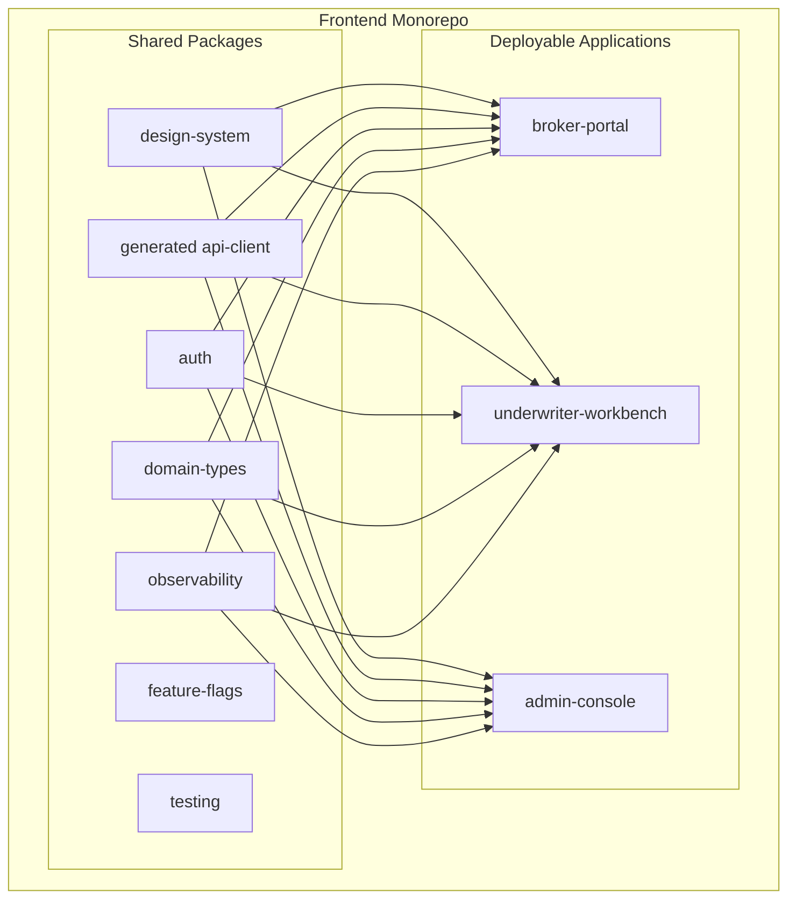
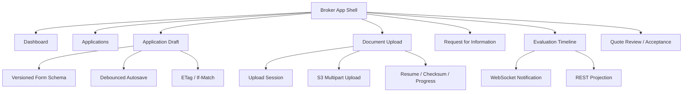
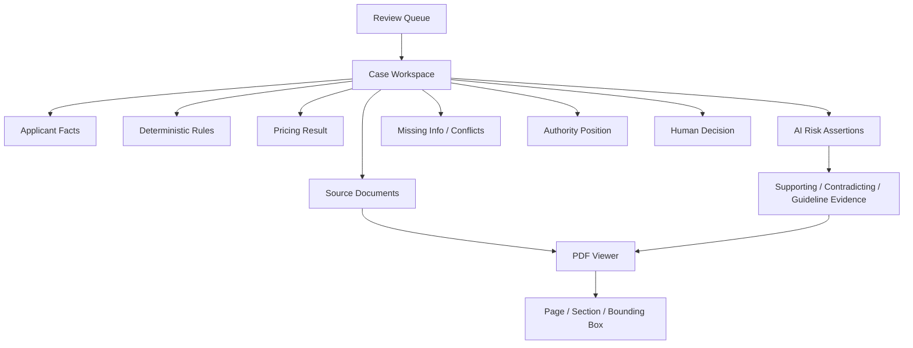
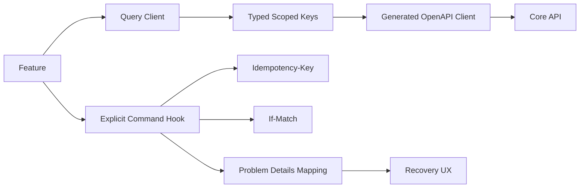

# Prism 前端内部组件架构

> 文档状态：生产目标架构
>
> 上层架构：[Prism AI Underwriter Agent 生产架构](./architecture.md)
>
> 配套文档：[Mermaid 架构图集](./architecture-diagrams.md) · [生产部署与发布架构](./deployment-architecture.md) · [后端内部组件架构](./backend-architecture.md)

## 1. 前端形态

前端采用一个 Monorepo、三个独立构建和部署的应用：

```text
apps/
├── broker-portal
├── underwriter-workbench
└── admin-console

packages/
├── api-client
├── auth
├── design-system
├── domain-types
├── observability
├── feature-flags
├── i18n
├── testing
├── eslint-config
└── tsconfig
```

三个应用共享稳定基础能力，但用户、权限、业务风险和发布节奏独立。当前不采用运行时 Micro-Frontend；只有出现独立团队所有权和部署规模需求后再评估。

## 2. 原则与依赖边界

1. 页面按业务 Capability/Feature 组织，不按 `components/hooks/services` 建全局目录。
2. 应用之间禁止直接依赖；共享包通过明确 `exports` 提供公共 API。
3. `api-client` 从 OpenAPI 生成，不手工复制后端 DTO。
4. Server State 由 Query Client 管理，不复制到无约束全局 Store。
5. Route Guard 只改善体验；服务端始终重新执行资源级授权和 Authority Check。
6. WebSocket 是变化通知，REST Projection 是权威状态。
7. AI、确定性规则、Pricing 和 Human Decision 在视觉与状态模型上分离。
8. 上传、Autosave、异步 Evaluation 和人工 Command 都必须支持恢复、并发冲突和幂等语义。
9. 共享包不得包含跨应用业务流程，避免形成隐形前端单体。
10. 可访问性、安全和遥测在 Design System/Platform 包中默认开启。

## 3. Monorepo 组件图



### 3.1 共享包职责

| 包              | 提供                                           | 禁止包含                  |
| --------------- | ---------------------------------------------- | ------------------------- |
| `design-system` | Token、无业务组件、A11y 模式、Story            | API、产品规则、应用 Route |
| `api-client`    | OpenAPI 生成 Client/DTO、Problem Details 映射  | 页面缓存和业务 Store      |
| `auth`          | PKCE、会话、Auth Provider、Active Context      | 页面具体业务权限          |
| `domain-types`  | 展示模型、Reason/Status Label                  | 手工复制 API DTO          |
| `observability` | RUM、Trace、Error、Typed Analytics             | PII 和任意自由文本        |
| `feature-flags` | Typed Key、Owner、Expiry、Kill Switch          | 不受控字符串 Flag         |
| `testing`       | Provider Harness、Mock Server、Fixture Builder | 生产依赖                  |

## 4. Broker Portal

### 4.1 Feature 边界



### 4.2 Draft 与 Submit

- Dynamic Form 绑定 Product/Form Version，客户端条件题只控制呈现；后端按同一版本重新验证。
- Autosave 使用可取消的去抖请求和 `If-Match`，清楚显示 Saving/Saved/Conflict。
- Submit 是明确 Command，携带 `Idempotency-Key` 和当前 ETag；成功返回 `202`、Evaluation ID 和 Status URL。
- Submission 创建后页面进入只读快照；新的补件产生新 Submission，不编辑历史提交。
- 412 表示 Draft 已被其他更新修改，需要获取最新版本并让用户确认；不能自动覆盖。

### 4.3 安全文档上传

- 客户端请求 Upload Session 后直接 Multipart 上传 S3，不经过 Core API 传文件。
- UI 类型/大小检查只提供早期反馈，不能替代服务端 Magic Bytes、Checksum、Malware 和 Active Content 检查。
- 上传状态区分 Uploading、Uploaded、Scanning、Processing、Ready、Quarantined、Rejected。
- 只有 `READY` Document Version 能进入 Submission。
- 过期 Session、网络恢复和 Multipart Resume 都必须有明确用户操作。
- 下载通过短期授权，页面不暴露长期 S3 URL。

### 4.4 RFI 与 Quote

- RFI 页面明确显示问题、Reason Code、关联字段/证据、截止时间和需要的附件。
- Broker 回复创建新的补件草稿；Submit 后形成新 Submission/Evaluation。
- Quote 页面显示精确 Quote Version、Coverage、Excess、Premium、Clause、Expiry 和 Material Assumptions。
- Accept Quote 是幂等 Command，并在提交前重新确认 Quote 未过期且仍是当前版本。
- Binding 失败不撤销已发生的 Acceptance；UI 显示 Binding Pending/Issue 和支持渠道。

## 5. Underwriter Workbench

### 5.1 Case Workspace



Workspace 以 Case 为页面边界，但清楚显示当前 Submission、Evaluation、Risk Snapshot 和配置版本。任何新 Evaluation 到达时，旧页面显示 `SUPERSEDED` 并禁止提交决定。

建议采用可调整分栏：一侧是原始文档和证据高亮，另一侧是事实、规则、AI Assertion、Pricing 和人工动作。选择 Assertion/字段时可以定位来源。

### 5.2 证据优先的人机协作

每条 AI Assertion 展示：

```text
Risk Statement
Severity
Confidence Band + Uncertainty Reasons
Supporting Evidence
Contradicting Evidence
Applicable Guideline
AI Release
Human Disposition
```

Underwriter 可以：

```text
ACCEPT_ASSERTION
EDIT_ASSERTION
REJECT_ASSERTION
REQUEST_MORE_INFORMATION
ESCALATE
```

- AI 结论与规则、Pricing、Human Assessment 和最终 Decision 分区显示。
- 先显示事实和证据，再显示 AI 结论；不能用一个醒目的 Overall AI Score 代替分析。
- `LOW/INSUFFICIENT`、证据冲突和限制必须直接可见，不能藏在 Tooltip。
- 不提供默认勾选的最终 Accept/Decline，也不提供高风险的一键接受所有 AI 建议。
- Human 修改创建新 Human Assessment，不修改 AI Assessment。
- 最终理由可以引用相同 Evidence，但不能只写 “agree with AI”。
- Human Feedback 作为审计/离线评测事件，不直接改变在线模型。

### 5.3 Assignment、Authority 与并发

- 一个 Active Review Task 只有一个 Primary Underwriter；其他用户只读。
- Reassignment/Takeover 是显式 Command，显示 Actor、Reason 和时间。
- 可使用短 Presence Lease 提示在线编辑，但 Durable Assignment 和 Version 才是正确性边界。
- Maker-checker 使用独立 Approval Task；Maker 不能批准自己的决定。
- Submit Decision 时后端重新检查 Assignment、Case State、Authority、Submission/Evaluation Version。
- GET 返回 ETag，Command 使用 `If-Match`。
- `412 Precondition Failed`：页面版本过期，拉取最新版本并要求重新确认。
- `409 Conflict`：版本仍当前，但业务状态不允许动作，例如 Case 已 Reassigned/Decided。
- 决定、Override 和非标准 Clause 不能自动 Merge。

### 5.4 决策动作

所有状态变化是明确 Command：

```text
Request Information
Refer / Escalate
Record Human Assessment
Approve / Decline
Approve Exception
Select Approved Clause
Reassign Task
```

按钮可见性只反映前端 Permission；提交时服务端重新检查。Decline、Override、非标准条款和权限升级要求结构化 Reason，必要时触发 Approval Task。

## 6. Admin Console

Admin Console 是配置发布控制面，不是直接编辑生产数据库的 CRUD 后台。

| Feature             | 能力                                    | 强制控制                             |
| ------------------- | --------------------------------------- | ------------------------------------ |
| Product/Form        | Product、Coverage、Form Schema          | 不可变版本、生效日期、兼容验证       |
| Eligibility Rules   | DSL/Decision Table、Golden Cases        | 静态验证、冲突检测、Maker-checker    |
| Pricing             | Rate、Factor、Minimum、Tax              | Diff、回归、审批                     |
| Authority           | Human/System Grant                      | No Self Approval、动作时复检         |
| Clause Library      | 批准 Clause 和适用范围                  | 禁止 AI 自由生成最终条款             |
| Prompt/Model Policy | Model、Prompt、Schema、Budget、Fallback | AI Eval、Shadow、Canary、Kill Switch |
| Knowledge Release   | Documents、Metadata、Index、Eval        | Tenant 隔离、审批、不可变 Release    |
| Audit/Search        | 配置和业务审计                          | 查询审计、脱敏、导出权限             |
| Operations          | Queue、Workflow、Provider、DLQ          | 只读优先、受控 Replay                |

统一流程：

```text
DRAFT → VALIDATING → APPROVED → SCHEDULED → ACTIVE → RETIRED
```

- 已发布版本不能原地编辑。
- Admin 展示精确 Diff、Validation、Regression/Eval、Maker 和 Approver。
- Rollback 是发布一个已验证的上一 Release，不修改历史记录。
- Replay、Kill Switch、Break-glass 和 Audit Export 需要再认证、理由和完整审计。
- Admin 不提供任意 JavaScript/SQL/Prompt 执行入口。

## 7. API 与状态管理

### 7.1 Query/Command 分离



状态归属：

| 状态                     | 位置                 |
| ------------------------ | -------------------- |
| API/Projection           | Query Client         |
| URL 可表达筛选和当前 Tab | Router Search Params |
| 表单输入/校验            | Form State + Schema  |
| 短期交互                 | Local State          |
| Auth/Active Context      | Auth Provider        |
| WebSocket 连接/Sequence  | Realtime Store       |

只有幂等 Query 和明确支持 Idempotency Key 的 Command 才能自动重试。Submit、Decision、Accept Quote 不能因通用网络重试产生第二个业务动作。

### 7.2 Problem Details 与恢复

前端至少区分：

| HTTP/Code             | UX                              |
| --------------------- | ------------------------------- |
| 400/422 Validation    | 显示字段和业务校验错误          |
| 401                   | 恢复/重新认证                   |
| 403                   | 无权限，不建议重试              |
| 409 Business Conflict | 显示最新状态和可用动作          |
| 412 Stale ETag        | 拉取最新版本并重新确认          |
| 429/503 Retryable     | 使用服务端 Retry-After/受控重试 |
| Operational Hold      | 显示延迟状态与支持信息          |

错误 UI 显示 Correlation ID，但不展示堆栈、Provider 响应或敏感信息。

## 8. 实时状态

WebSocket Event 示例：

```json
{
  "eventId": "evt-123",
  "sequence": 18,
  "resourceType": "evaluation",
  "resourceId": "eval-456",
  "resourceVersion": 9,
  "eventType": "evaluation.stage_completed"
}
```

- Event 只提示变化，前端收到后使精确 Query Key 失效并重新获取 REST Projection。
- 事件允许重复、延迟和乱序；旧 Resource Version 被忽略。
- 重连携带最后 Sequence；无法补发时服务端返回 `RESYNC_REQUIRED`，页面执行完整刷新。
- WebSocket 不可用时使用带指数退避和抖动的 REST Polling。
- Assignment/Permission 改变时刷新授权或断开连接。
- 不通过 WebSocket 推完整 AI Assessment、Document、PII 或 Prompt。

## 9. 认证与前端安全

- OAuth 2.0 Authorization Code + PKCE；内部用户可联合企业 IdP。
- Broker Portal 使用独立 Broker Cognito Pool；Underwriter/Admin 使用 Workforce Pool 的不同 App Client，Admin 高风险动作执行 Step-up Authentication。
- Identity 可拥有多个 Membership，但每次请求只有一个明确 Active Context。
- Token、Tenant、Brokerage 和 Role 不能作为页面自行授权的依据；服务端重建并验证资源上下文。
- 避免在 `localStorage` 保存长期 Token；Cookie Session 使用 `Secure`、`HttpOnly`、`SameSite` 和 CSRF/Origin 控制。
- CSP、HSTS、Frame、Referrer Policy 统一配置；富文本、PDF 链接和用户内容使用 Allowlist Sanitisation。
- Bundle、Source Map、环境变量和 Feature Flag 不含 Secret。
- 日志和 Analytics 不发送 Token、完整文档、Prompt、自由文本理由或不必要 PII。
- 高权限 Admin 操作支持 Step-up Authentication。

## 10. 可访问性与高风险 UX

- Design System 默认满足键盘导航、语义、Focus、对比度和屏幕阅读器要求。
- Severity/Confidence 不能只用颜色表达。
- Evidence 高亮、PDF Viewer、表格和 Diff 必须提供文本替代和键盘路径。
- Mutation Pending 时防止重复提交，但不能以 Disabled Button 隐藏失败原因。
- 页面刷新后通过 URL 和服务端恢复 Case/Tab/Version，不依赖仅在内存的关键状态。
- Large List 使用虚拟化；PDF Viewer 和 Admin 编辑器按路由懒加载。

## 11. Observability

共享 Observability 包记录：

- 页面、路由、Web Vitals 和错误边界；
- API Operation、延迟、状态码、Correlation ID；
- WebSocket Connect/Reconnect/Sequence Gap/Event Latency；
- Upload、Scan/Process 状态和失败阶段；
- 412/409、Command Retry、RFI、Quote Acceptance 和 Decision Journey；
- AI Assertion 的 Accept/Edit/Reject、Citation Open 和 Override Reason Code。

事件必须使用稳定 Schema 和受控枚举。自由文本、原文、Prompt 和完整错误响应不能直接进入 Telemetry。

## 12. 测试策略

| 层级          | 重点                                                           |
| ------------- | -------------------------------------------------------------- |
| Unit          | Adapter、Schema、Formatter、Query Key、Permission Presentation |
| Component     | Form、Upload、Evidence、AI Assertion、Conflict UX              |
| Story/Visual  | Design System 和高风险状态矩阵                                 |
| Accessibility | axe、键盘、屏幕阅读器人工检查                                  |
| Contract      | Generated OpenAPI Client、Problem Details、Event Schema        |
| E2E           | Submit、RFI、新 Evaluation、Human Decision、Quote Acceptance   |
| Resilience    | WebSocket 断线、412、409、重复 Command、超时恢复               |
| Security      | XSS、授权呈现、敏感遥测、恶意文件名/链接                       |

CI 对三个应用执行 Typecheck、Lint、Unit/Component、Contract、A11y 和关键 E2E。测试按照用户旅程分片，而不是假设某个应用只需要某一种测试。

## 13. 建议应用目录

```text
apps/underwriter-workbench/src/
  app/
    providers/
    routing/
    layout/
  features/
    review-queue/
    case-workspace/
    evidence-viewer/
    risk-assertions/
    pricing/
    human-assessment/
    decision/
    assignment/
    audit/

apps/broker-portal/src/features/
  applications/
  application-form/
  document-upload/
  rfi/
  evaluation-status/
  quotes/

apps/admin-console/src/features/
  product-release/
  rules-release/
  pricing-release/
  authority/
  model-policy/
  knowledge-release/
  operations/
  audit/
```

每个 Feature 只在实际需要时包含 `api/components/model/routes/tests`，避免空目录模板。Feature 对外只导出公开入口，禁止跨 Feature 深层导入。

## 14. 实施顺序

1. 建立 Design System、Auth、Generated API Client、Problem Details 和 Typed Query Keys。
2. Broker Portal 完成 Draft、上传、Submit、状态和 RFI。
3. 建立 WebSocket 通知、REST Resync、412/409 和 Idempotent Command UX。
4. Underwriter Workbench 完成 Queue、Evidence Viewer、AI Assertion 和 Human Assessment。
5. 增加 Assignment、Authority、Decision 和 Maker-checker。
6. Broker Quote/Acceptance 与 Binding 状态。
7. Admin Configuration/AI/KB Release 流程。
8. 完善 A11y、Visual/E2E、RUM、性能预算和安全门禁。

## 15. 部署与发布

三个应用使用独立域名、私有 S3 Origin、CloudFront Distribution、WAF、CSP 和发布流水线：

```text
broker.prism.example       → broker-portal
underwriter.prism.example  → underwriter-workbench
admin.prism.example        → admin-console
```

- Monorepo CI 根据受影响路径测试和构建应用，但每个应用生成独立 Release Artifact。
- 同一 Commit 的 Bundle 只构建一次，以不可变 Release Prefix 晋级 Dev、Staging 和 Production。
- 环境差异由不含 Secret 的 `runtime-config.json` 提供，不为每个环境重新编译 Bundle。
- Hash Asset 长期不可变缓存；`index.html` 和 Runtime Config 使用短缓存或重新验证。
- CloudFront Staging Distribution 先执行 Header-based 内部验证；Broker Portal 再以 1%→5%→15% 和 Session Stickiness 灰度。
- Underwriter/Admin 低流量应用使用指定内部 Cohort 和关键 Journey 验证，不依赖随机百分比产生统计信心。
- JS Error、RUM、API Failure、CSP 或业务 Journey 越界时停止灰度；回滚到上一份已批准 Release Manifest。
- 前端发布必须兼容当前和上一版 REST/Event Contract；破坏性 API 变更不能通过同时发布前后端规避兼容责任。

全球域名、CloudFront、身份、WebSocket、CI/CD 和灾备细节见[生产部署与发布架构](./deployment-architecture.md)。
