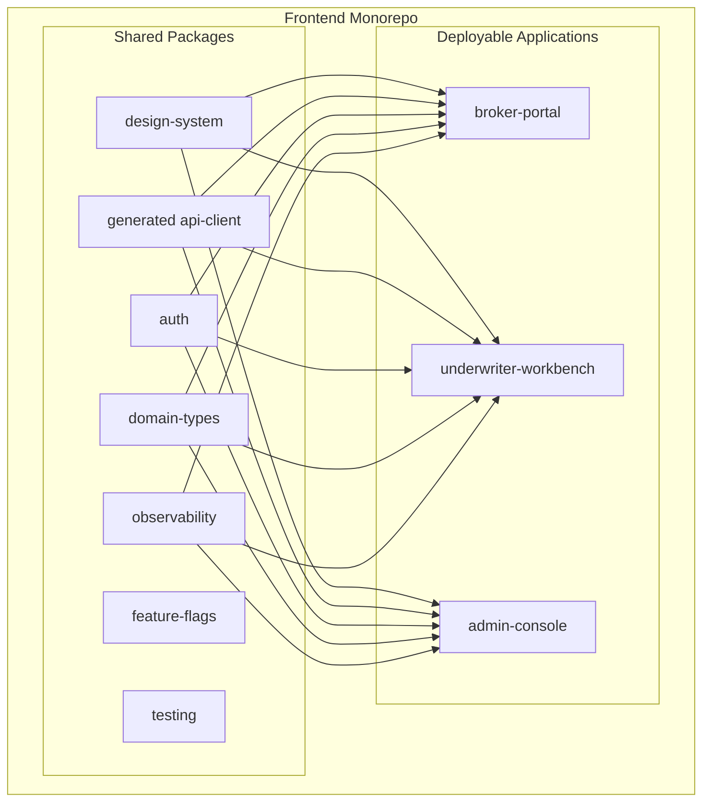
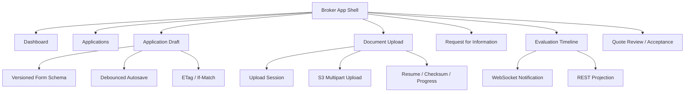
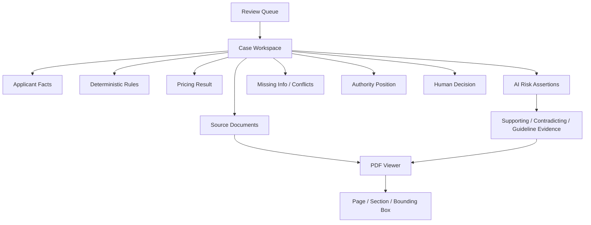
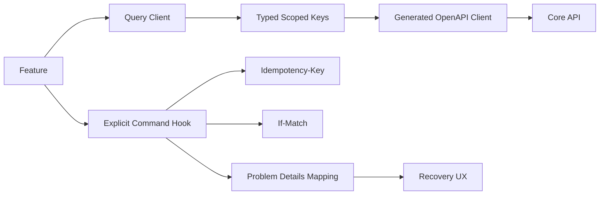

# Prism Frontend Internal Component Architecture

> Document status: production target architecture
>
> Parent document: [Prism AI Underwriter Agent production architecture](./architecture.md)
>
> Companion documents: [Mermaid architecture diagrams](./architecture-diagrams.md) · [Production deployment and release architecture](./deployment-architecture.md) · [Backend internal component architecture](./backend-architecture.md)

## 1. Frontend Shape

The frontend uses one monorepo with three independently built and deployed applications:

```text
apps/
├── broker-portal
├── underwriter-workbench
└── admin-console

packages/
├── api-client
├── auth
├── design-system
├── domain-types
├── observability
├── feature-flags
├── i18n
├── testing
├── eslint-config
└── tsconfig
```

The three applications share stable platform capabilities, but their users, permissions, business risk, and release cadence are independent. Runtime micro-frontends are not used now; they should only be reconsidered if independent team ownership and deployment scale make them necessary.

## 2. Principles and Dependency Boundaries

1. Organize pages by business capability/feature, not global `components/hooks/services` folders.
2. Applications cannot depend directly on each other; shared packages expose public APIs through explicit `exports`.
3. `api-client` is generated from OpenAPI; frontend DTOs are not copied by hand.
4. Server state belongs to the Query Client, not to an unconstrained global store.
5. Route guards improve UX only; the server always rechecks resource authorization and authority.
6. WebSocket is a change notification channel; REST projections are authoritative state.
7. AI, deterministic rules, Pricing, and Human Decision are visually and state-model distinct.
8. Upload, autosave, async Evaluation, and human Commands must support recovery, concurrency conflicts, and idempotency.
9. Shared packages must not contain cross-application business workflows, which would create a hidden frontend monolith.
10. Accessibility, security, and telemetry are enabled by default in Design System / Platform packages.

## 3. Monorepo Component Diagram



### 3.1 Shared Package Responsibilities

| Package         | Provides                                                 | Must not contain                        |
| --------------- | -------------------------------------------------------- | --------------------------------------- |
| `design-system` | Tokens, business-free components, A11y patterns, stories | APIs, product rules, application routes |
| `api-client`    | OpenAPI-generated client/DTOs, Problem Details mapping   | Page cache or business stores           |
| `auth`          | PKCE, sessions, Auth Provider, Active Context            | Page-specific business permissions      |
| `domain-types`  | presentation models, reason/status labels                | hand-copied API DTOs                    |
| `observability` | RUM, traces, errors, typed analytics                     | PII or arbitrary free text              |
| `feature-flags` | typed keys, owner, expiry, kill switch                   | uncontrolled string flags               |
| `testing`       | provider harness, mock server, fixture builders          | production dependencies                 |

## 4. Broker Portal

### 4.1 Feature Boundary



### 4.2 Draft and Submit

- Dynamic forms are bound to Product/Form Version. Client-side conditional questions only control presentation; the backend revalidates against the same version.
- Autosave uses cancellable debounced requests plus `If-Match`, and clearly shows Saving/Saved/Conflict.
- Submit is an explicit Command with `Idempotency-Key` and current ETag. Success returns `202`, Evaluation ID, and Status URL.
- After Submission creation, the page becomes a read-only snapshot. Supplements create new Submissions; historical submissions are not edited.
- `412` means another update changed the Draft. The UI must fetch the latest version and ask the user to confirm; it must not auto-overwrite.

### 4.3 Secure Document Upload

- The client requests an Upload Session and uploads multipart directly to S3; Core API does not proxy file bytes.
- UI type/size checks are early feedback only. They do not replace server-side magic bytes, checksum, malware, and active-content checks.
- Upload state distinguishes Uploading, Uploaded, Scanning, Processing, Ready, Quarantined, and Rejected.
- Only `READY` Document Versions may enter a Submission.
- Expired sessions, network recovery, and multipart resume require explicit user-facing actions.
- Downloads use short-lived authorization; the page never exposes long-lived S3 URLs.

### 4.4 RFI and Quote

- RFI pages show questions, reason codes, related fields/evidence, due dates, and required attachments.
- Broker replies create a supplement draft; submit creates a new Submission/Evaluation.
- Quote pages show exact Quote Version, Coverage, Excess, Premium, Clauses, Expiry, and Material Assumptions.
- Accept Quote is an idempotent Command and rechecks that the quote is not expired and is still current.
- Binding failure does not undo Acceptance; the UI shows Binding Pending/Issue and support channels.

## 5. Underwriter Workbench

### 5.1 Case Workspace



The workspace is organized around a Case, but it clearly shows the current Submission, Evaluation, Risk Snapshot, and configuration versions. When a newer Evaluation arrives, the old page shows `SUPERSEDED` and blocks decision submission.

Use a resizable split layout: source documents and evidence highlights on one side; facts, rules, AI assertions, pricing, and human actions on the other. Selecting an assertion or field can jump to its source.

### 5.2 Evidence-First Human-AI Collaboration

Each AI Assertion shows:

```text
Risk Statement
Severity
Confidence Band + Uncertainty Reasons
Supporting Evidence
Contradicting Evidence
Applicable Guideline
AI Release
Human Disposition
```

The Underwriter can:

```text
ACCEPT_ASSERTION
EDIT_ASSERTION
REJECT_ASSERTION
REQUEST_MORE_INFORMATION
ESCALATE
```

- AI conclusions are separated from rules, Pricing, Human Assessment, and final Decision.
- Facts and evidence appear before AI conclusions; a prominent Overall AI Score must not replace analysis.
- `LOW/INSUFFICIENT`, evidence conflicts, and limitations must be directly visible, not hidden in tooltips.
- The UI must not default-select final Accept/Decline or offer high-risk "accept all AI suggestions" actions.
- Human changes create a new Human Assessment; they do not mutate AI Assessment.
- Final reasons may cite the same Evidence, but cannot only say "agree with AI".
- Human Feedback is an audit/offline-evaluation event and does not directly change the online model.

### 5.3 Assignment, Authority, and Concurrency

- One active Review Task has exactly one Primary Underwriter; everyone else is read-only.
- Reassignment/Takeover is an explicit Command showing Actor, Reason, and time.
- A short presence lease may hint at active editing, but durable Assignment and Version are the correctness boundary.
- Maker-checker uses an independent Approval Task; the maker cannot approve their own decision.
- On Submit Decision, the backend rechecks Assignment, Case State, Authority, Submission/Evaluation Version.
- GET returns ETag; Commands use `If-Match`.
- `412 Precondition Failed`: page version is stale. Fetch latest version and require reconfirmation.
- `409 Conflict`: version is current, but business state disallows the action, such as Case already reassigned or decided.
- Decisions, Overrides, and non-standard Clauses cannot be auto-merged.

### 5.4 Decision Actions

All state changes are explicit Commands:

```text
Request Information
Refer / Escalate
Record Human Assessment
Approve / Decline
Approve Exception
Select Approved Clause
Reassign Task
```

Button visibility reflects frontend permissions only. The server rechecks on submit. Decline, Override, non-standard terms, and authority escalation require structured Reasons and may trigger Approval Tasks.

## 6. Admin Console

Admin Console is a configuration release control plane, not a CRUD backend for directly editing the production database.

| Feature             | Capability                              | Mandatory controls                                            |
| ------------------- | --------------------------------------- | ------------------------------------------------------------- |
| Product/Form        | Product, Coverage, Form Schema          | immutable versions, effective dates, compatibility validation |
| Eligibility Rules   | DSL/Decision Table, Golden Cases        | static validation, conflict detection, maker-checker          |
| Pricing             | Rate, Factor, Minimum, Tax              | diff, regression, approval                                    |
| Authority           | Human/System Grant                      | no self approval, action-time recheck                         |
| Clause Library      | approved Clauses and applicability      | AI cannot freely generate final clauses                       |
| Prompt/Model Policy | Model, Prompt, Schema, Budget, Fallback | AI Eval, Shadow, Canary, Kill Switch                          |
| Knowledge Release   | Documents, Metadata, Index, Eval        | tenant isolation, approval, immutable release                 |
| Audit/Search        | configuration and business audit        | query audit, redaction, export authorization                  |
| Operations          | Queue, Workflow, Provider, DLQ          | read-only first, controlled replay                            |

Unified lifecycle:

```text
DRAFT -> VALIDATING -> APPROVED -> SCHEDULED -> ACTIVE -> RETIRED
```

- Published versions cannot be edited in place.
- Admin shows exact diff, validation, regression/eval, maker, and approver.
- Rollback publishes a previously validated Release; it does not modify history.
- Replay, Kill Switch, break-glass, and audit export require re-authentication, reason, and full audit.
- Admin does not expose arbitrary JavaScript, SQL, or Prompt execution.

## 7. API and State Management

### 7.1 Query/Command Separation



State ownership:

| State                               | Location             |
| ----------------------------------- | -------------------- |
| API/Projection                      | Query Client         |
| URL-expressible filters/current tab | Router Search Params |
| form input/validation               | Form State + Schema  |
| short-lived interaction             | Local State          |
| Auth/Active Context                 | Auth Provider        |
| WebSocket connection/Sequence       | Realtime Store       |

Only idempotent Queries and Commands that explicitly support Idempotency Keys may auto-retry. Submit, Decision, and Accept Quote must not create a second business action through generic network retry.

### 7.2 Problem Details and Recovery

The frontend distinguishes at least:

| HTTP/Code             | UX                                              |
| --------------------- | ----------------------------------------------- |
| 400/422 Validation    | Show field and business validation errors       |
| 401                   | Recover or re-authenticate                      |
| 403                   | No permission; retry is not suggested           |
| 409 Business Conflict | Show latest state and available actions         |
| 412 Stale ETag        | Fetch latest version and require reconfirmation |
| 429/503 Retryable     | Use server `Retry-After` / controlled retry     |
| Operational Hold      | Show delayed state and support information      |

Error UI shows a Correlation ID but never stack traces, provider responses, or sensitive data.

## 8. Realtime State

WebSocket event example:

```json
{
  "eventId": "evt-123",
  "sequence": 18,
  "resourceType": "evaluation",
  "resourceId": "eval-456",
  "resourceVersion": 9,
  "eventType": "evaluation.stage_completed"
}
```

- Events only hint that something changed. The frontend invalidates precise Query Keys and refetches REST projections.
- Events may be duplicated, delayed, and out of order; older Resource Versions are ignored.
- Reconnect includes the last Sequence. If the server cannot replay, it returns `RESYNC_REQUIRED` and the page performs a full refresh.
- If WebSocket is unavailable, use REST polling with exponential backoff and jitter.
- Assignment/Permission changes refresh authorization or disconnect.
- Do not send full AI Assessments, documents, PII, or prompts over WebSocket.

## 9. Authentication and Frontend Security

- The public homepage has exactly one `Sign in` entry and does not show selectable Broker/Underwriter/Admin portal cards before authentication.
- In Phase 1, when only Underwriter exists, sign-in goes directly to Workforce Cognito. In Phase 2, Email/Home-realm Discovery chooses the correct issuer/app client between Broker Pool and Workforce Pool.
- After login, Core API `/me` returns allowed portals from trusted Membership/Role. One allowed portal auto-routes; multiple workforce portals show an authenticated Workspace Selector; zero permissions route to Access Denied.
- Portal route, token claim, or user choice never grants business permission; each Core API module still performs resource-level authorization.
- OAuth 2.0 Authorization Code + PKCE; internal users may federate with enterprise IdPs.
- Broker Portal uses a separate Broker Cognito Pool. Underwriter/Admin use different app clients in the Workforce Pool, and high-risk Admin actions require step-up authentication.
- An Identity may have multiple Memberships, but each request has one explicit Active Context.
- Token, Tenant, Brokerage, and Role are not sufficient for page-side authorization; the server reconstructs and validates resource context.
- Avoid storing long-lived tokens in `localStorage`; cookie sessions use `Secure`, `HttpOnly`, `SameSite`, plus CSRF/Origin controls.
- CSP, HSTS, frame, and referrer policies are centrally configured. Rich text, PDF links, and user content use allowlist sanitization.
- Bundles, source maps, environment variables, and feature flags contain no secrets.
- Logs and analytics do not send tokens, full documents, prompts, free-text reasons, or unnecessary PII.
- High-privilege Admin actions support step-up authentication.

## 10. Accessibility and High-Risk UX

- The Design System defaults to keyboard navigation, semantics, focus, contrast, and screen-reader support.
- Severity/Confidence cannot be represented by color alone.
- Evidence highlights, PDF Viewer, tables, and diffs need text alternatives and keyboard paths.
- During mutation pending state, prevent duplicate submit, but do not hide failure reasons behind a disabled button.
- After page refresh, restore Case/Tab/Version from URL and server state, not from memory-only critical state.
- Large lists use virtualization. PDF Viewer and Admin editors are route-lazy-loaded.

## 11. Observability

The shared Observability package records:

- page, route, Web Vitals, and error boundaries;
- API operation, latency, status code, and Correlation ID;
- WebSocket connect/reconnect/sequence gap/event latency;
- Upload and Scan/Process state and failure stage;
- `412`/`409`, Command Retry, RFI, Quote Acceptance, and Decision Journey;
- AI Assertion accept/edit/reject, citation open, and override reason code.

Events must use stable schemas and controlled enums. Free text, source text, prompts, and full error responses do not go directly into telemetry.

## 12. Testing Strategy

| Layer         | Focus                                                                           |
| ------------- | ------------------------------------------------------------------------------- |
| Unit          | adapters, schema, formatter, query keys, permission presentation                |
| Component     | form, upload, evidence, AI assertion, conflict UX                               |
| Story/Visual  | Design System and high-risk state matrix                                        |
| Accessibility | axe, keyboard, manual screen-reader checks                                      |
| Contract      | Generated OpenAPI Client, Problem Details, Event Schema                         |
| E2E           | Submit, RFI, new Evaluation, Human Decision, Quote Acceptance                   |
| Resilience    | WebSocket disconnect, 412, 409, duplicate Command, timeout recovery             |
| Security      | XSS, authorization presentation, sensitive telemetry, malicious filenames/links |

CI runs typecheck, lint, unit/component, contract, accessibility, and key E2E checks for the three apps. Tests are sliced by user journey, not by the assumption that an app only needs one test type.

## 13. Recommended Application Directories

```text
apps/underwriter-workbench/src/
  app/
    providers/
    routing/
    layout/
  features/
    review-queue/
    case-workspace/
    evidence-viewer/
    risk-assertions/
    pricing/
    human-assessment/
    decision/
    assignment/
    audit/

apps/broker-portal/src/features/
  applications/
  application-form/
  document-upload/
  rfi/
  evaluation-status/
  quotes/

apps/admin-console/src/features/
  product-release/
  rules-release/
  pricing-release/
  authority/
  model-policy/
  knowledge-release/
  operations/
  audit/
```

Each feature contains `api/components/model/routes/tests` only when needed. Avoid empty directory templates. Features expose only public entry points and must not deep-import across feature boundaries.

## 14. Implementation Order

1. Phase 1 starts with a single sign-in entry, Workforce Auth, Generated API Client, and Underwriter Protected Shell.
2. Underwriter Workbench then completes Queue/Assignment, Case Workspace, Evidence Viewer, AI Assessment, Deterministic Pricing, Human Review/RFI, and Quote Authoring.
3. Every Phase 1 feature also delivers accessibility, contract/E2E tests, RUM, error recovery, and security gates. These are not deferred to the end of the portal.
4. Phase 2 adds Broker Realm Discovery and Broker Portal, then completes Draft, Upload, Submit, Progress, RFI, Quote Acceptance, and Binding Status.
5. Broker Submit replaces the Phase 1 development-only Case Fixture Adapter and runs the full Broker -> Underwriter -> Broker journey.
6. Phase 3 adds Admin Console, authenticated multi-workspace selector, step-up authentication, and Configuration/AI/KB Release.
7. The three portals remain independently built, deployed, and rolled back. They must not be merged into one SPA for development convenience.

## 15. Deployment and Release

The three applications use independent domains, private S3 origins, CloudFront distributions, WAF, CSP, and release pipelines:

```text
prism.example              -> single sign-in / home-realm discovery
broker.prism.example       -> broker-portal
underwriter.prism.example  -> underwriter-workbench
admin.prism.example        -> admin-console
```

- Monorepo CI tests and builds affected applications by path, but each application produces an independent Release Artifact.
- A bundle for the same commit is built once and promoted through Dev, Staging, and Production under an immutable Release Prefix.
- Environment differences are provided by non-secret `runtime-config.json`; bundles are not recompiled per environment.
- Hashed assets are long-lived immutable cache; `index.html` and Runtime Config use short cache or revalidation.
- CloudFront Staging Distribution runs header-based internal verification first. Broker Portal can then canary with 1% -> 5% -> 15% plus session stickiness.
- Underwriter/Admin are lower-traffic apps, so they use named internal cohorts and key journey validation instead of relying on random percentage canaries for statistical confidence.
- JS errors, RUM, API failures, CSP violations, or business journey breaches stop the canary. Rollback returns to the previous approved Release Manifest.
- Frontend releases must be compatible with current and previous REST/Event contracts. Breaking API changes cannot hide behind simultaneous frontend/backend deployment.

Global DNS, CloudFront, identity, WebSocket, CI/CD, and DR details are covered in [Production deployment and release architecture](./deployment-architecture.md).
